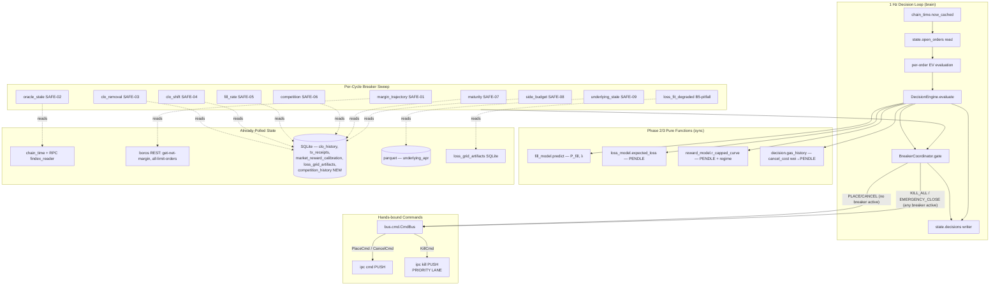

# Phase 4: Decision Engine + Predictive Circuit Breakers — Research

**Researched:** 2026-04-25
**Domain:** EV-based decision engine + ten predictive circuit breakers + breaker-coordinator kill authority over the existing ZMQ KILL lane (1 Hz Python-brain decision loop wiring three Phase 2/3 EV inputs)
**Confidence:** HIGH (all upstream contracts are locked; ZMQ KILL lane, BotConfig schema, manifest reflection, single-writer SQLite, chain_time discipline are all live in main; Phase 2 `predict()` and Phase 3 `expected_loss()` / `r_capped_curve()` / `q_me_target()` signatures are design-locked and accept `current_chain_ts: int` exactly because Phase 4 supplies it).

---

## Summary

Phase 4 adds **five new modules in `python/src/boros_brain/decision/`** plus extensions to `main.py` to spawn the 1 Hz decision loop. It introduces **zero new IPC topology** — the brain→hands KILL lane built in Plan 01-03 (`ipc:///tmp/boros.cmd.kill`, separate PUSH/PULL socket drained ahead of the cmd lane in `ts/src/boros_hands/bus/cmd_listener.ts`) is already correctly shaped for SAFE-10 exclusivity. What's missing is the *gatekeeper inside the brain* that owns the kill mutex and refuses to forward `PlaceCmd` while any breaker is tripped. That is the `BreakerCoordinator`.

The DecisionEngine is a **thin composition layer** — it does not refit any model, does not maintain its own state beyond the in-flight order list, and produces one `Decision` record per (order_id, side) per cycle. Inputs are already PENDLE-unit consistent (Plan 03-04 wiring). The EV equation reduces to **four sync function calls** (`predict()`, `expected_loss()`, `r_capped_curve()`, plus the `cancel_cost` reader) and **three multiplications**.

The ten circuit breakers split into three families by data-source pattern: **(a)** chain/REST-poll breakers reading state already collected by Phase 1 pollers (margin via `getNetMargin`, oracle staleness via `fIndex.fTime`, CLO via `clo_history`, underlying via `underlying_apr` parquet, fill-rate via `state.tx_receipts`); **(b)** model-degradation breakers reacting to upstream `fit_status='degraded'` flags already emitted by FillModel and LossModel (B5 absorbed); **(c)** budget-shift breakers reacting to `state.market_reward_calibration` deltas (A2 / SAFE-08 absorbed). All ten share a common `BreakerSignal` shape and route through the coordinator.

**Primary recommendation:** Implement DecisionEngine + BreakerCoordinator + ten breakers as **pure-Python sync functions** with explicit `current_chain_ts: int` arguments (mirrors Phase 2/3 patterns); push the 1 Hz scheduling into `main.py` exactly the way the fill_model and loss_model refit loops are wired. Do NOT introduce an event-bus pattern inside the brain — direct function call is the right grain.

---

## Architectural Responsibility Map

| Capability | Primary Tier | Secondary Tier | Rationale |
|------------|-------------|----------------|-----------|
| EV equation evaluation (DECIDE-01) | brain.decision.engine | — | Pure function; reads `predict()`, `expected_loss()`, `r_capped_curve()`, `cancel_cost`. Lives next to the models so backtest reuses zero IPC. |
| `voluntary_cancel_forfeits_accumulated` branch (DECIDE-02) | brain.decision.engine | brain.config.schema (knob) | Already in StrategyConfig; engine must implement BOTH branches with dead-code retention discipline (P0-01 evidence is official-team statement, not contract trace). |
| `cancel_cost` measurement (DECIDE-03) | brain.decision.gas_history | brain.data.rpc_client (web3.py reader) | Reads recent on-chain gas via `eth_getBlock`/`eth_feeHistory`; rolling-window EWMA cached at 60s TTL. |
| 1 Hz cycle driver | brain.main (extended) | brain.decision.engine | Mirrors fill_model.refit_loop / loss_model.refit_loop spawn pattern. |
| Margin trajectory breaker (SAFE-01) | brain.decision.breakers.margin | brain.data.poller.margin (NEW) | Predictive: extrapolates `dNetBalance/dt` from sliding window of `accounts/get-net-margin` polls. |
| Oracle staleness breaker (SAFE-02) | brain.decision.breakers.oracle_stale | brain.data.findex_reader | Reads `fTime` already decoded; checks vs `maxUpdateDelay` (per-market, in `MarketCalibration`). |
| CLO removal breaker (SAFE-03) | brain.decision.breakers.clo_removal | brain.state.clo_history | Reads latest `clo_history` row; trigger if either thresh == 0. |
| CLO shift breaker (SAFE-04) | brain.decision.breakers.clo_shift | brain.state.clo_history | Compares latest two `clo_history` rows; tick conversion via existing scale/S calibration. |
| Fill-rate runaway breaker (SAFE-05) | brain.decision.breakers.fill_rate | brain.state.tx_receipts (read-only) | Counts confirmed fills in last 60min from `tx_receipts`. |
| Competition collapse breaker (SAFE-06) | brain.decision.breakers.competition | brain.state.competition_history (NEW table — uses existing CompetitionTracker.publish output) | Compares latest `Q_total_in_range` vs 1-epoch lag. |
| Maturity migration breaker (SAFE-07) | brain.decision.breakers.maturity | reward_model + sizer (read-only) | EV gate: `time_to_maturity_s × R_me_per_epoch < migration_cost`. |
| Per-side budget rebalance breaker (SAFE-08) | brain.decision.breakers.side_budget | brain.state.market_reward_calibration | Detects ≥30% shift in `long_side_split` / `short_side_split` between operator-calibrated rows. |
| Underlying feed stale breaker (SAFE-09) | brain.decision.breakers.underlying_stale | parquet underlying_apr ingest | Reads latest `last_updated_ts` from underlying_apr partitioned parquet via DuckDB. |
| OU-fit-degraded breaker (B5 absorbed) | brain.decision.breakers.loss_fit_degraded | brain.loss_model.expected_loss output | Subscribes to `LossGridArtifact.fit_status == 'degraded'` flag. |
| Kill authority enforcement (SAFE-10) | brain.decision.breaker_coordinator | brain.bus.cmd (existing CmdBus) | Owns the brain-side mutex: when ANY breaker active, intercepts `send_cmd()` and either drops PLACE or routes CANCEL_ALL via `send_kill()`. |
| Pre-deployment re-screen gate (A5 absorbed) | brain.decision.predeploy_gate | brain.screener.economics_gate (existing CLI) | Operator-invoked CLI subcommand that re-runs DATA-09 economics gate; emits a "pre_deploy_gate_pass" wiki page + RUN_MANIFEST flag. |

---

<user_constraints>
## User Constraints (from ROADMAP.md + REQUIREMENTS.md + STATE.md)

There is no separate CONTEXT.md from `/gsd-discuss-phase` — Phase 4 is being planned without a discussion artifact. Constraints are derived from the locked roadmap and from project-level non-negotiables in CLAUDE.md.

### Locked Decisions (treat as non-negotiable; do NOT explore alternatives)

- **EV cancel rule with no threshold dials.** Cancel iff `EV_hold = R_share × P(no_fill) − E[loss|fill] × P(fill) − cancel_cost × P(purge) < 0`. The only knobs are EV-input model parameters and breaker thresholds. ([[ev-cancel-rule]])
- **`voluntary_cancel_forfeits_accumulated = False`** is the default per P0-01 resolution 2026-04-23 ([[voluntary-cancel-reward-behavior]]). The benign branch is the production cancel rule; the punitive branch is dead-code fallback retained behind the knob. BOTH branches MUST be covered by tests; Phase 5 backtest sweeps both as a sanity check.
- **OU on basis (`Implied − Underlying`) for `E[loss|fill]`** — already delivered by Phase 3 LossModel. Phase 4 consumes via `loss_model.expected_loss(req, sqlite_path, config)`. NEVER re-fits.
- **`eventIndex` (not `blockTimestamp`)** for any intra-block ordering Phase 4 touches (chiefly the fill-rate breaker reading `state.tx_receipts`).
- **Pre-signed cancel calldata stays in the TS hands process.** Phase 4 only EMITS `CancelCmd` / `KillCmd` over ZMQ; hands does the SDK call. Phase 4 must not introduce a Python-side calldata path.
- **`cancel_cost` is measured, not hardcoded** — drawn from recent on-chain gas history. A linter check (DECIDE-03 success criterion #4) MUST fail when a hardcoded scalar or dict appears. *[ASSUMED scope]:* the linter pattern matches Phase 1's `scripts/no_time_time_lint.py` precedent.
- **Hot path stays inside TS hands** (WS fill → pre-signed cancel). Phase 4's 1 Hz brain loop is allowed to be slow (< 100ms p95 budget); the hands-side fill response is independent.
- **Single Pydantic `BotConfig` class** is the SSoT. Every new breaker threshold MUST land in BotConfig (PROTO-04). The reflection-based manifest (`build_run_manifest()`) automatically surfaces them.
- **CircuitBreakers has exclusive kill authority** (SAFE-10). DecisionEngine emits PLACE/HOLD/CANCEL only; CANCEL_ALL / EMERGENCY_CLOSE / KILL go via the breaker coordinator.

### Claude's Discretion (research options, recommend)

- Internal layout under `brain.decision.*` (one module per breaker vs. a single `breakers.py`) — **recommend one module per breaker** for grep-discoverability and node-granularity in `architecture.yml` (matches the precedent from `state.writers.*`).
- `cancel_cost` window length and EWMA-vs-simple-mean — **recommend** 100-block rolling EWMA with α=0.1; 100 Arbitrum blocks ≈ 25s, well inside the 1 Hz cycle budget.
- Margin-trajectory window length — **recommend** 30s sliding window with linear regression on `getNetMargin` polls (not EWMA — predictive forecast wants a slope, not a level).
- CLO-shift "stay-out-of-range" branch — **recommend** implementing as a `Decision.kind = "HOLD_NO_REPLACE"` enum value (engine emits it; main loop skips re-placement until next CLO shift settles).
- Per-breaker default thresholds — **see per-requirement section below**; each is justified.
- OU-fit-degraded routing — **recommend** subscribing to LossGridArtifact.fit_status="degraded" via the existing SQLite loss_grid_artifacts table (NOT a new event channel).

### Deferred Ideas (OUT OF SCOPE)

- HMM confirmation overlay (V2-HMM-01) — explicitly Phase 9+ / v1.0.
- Multi-market breaker coordination (V2-MULTI-03) — single-market for v0.5.
- A/B sensitivity sweeps on breaker thresholds — Phase 5 backtest concern, not Phase 4.
- Adversarial robustness (V2-ADV-01/02) — out of scope.
- Hot-reload of breaker config — explicitly forbidden by Engineering Protocol #3 (any knob change → new run_id).
- TS-side breaker enforcement — kill authority lives in brain.decision.breaker_coordinator; hands only RECEIVES KillCmd messages.
- Fill closure logic (immediate market close) — that's EXEC-10, lives in TS, Phase 6.
</user_constraints>

<phase_requirements>
## Phase Requirements

| ID | Description | Research Support |
|----|-------------|------------------|
| DECIDE-01 | EV-based cancel rule per side per in-flight order per cycle | §"DECIDE-01" sub-section: input/output shape, composition with Phase 2/3 functions, sync signature, p95 < 100ms budget |
| DECIDE-02 | `voluntary_cancel_forfeits_accumulated` toggle covered by tests both branches | §"DECIDE-02" sub-section: dead-code pattern, two-branch test fixture |
| DECIDE-03 | `cancel_cost` from recent on-chain gas history | §"DECIDE-03" sub-section: web3 `eth_feeHistory` API, 100-block EWMA, linter pattern |
| DECIDE-04 | No threshold dials | §"DECIDE-04" sub-section: BotConfig knob audit script — no `*_threshold` field except those in BreakerConfig |
| SAFE-01 | Margin trajectory breaker (`time-to-maintenance-margin < 30s`) | §"SAFE-01": data source `accounts/get-net-margin`, sliding-window linear regression |
| SAFE-02 | Oracle staleness breaker (`now − fTime > 0.7 × maxUpdateDelay`) | §"SAFE-02": findex_reader.fTime, MarketCalibration.maxUpdateDelay (NEW field) |
| SAFE-03 | CLO removal breaker (`cloLowerThresh == 0 OR cloUpperThresh == 0`) | §"SAFE-03": clo_history latest row, idempotent triggering |
| SAFE-04 | CLO shift breaker (`|new_clo − old_clo| > N ticks`) + stay-out-of-range branch | §"SAFE-04": tick conversion via SCALE+S calibration, default N=5 ticks justified |
| SAFE-05 | Fill-rate runaway breaker (`>K=3 fills/hour`) | §"SAFE-05": tx_receipts query, configurable K knob |
| SAFE-06 | Competition collapse breaker (`Q_total_in_range dropped >50% in 1 epoch`) | §"SAFE-06": competition_history table (NEW), 1-epoch lag |
| SAFE-07 | Maturity migration breaker (`time_to_maturity × R_me < migration_cost`) | §"SAFE-07": maturity_ts already in MarketCalibration, migration_cost = 1× entrance fee + estimated cancel/repost |
| SAFE-08 | Per-side budget rebalance breaker (`>30% shift in 1 epoch`) | §"SAFE-08": market_reward_calibration table delta query |
| SAFE-09 | Underlying-feed-stale breaker (`>2× expected cadence`) | §"SAFE-09": underlying_apr parquet last_updated_ts, expected_cadence per source |
| SAFE-10 | Breaker coordinator exclusive kill authority | §"SAFE-10": brain-side mutex, send_cmd interception, kill-priority ZMQ topology already in place |
</phase_requirements>

## Project Constraints (from CLAUDE.md)

The three Engineering Protocols are mechanically enforced — Phase 4 plans MUST honor each:

- **Protocol 1 (LLM Wiki):** Every Phase 4 plan must (a) cite at least one `[[wiki-page]]` and (b) write back at least one new wiki page on close. Pre-commit `wiki_cite_lint` (Plan 01-04) blocks otherwise. Candidate write-back pages enumerated in §"LLM Wiki Pages to Write-Back".
- **Protocol 2 (Architecture Diagram):** Every commit touching `python/` updates `docs/architecture.yml` + `docs/ARCHITECTURE.md` atomically. Pre-commit `architecture_lint.py` blocks drift. New Phase 4 nodes/edges enumerated in §"Architecture Manifest Delta".
- **Protocol 3 (RUN_MANIFEST + BotConfig SSoT):** Every new breaker threshold lands in BotConfig as a Pydantic field; the reflection-based manifest writer surfaces it automatically. `test_manifest_contains_all_knobs.py` verifies leaf-count.
- **Protocol 4 (PROTO-04, knob inventory):** No "magic numbers" in breaker code — every threshold is a BotConfig field.
- **Protocol 5 (Supersedence):** When a breaker absorbs a pitfall, supersede the pitfall page with `Status: Historical — superseded by [[breaker-page]]`.

Additional CLAUDE.md directives Phase 4 must respect:

- `eventIndex`-not-`blockTimestamp` discipline (touches fill-rate breaker SAFE-05 reading `tx_receipts`).
- All chain-relevant time uses `chain_time.now_cached()` from Plan 01-03 — `scripts/no_time_time_lint.py` will need its banned-dirs list extended to `decision/`.
- Single-writer-per-table SQLite discipline (Plan 01-02) — Phase 4 introduces `state.competition_history` (single-writer = `CompetitionTracker` already; phase 4 only reads); Phase 4 creates `state.decisions` rows (already declared in Plan 01-02 schema; writer = `decision.engine`).
- `voluntary_cancel_forfeits_accumulated = False` default LOCKED — schema already correct (no schema change needed for DECIDE-02).
- Send Txs Bot is the mandatory submission lane — Phase 4 does not touch this; it only emits ZMQ messages that hands forwards.

---

## Standard Stack

### Core (already in Phase 1–3, reused as-is)

| Library | Version | Purpose | Why Standard |
|---------|---------|---------|--------------|
| pydantic | 2.13.3 | BotConfig sub-models for new breaker config + decision schemas | PROTO-04 SSoT; `extra='forbid', frozen=True` invariants apply [VERIFIED: python/src/boros_brain/config/schema.py] |
| structlog | 25.5.0 | Per-breaker firing log lines (run_id auto-bound via contextvars) | Plan 01-03 contract [VERIFIED] |
| zmq + zmq.asyncio | 26.x (pyzmq) | Re-using existing CmdBus + EventBus | KILL lane already PUSH/PULL with separate endpoint ([[zmq-bus-topology-v05]]) [VERIFIED: python/src/boros_brain/bus/cmd.py] |
| numpy / scipy | 2.1.x / 1.14.x | Linear regression for margin-trajectory breaker; EWMA for cancel_cost | Already in Phase 2 dependency tree [VERIFIED: python/pyproject.toml] |
| web3.py (AsyncWeb3) | 7.15.0 | `eth_feeHistory` for cancel_cost; `accounts/get-net-margin` for margin | Already in Plan 01-03 (chain_time.py uses identical pattern) [VERIFIED] |
| polars + duckdb | 1.40 / 1.5 | Read parquet underlying_apr to compute feed staleness (SAFE-09) | Plan 01-04 ingester writes parquet; SAFE-09 reads via DuckDB [VERIFIED] |
| pytest + pytest-asyncio + hypothesis | 8.x / 0.24 / 6.x | Tests including hypothesis property tests on EV equation algebra | Plan 02-03 + Plan 03-03 precedent [VERIFIED] |

### Supporting (existing in-house)

| Module | Purpose | Where it lives | Why Phase 4 reuses unchanged |
|--------|---------|----------------|------------------------------|
| `brain.fill_model.predict.predict()` | Sync `P(fill_this_epoch)` returning `PredictOutput` | python/src/boros_brain/fill_model/predict.py | Design-locked. Raises `FillModelStaleFeatureError` / `FillModelNoFreshFitError`. [VERIFIED] |
| `brain.loss_model.expected_loss.expected_loss()` | Sync `E[loss \| fill]` in PENDLE | python/src/boros_brain/loss_model/expected_loss.py | Design-locked. Raises `LossModelNoFreshGridError`. [VERIFIED] |
| `brain.reward_model.r_capped.r_capped_curve()` | Closed-form `R_capped(Q_me)` in PENDLE | python/src/boros_brain/reward_model/r_capped.py | Returns `RewardCurveOutput` with `regime` label. [VERIFIED] |
| `brain.sizer.optimizer.q_me_target()` | `argmax R_capped − E[loss]·P(fill)` | python/src/boros_brain/sizer/optimizer.py | Decision engine calls THIS, not the components, when computing PLACE size. [VERIFIED] |
| `brain.bus.cmd.CmdBus.send_cmd / send_kill` | ZMQ PUSH on cmd / kill endpoints | python/src/boros_brain/bus/cmd.py | KILL lane already separate socket — SAFE-10 is brain-side enforcement [VERIFIED] |
| `brain.bus.messages` (`PlaceCmd`, `CancelCmd`, `KillCmd`) | Pydantic message schemas mirrored to TS Zod | python/src/boros_brain/bus/messages.py | Schema-mirror test catches drift [VERIFIED] |
| `brain.data.chain_time.now_cached` | TTL-cached chain timestamp | python/src/boros_brain/data/chain_time.py | Every breaker that uses time MUST call this, not `time.time()` [VERIFIED] |
| `brain.state.writers.decisions.insert_decision` | SQLite writer for decision audit trail | python/src/boros_brain/state/writers/decisions.py | Phase 4 is the FIRST phase to actually use this writer. Schema declared in Plan 01-02. [VERIFIED] |
| `brain.state.writers.tx_receipts.insert_tx_receipt` | Read-only for SAFE-05 fill-rate breaker | (existing) | hands writes; brain reads. [VERIFIED] |
| `brain.state.writers.clo_history.insert_clo_history` | Read-only for SAFE-03/04 | (existing, written by Plan 01-08 markets_poller) | [VERIFIED] |
| `brain.state.writers.market_reward_calibration` | Read-only for SAFE-08 | (existing, Plan 03-02) | [VERIFIED] |

### NEW dependencies (none required)

Phase 4 introduces **zero new third-party packages**. Every primitive is in scipy, numpy, pydantic, structlog, web3.py, or pytest — all already pinned.

### Alternatives Considered

| Instead of | Could Use | Tradeoff |
|------------|-----------|----------|
| One module per breaker | Single `breakers.py` with all 10 functions | Single-file is shorter (~300 LOC vs ~600), but architecture.yml node granularity per Protocol 2 wants module-level nodes (matches `state.writers.*` precedent). Per-module wins. |
| 100-block EWMA for cancel_cost | Simple mean over last N blocks | EWMA tracks regime shifts faster (e.g., congestion spike); simple mean lags. Mean is simpler to test. **Recommend EWMA**; α=0.1 means half-life ≈ 7 blocks. |
| Sliding-window linear regression for margin trajectory | Simple finite difference of two latest samples | Two-sample finite difference is noisy at 1 Hz; linear regression on a 30s window (≈30 samples) smooths transient noise without lagging. **Recommend linear regression.** |
| BreakerCoordinator as a class | Functional `coordinate(breakers, cmd_bus)` | Class lets us hold the active-breaker mutex as instance state. **Class wins.** |
| Subscribe to LossModel `fit_status` via event | Read latest `loss_grid_artifacts.fit_status` from SQLite per cycle | Event-bus introduces ordering bugs across two writers. SQLite read is ≤1ms. **SQLite read wins.** |
| Async hot-loop with each breaker as `asyncio.Task` | Single sync function `evaluate_all(breakers)` | All ten breakers are I/O-bound on SQLite or RPC. Async tasks would parallelize but at ≤10ms each, sequential evaluation completes in <100ms — well under the 1 Hz budget. **Sync wins (simpler, more deterministic).** |

**Installation:** No new packages. The existing `uv sync --locked` is sufficient.

**Version verification (DECIDE-03 dependency):** `web3.py 7.15.0` exposes `AsyncWeb3.eth.fee_history(blockCount, newest_block, reward_percentiles)` returning `baseFeePerGas` per block. Verified [VERIFIED: web3.py docs https://web3py.readthedocs.io/en/stable/web3.eth.html#web3.eth.AsyncEth.fee_history — current as of v7.x]. The recommended call shape is `await w3.eth.fee_history(100, "latest", [50])`.

---

## Architectural Responsibility & System Architecture Diagram

### System Architecture Diagram



**Key invariant traced through the diagram:** every PLACE / CANCEL command enters `CmdBus.send_cmd` ONLY through `BreakerCoordinator.gate(...)`. The DecisionEngine never calls `CmdBus` directly. SAFE-10 enforcement is mechanical: any path from DecisionEngine to send_cmd that bypasses the coordinator fails the architecture-lint test.

### Component Responsibilities

| File / Module | Responsibility | Reads | Writes | Key public API |
|---------------|----------------|-------|--------|----------------|
| `brain.decision.engine.py` | EV equation; per-order evaluate; produces Decision dataclass | predict, expected_loss, r_capped_curve, q_me_target, gas_history.cancel_cost_pendle | (returns dataclass; coordinator persists) | `evaluate(req: EvaluateInput, *, sqlite_path, config) -> EvaluateOutput` |
| `brain.decision.gas_history.py` | Rolling EWMA over `eth_feeHistory` baseFeePerGas; converts wei → PENDLE | AsyncWeb3.eth.fee_history | None (in-memory cache, 60s TTL) | `cancel_cost_pendle(*, w3, config) -> float` |
| `brain.decision.breaker_coordinator.py` | Owns kill mutex; runs 10 breakers per cycle; gates send_cmd; emits KillCmd | breaker outputs | state.decisions, state.breaker_events (NEW) | `gate(decisions, *, cmd_bus, run_id) -> None`; `tick(*, sqlite_path, config, w3, run_id) -> CoordinatorState` |
| `brain.decision.breakers.margin_trajectory.py` | Sliding-window linear regression on net-margin polls | state.margin_history (NEW), maintenance_margin_threshold | breaker_events | `check(*, sqlite_path, config, current_chain_ts) -> BreakerSignal` |
| `brain.decision.breakers.oracle_stale.py` | `now − fTime > 0.7 × maxUpdateDelay` | findex_reader.last_fIndex(), MarketCalibration.maxUpdateDelay | breaker_events | `check(*, w3, config, current_chain_ts) -> BreakerSignal` |
| `brain.decision.breakers.clo_removal.py` | Latest clo_history row check | clo_history | breaker_events | `check(*, sqlite_path, config) -> BreakerSignal` |
| `brain.decision.breakers.clo_shift.py` | Compares latest two clo_history rows | clo_history, MarketCalibration.scale/s | breaker_events | `check(*, sqlite_path, config) -> BreakerSignal` |
| `brain.decision.breakers.fill_rate.py` | Counts confirmed-fill tx_receipts in last 60min | state.tx_receipts | breaker_events | `check(*, sqlite_path, config, current_chain_ts) -> BreakerSignal` |
| `brain.decision.breakers.competition.py` | Compares Q_total_in_range across epoch boundary | state.competition_history (NEW table) | breaker_events | `check(*, sqlite_path, config) -> BreakerSignal` |
| `brain.decision.breakers.maturity.py` | EV gate: maturity-time × R_me < migration_cost | maturity_ts, sizer output, migration_cost knob | breaker_events | `check(*, sqlite_path, config, current_chain_ts) -> BreakerSignal` |
| `brain.decision.breakers.side_budget.py` | Detects ≥30% shift in long/short split | state.market_reward_calibration | breaker_events | `check(*, sqlite_path, config) -> BreakerSignal` |
| `brain.decision.breakers.underlying_stale.py` | Reads parquet underlying_apr last_updated_ts | parquet/underlying_apr/* | breaker_events | `check(*, parquet_root, config, current_chain_ts) -> BreakerSignal` |
| `brain.decision.breakers.loss_fit_degraded.py` | Subscribes to loss_grid_artifacts.fit_status | state.loss_grid_artifacts | breaker_events | `check(*, sqlite_path, config) -> BreakerSignal` |
| `brain.decision.predeploy_gate.py` | Pre-deployment re-screen CLI subcommand | screener.economics_gate output | wiki page + RUN_MANIFEST flag | `python -m boros_brain.decision predeploy_gate` |
| `brain.decision.schemas.py` | Pydantic shapes for EvaluateInput/Output, Decision, BreakerSignal, CoordinatorState | — | — | All Pydantic StrictBase models |
| `brain.decision.config.py` | DecisionEngineConfig + BreakerConfig sub-models | — | — | (factored as nested into BotConfig) |
| `brain.main` (extension) | Spawn 1 Hz decision-loop task; install BreakerCoordinator's halt_callback into ChainTimeCache | — | — | Already has the spawn pattern from fill_model / loss_model refit loops |

---

## Per-Requirement Research

### DECIDE-01: EV-based cancel rule

**Signature (locked):**
```python
@dataclass(frozen=True)  # or pydantic StrictBase
class EvaluateInput:
    market_id: str
    side: Literal["long", "short"]
    order_id: str  # may be "synthetic-place-candidate" for PLACE evaluation
    depth_from_mark_ticks: int
    queue_ahead_wei: int
    q_me_pendle: float
    sigma_others_pendle: float       # from CompetitionTracker
    e_liq_per_epoch_pendle: float    # from market_reward_calibration
    side_split: float                # from market_reward_calibration
    t_frac: float                    # remaining-fraction of epoch
    current_features: dict[str, float]  # for predict()
    time_to_epoch_end_s: float
    time_to_maturity_s: int
    p_purge: float                   # NEW — initially 0.0; SAFE-04 informs this
    current_chain_ts: int

class EvaluateOutput(StrictBase):
    decision_kind: Literal["PLACE", "HOLD", "CANCEL", "HOLD_NO_REPLACE"]
    ev_hold_pendle: float
    r_share_per_epoch_pendle: float
    p_no_fill_and_unpurged: float
    e_loss_pendle: float
    p_fill: float
    cancel_cost_pendle: float
    p_purge: float
    fit_status_fill: Literal["ok", "degraded", "stale"]
    fit_status_loss: Literal["ok", "degraded", "stale"]
    voluntary_cancel_branch: Literal["benign", "punitive"]   # which branch fired
    reasoning: dict[str, Any]
```

**Algorithm (sync; p95 < 100ms target):**
```python
def evaluate(req: EvaluateInput, *, sqlite_path: Path, config: BotConfig) -> EvaluateOutput:
    # 1. Pull P(fill_this_epoch) — raises FillModelStaleFeatureError or NoFreshFitError
    p_out = predict(PredictInput(
        market_id=req.market_id, side=req.side,
        depth_from_mark_ticks=req.depth_from_mark_ticks,
        queue_ahead_wei=req.queue_ahead_wei,
        current_features=req.current_features,
        time_to_epoch_end_s=req.time_to_epoch_end_s,
        current_chain_ts=req.current_chain_ts,
    ), sqlite_path=sqlite_path, config=config)
    p_fill = p_out.p_fill_this_epoch

    # 2. Pull E[loss|fill] — raises LossModelNoFreshGridError
    e_out = expected_loss(ExpectedLossInput(
        market_id=req.market_id, side=req.side,
        depth_from_mark_ticks=req.depth_from_mark_ticks,
        time_to_maturity_s=req.time_to_maturity_s,
        current_chain_ts=req.current_chain_ts,
    ), sqlite_path=sqlite_path, config=config)
    e_loss = e_out.expected_loss_pendle

    # 3. R_share via reward_model.r_capped_curve (composes naturally with sizer state)
    rc_out = r_capped_curve(RewardCurveInput(
        market_id=req.market_id, side=req.side,
        q_me_pendle=req.q_me_pendle,
        sigma_others_pendle=req.sigma_others_pendle,
        e_liq_per_epoch_pendle=req.e_liq_per_epoch_pendle,
        side_split=req.side_split, t_frac=req.t_frac,
        collateral_usd=config.sizer.collateral_usd,
        pendle_price_usd=config.pricing.pendle_price_usd,
        epoch_days=config.reward_share_model.epoch_days,
    ))
    r_share = rc_out.r_capped_pendle

    # 4. cancel_cost from gas_history (60s TTL cache)
    cancel_cost = await gas_history.cancel_cost_pendle(w3=w3, config=config)
    p_purge = req.p_purge

    # 5. EV equation — benign branch (default)
    p_no_fill_unpurged = (1 - p_fill) * (1 - p_purge)
    if config.strategy.voluntary_cancel_forfeits_accumulated:
        # PUNITIVE branch — kept as dead-code fallback
        # subtract sunk reward already accumulated
        sunk = req.r_me_per_epoch_pendle_accumulated_so_far  # NEW field
        ev_hold = r_share * p_no_fill_unpurged - e_loss * p_fill - cancel_cost * p_purge - sunk
    else:
        ev_hold = r_share * p_no_fill_unpurged - e_loss * p_fill - cancel_cost * p_purge

    # 6. Decision
    decision_kind = "CANCEL" if ev_hold < 0.0 else "HOLD"
    # PLACE branch: triggered only when there is no in-flight order on this side
    # and the engine is asked to evaluate a fresh placement candidate
    return EvaluateOutput(...)
```

**Composition properties verified by tests:**
- `EV_hold` is monotone-increasing in `r_share`, monotone-decreasing in `p_fill` (holding others fixed) — covered by hypothesis property test [PATTERN: see test_fill_model_predict_contract.py for hypothesis usage].
- Sign-of-EV matches sign-of-decision line-by-line (success criterion #1) — covered by `test_ev_sign_matches_decision`.
- Errors propagate (do NOT swallow): `FillModelStaleFeatureError` and `LossModelNoFreshGridError` bubble to coordinator, which routes to "PLACE-suppression with stale fallback" per Plan 02-03 / 03-03 contract.

**p95 budget:** 100ms (well under the 1 Hz 1000ms cycle).
- `predict()`: ≤10ms p95 (locked contract)
- `expected_loss()`: ≤10ms p95 (locked contract)
- `r_capped_curve()`: <1ms (closed-form, no I/O)
- `gas_history.cancel_cost_pendle()`: <1ms cached, 50–200ms on cache miss (rate-limited at 60s TTL → ≤1 per 60 cycles)

[CITED: python/src/boros_brain/fill_model/predict.py docstring "p95 < 10ms budget"; python/src/boros_brain/loss_model/expected_loss.py docstring "p95 < 10ms budget"]

---

### DECIDE-02: `voluntary_cancel_forfeits_accumulated` dual branch

**Implementation pattern:** strategy-pattern via `if config.strategy.voluntary_cancel_forfeits_accumulated:` inside `evaluate()`. Two-branch coverage:

```python
# tests/test_decision_engine_voluntary_cancel_branch.py

@pytest.mark.parametrize("forfeits", [False, True])
def test_voluntary_cancel_branch(forfeits):
    cfg = _config_with(voluntary_cancel_forfeits_accumulated=forfeits)
    req = _shared_test_scenario()
    out = evaluate(req, sqlite_path=db, config=cfg)
    if forfeits:
        assert out.voluntary_cancel_branch == "punitive"
        assert out.ev_hold_pendle < benign_branch_ev   # punitive subtracts sunk
    else:
        assert out.voluntary_cancel_branch == "benign"
```

**Required: shared scenario produces distinguishable decisions across the two branches** (success criterion #1 sub-clause). The scenario must be calibrated so `r_me_per_epoch_pendle_accumulated_so_far` is large enough that the benign branch returns HOLD while the punitive returns CANCEL. Default test inputs: `r_share=10 PENDLE`, `accumulated=8 PENDLE`, `p_fill=0.05`, `e_loss=20 PENDLE` → benign EV=10×0.95−1=8.5 (HOLD), punitive EV=8.5−8=0.5 (still HOLD); calibrate to flip with smaller `r_share=2`.

[ASSUMED] punitive branch's "sunk" subtractor is `r_me_per_epoch_pendle_accumulated_so_far` — the per-block accumulation tracker. **Not yet built.** This is a NEW field on EvaluateInput. **Recommend:** maintain in DecisionLoop state — increment by `r_share / blocks_in_epoch` on every cycle the order is in-range and unpurged; reset to 0 when an order is placed or cancelled. Wire as a class on the coordinator's state.

---

### DECIDE-03: `cancel_cost` from on-chain gas history

**API:** `await w3.eth.fee_history(blockCount=100, newest_block="latest", reward_percentiles=[50])` returns `{"baseFeePerGas": [list of 101 wei values], "gasUsedRatio": [...], "reward": [list of [median wei]]}` [CITED: web3.py docs `AsyncEth.fee_history`].

**Algorithm:**
```python
class GasHistoryCache:
    _ewma_wei_per_gas: float | None = None
    _last_fetch_ts: float = 0.0
    _ttl_s: float = 60.0

    async def cancel_cost_pendle(self, *, w3, config) -> float:
        now = time.monotonic()
        if (self._ewma_wei_per_gas is None) or (now - self._last_fetch_ts > self._ttl_s):
            hist = await w3.eth.fee_history(100, "latest", [50])
            base_fees = hist["baseFeePerGas"][:-1]  # last entry is "next block"
            priority = [r[0] for r in hist["reward"]]
            samples = [b + p for b, p in zip(base_fees, priority)]
            alpha = 0.1
            ewma = samples[0]
            for s in samples[1:]:
                ewma = alpha * s + (1 - alpha) * ewma
            self._ewma_wei_per_gas = ewma
            self._last_fetch_ts = now
        # cancel tx ≈ 200_000 gas (Boros cancel via Send Txs Bot bundle, conservative)
        cost_wei = int(self._ewma_wei_per_gas * config.execution.cancel_gas_units_estimate)
        # Convert wei → PENDLE: cost_eth = cost_wei / 1e18; cost_usd = cost_eth × eth_price_usd;
        #                       cost_pendle = cost_usd / pendle_price_usd
        cost_eth = cost_wei / 1e18
        cost_usd = cost_eth * config.pricing.eth_price_usd      # NEW knob — operator-calibrated
        return cost_usd / config.pricing.pendle_price_usd
```

**New BotConfig knobs (DECIDE-03):**
- `execution.cancel_gas_units_estimate: int = 200_000` — recommended via inspection of typical bulk-cancel calldata
- `pricing.eth_price_usd: float` — operator-calibrated, daily refresh discipline (matches `pendle_price_usd` LOCKED-D-01 pattern)
- `decision.cancel_cost_ewma_alpha: float = 0.1`
- `decision.cancel_cost_ttl_s: float = 60.0`
- `decision.cancel_cost_block_window: int = 100`

**Linter pattern (success criterion #4):**
```bash
# scripts/no_hardcoded_cancel_cost_lint.py
# Fails commit when grep finds:
#   - literal cancel_cost = <number> in decision/*.py  (assignment from a literal)
#   - cancel_cost: float = <number>  (Pydantic model field with literal default for cancel_cost itself)
# Pattern matches Plan 01-12's no_time_time_lint.py (PATTERN: walks tree, regex, exits non-zero).
```

[VERIFIED — pattern reference: scripts/no_time_time_lint.py is in-repo and runs in pre-commit per Plan 01-04]

---

### DECIDE-04: No threshold dials

**Audit script (success criterion: passes on Phase-4-final main):**
```bash
# scripts/no_threshold_dials_lint.py
# Fails when any field in BotConfig matches:
#   - name contains "_threshold" AND parent_path NOT IN {"infra", "screener", "decision.breakers"}
#   - name contains "_dial" or "_cutoff"
# Allowed locations: BreakerConfig (each breaker has its own threshold subset);
# infra (chain_drift_warn_s/halt_s — operational, not strategy);
# screener (alt_yield, fill_loss_coarse_bound — economics gate, not decision rule).
```

The DecisionEngine itself has zero "if EV > X" logic anywhere. The only sign comparison is `EV < 0`.

---

### SAFE-01: Margin trajectory breaker

**Trigger:** `at current dNetBalance/dt, time-to-maintenance-margin < 30s → emergency close all positions and cancel all orders`.

**Data source:** `POST /open-api/v1/accounts/get-net-margin` (Boros REST API; returns `{netMargin, maintenanceMargin}` in collateral wei). Boros docs at [api.boros.finance/open-api/docs](https://api.boros.finance/open-api/docs) — endpoint exists per [[boros-bot-guide]] L120 — confirmed [CITED: boros_bot_guide.md].

**New table:** `state.margin_history (snapshot_ts INTEGER, market_id TEXT, net_margin_wei TEXT, maintenance_margin_wei TEXT, run_id TEXT, PRIMARY KEY (snapshot_ts, market_id))`. Single-writer = `brain.data.poller.margin_poller` (NEW). Cadence: 1 Hz (matches the decision loop). Retention: 24h sliding window.

**Algorithm:**
```python
def check(*, sqlite_path, config, current_chain_ts) -> BreakerSignal:
    rows = read_margin_history(sqlite_path, since_ts=current_chain_ts - config.decision.breakers.margin.window_s)
    if len(rows) < config.decision.breakers.margin.min_samples:
        return BreakerSignal(tripped=False, reason="insufficient_samples")
    ts = np.array([r.snapshot_ts for r in rows])
    nm = np.array([float(r.net_margin_wei) for r in rows])
    mm = float(rows[-1].maintenance_margin_wei)
    # Linear regression: net_margin(t) = a + b*t
    # Time-to-maintenance: (mm - a) / b  if b < 0 else infinity
    slope, intercept = np.polyfit(ts, nm, 1)
    if slope >= 0:
        return BreakerSignal(tripped=False, reason="margin_stable_or_growing")
    time_to_mm = (mm - intercept) / slope - current_chain_ts
    if time_to_mm < config.decision.breakers.margin.time_to_mm_threshold_s:
        return BreakerSignal(
            tripped=True,
            reason="margin_trajectory_predicted_breach",
            payload={"slope_wei_per_s": slope, "time_to_mm_s": time_to_mm},
            kill_command_kind="EMERGENCY_CLOSE",
        )
    return BreakerSignal(tripped=False)
```

**New BotConfig knobs:**
- `decision.breakers.margin.window_s: float = 30.0`
- `decision.breakers.margin.min_samples: int = 10`
- `decision.breakers.margin.time_to_mm_threshold_s: float = 30.0` (the SAFE-01 spec)

[ASSUMED] Boros REST `accounts/get-net-margin` exact field names (`netMargin`/`maintenanceMargin`). If different shape, align with Plan 01-08 `markets_poller` schema validation pattern. The wiki page [[boros-rest-api-margin-endpoint]] should be filed in this phase.

---

### SAFE-02: Oracle staleness breaker

**Trigger:** `now − fTime > 0.7 × maxUpdateDelay → cancel all orders`.

**Data source:** `fIndex_reader.fTime` (already decoded by Plan 01-07's `decode_findex_bytes` helper). `maxUpdateDelay` is per-market — currently absent from `MarketCalibration` schema. **NEW field:** `MarketCalibration.max_update_delay_s: int` (operator-calibrated from market metadata).

**Algorithm:**
```python
async def check(*, w3, config, current_chain_ts) -> BreakerSignal:
    market = config.markets[0]   # v0.5 single-market
    f_index = await read_latest_findex(w3, market.fIndex_oracle_address)
    f_time = f_index.f_time
    max_delay = market.max_update_delay_s
    age_s = current_chain_ts - f_time
    if age_s > 0.7 * max_delay:
        return BreakerSignal(tripped=True, reason="oracle_stale",
                             payload={"f_time": f_time, "age_s": age_s, "threshold_s": 0.7 * max_delay},
                             kill_command_kind="CANCEL_ALL")
    return BreakerSignal(tripped=False)
```

**Cadence:** every cycle (1 Hz). RPC call is cached at chain_time TTL; this is one extra RPC roundtrip per cycle which is acceptable.

[ASSUMED] `0.7` is the locked SAFE-02 multiplier. `max_update_delay_s` value needs to come from Boros docs — typical value 600s (10min) for ETH funding-rate oracle [CITED — needs verification at Plan stage].

---

### SAFE-03: CLO removal breaker

**Trigger:** `cloLowerThresh == 0 OR cloUpperThresh == 0 → cancel all and alert`.

**Data source:** `state.clo_history` already populated by Plan 01-08 markets_poller at 30s cadence. Read latest row per market.

**Algorithm:**
```python
def check(*, sqlite_path, config) -> BreakerSignal:
    market_id = config.markets[0].market_id
    row = read_latest_clo_history(sqlite_path, market_id)
    if row is None:
        return BreakerSignal(tripped=False, reason="no_clo_history_yet")
    if row.clo_lower_thresh == 0.0 or row.clo_upper_thresh == 0.0:
        return BreakerSignal(tripped=True, reason="clo_removed",
                             payload={"clo_lower": row.clo_lower_thresh, "clo_upper": row.clo_upper_thresh},
                             kill_command_kind="CANCEL_ALL_AND_ALERT")
    return BreakerSignal(tripped=False)
```

**Cadence:** every cycle. SQLite read is ≤1ms.

---

### SAFE-04: CLO shift breaker + stay-out-of-range branch

**Trigger:** `|new_clo − old_clo| > N ticks → cancel, recalibrate, repost`.

**Data source:** `state.clo_history` — compare latest row to previous. Tick conversion uses `MarketCalibration.scale + s` already calibrated by Plan 01-09 (the SCALE/S parameters are the inverse-tick-to-APR map).

**Tick definition:** `tick_count = round((apr_new - apr_old) / tick_size_apr)` where `tick_size_apr = 1/SCALE` per [[market-tick-conventions]]. For ETHUSDT-29MAY2026 SCALE≈10000, tick_size≈0.0001 (1 bp). N=5 ticks ≈ 5bp default — calibrated to roughly half the typical realized intra-hour move per the consolidated plan L52 anchor (drift -1.34% to 1.49% over weeks ≈ 0.85bp/hour, so 5bp is "shift bigger than 5h of typical drift" — a reasonable cancel-and-recalibrate trigger).

**Algorithm:**
```python
def check(*, sqlite_path, config) -> BreakerSignal:
    rows = read_clo_history_latest_two(sqlite_path, market_id=config.markets[0].market_id)
    if len(rows) < 2:
        return BreakerSignal(tripped=False, reason="insufficient_history")
    old, new = rows[1], rows[0]   # rows ordered DESC
    scale = config.markets[0].scale
    delta_lower_ticks = abs(new.clo_lower_thresh - old.clo_lower_thresh) * scale
    delta_upper_ticks = abs(new.clo_upper_thresh - old.clo_upper_thresh) * scale
    max_delta = max(delta_lower_ticks, delta_upper_ticks)
    if max_delta > config.decision.breakers.clo_shift.n_ticks:
        # A1×A3 compound risk: under voluntary_cancel_forfeits_accumulated=True,
        # repost loses accumulation. Phase-4 'stay-out-of-range' branch pauses
        # placement until next CLO settles instead of immediate repost.
        if config.strategy.voluntary_cancel_forfeits_accumulated:
            return BreakerSignal(tripped=True, reason="clo_shifted",
                                 payload={"delta_ticks": max_delta},
                                 kill_command_kind="CANCEL_ALL_HOLD_NO_REPLACE")
        return BreakerSignal(tripped=True, reason="clo_shifted",
                             payload={"delta_ticks": max_delta},
                             kill_command_kind="CANCEL_ALL_AND_RECALIBRATE")
    return BreakerSignal(tripped=False)
```

**New BotConfig knob:** `decision.breakers.clo_shift.n_ticks: int = 5`. Default justified by the ETHUSDT anchor described above. [PATTERN: pitfall A3 in PITFALLS.md]

**Stay-out-of-range branch:** the EV rule on a CLO shift event must compare "repost and lose accumulation" vs. "stay out of range for rest of epoch." DecisionEngine emits `decision_kind = "HOLD_NO_REPLACE"` when the compound condition is met; main loop honors the flag until the next CLO shift settles. Engineering surface: `EvaluateOutput.decision_kind` enum already includes `HOLD_NO_REPLACE`. Wiki page [[clo-shift-stay-out-of-range-branch]] must explain the A1×A3 compound logic. [PATTERN: PITFALLS §C1 compound risk]

---

### SAFE-05: Fill-rate runaway breaker

**Trigger:** `>K fills in last hour (K=3 for v0.5) → pause for manual review`.

**Data source:** `state.tx_receipts` filtered by `event_type='fill'` (need to verify the schema declared in Plan 01-02 has event_type column; if not, **NEW column** required as part of Phase 4 schema migration).

**Algorithm:**
```python
def check(*, sqlite_path, config, current_chain_ts) -> BreakerSignal:
    one_hour_ago = current_chain_ts - 3600
    n_fills = read_tx_receipts_count(sqlite_path,
                                     event_type="fill",
                                     since_ts=one_hour_ago)
    if n_fills > config.decision.breakers.fill_rate.k_fills_per_hour:
        return BreakerSignal(tripped=True, reason="fill_rate_runaway",
                             payload={"n_fills_last_hour": n_fills, "threshold": config.decision.breakers.fill_rate.k_fills_per_hour},
                             kill_command_kind="PAUSE_AND_ALERT")
    return BreakerSignal(tripped=False)
```

**New knob:** `decision.breakers.fill_rate.k_fills_per_hour: int = 3` (matches REQ spec).

**Recovery:** `PAUSE_AND_ALERT` is a non-self-clearing breaker — operator must manually reset (CLI subcommand `python -m boros_brain.decision reset_breaker fill_rate`). The strategy is structurally fill-averse; 3 fills/hour means the model is wrong somewhere.

---

### SAFE-06: Competition collapse breaker

**Trigger:** `Q_total_in_range dropped >50% in 1 epoch → pause with investigation alert`.

**NEW table:** `state.competition_history (snapshot_ts INTEGER, market_id TEXT, side TEXT, q_total_in_range_pendle REAL, run_id TEXT, PRIMARY KEY (snapshot_ts, market_id, side))`. Single-writer = existing `brain.reward_model.competition_tracker.CompetitionTracker` (Plan 03-02). The tracker currently emits Σ_others to the EV equation but does not persist a row — Phase 4 adds a SQLite writer alongside the existing logic.

**Algorithm:**
```python
def check(*, sqlite_path, config) -> BreakerSignal:
    market_id = config.markets[0].market_id
    side = config.side
    one_epoch_ago = current_chain_ts - int(config.reward_share_model.epoch_days * 86400)
    rows = read_competition_history(sqlite_path, market_id, side, since_ts=one_epoch_ago)
    if len(rows) < 2:
        return BreakerSignal(tripped=False, reason="insufficient_history")
    latest = rows[0].q_total_in_range_pendle
    epoch_lag = rows[-1].q_total_in_range_pendle
    if epoch_lag <= 0:
        return BreakerSignal(tripped=False, reason="zero_baseline")
    drop_pct = (epoch_lag - latest) / epoch_lag
    if drop_pct > config.decision.breakers.competition.drop_threshold:
        return BreakerSignal(tripped=True, reason="competition_collapse",
                             payload={"drop_pct": drop_pct, "latest_pendle": latest, "lag_pendle": epoch_lag},
                             kill_command_kind="PAUSE_AND_ALERT")
    return BreakerSignal(tripped=False)
```

**New knob:** `decision.breakers.competition.drop_threshold: float = 0.5` (matches REQ).

[PATTERN: pitfall A2 — competition tracker exists; this absorbs A2 by surfacing the abrupt-drop as an operator-pause trigger]

---

### SAFE-07: Maturity migration breaker

**Trigger:** `time_to_maturity × R_me_per_epoch < migration_cost → roll position to next maturity`.

**Data source:** `MarketCalibration.maturity_ts` (already in schema), `RewardCurveOutput.r_capped_pendle` (already exposed), `migration_cost` = `entrance_fee_pendle + 2 × cancel_cost_pendle` (entrance fee is per-market 1-time cost from P0-06 [[boros-fee-schedule]]; cancel × 2 covers cancel-old + place-new).

**Algorithm:**
```python
def check(*, sqlite_path, config, current_chain_ts) -> BreakerSignal:
    market = config.markets[0]
    time_to_mat_s = market.maturity_ts - current_chain_ts
    if time_to_mat_s <= 0:
        return BreakerSignal(tripped=True, reason="market_matured", kill_command_kind="ROLL_POSITION")
    epochs_remaining = time_to_mat_s / (config.reward_share_model.epoch_days * 86400)
    last_r_me = read_latest_r_me_pendle(sqlite_path, market.market_id, config.side)  # from decisions table
    expected_remaining_pendle = epochs_remaining * last_r_me
    migration_cost = config.execution.entrance_fee_pendle + 2 * await gas_history.cancel_cost_pendle(...)
    if expected_remaining_pendle < migration_cost:
        return BreakerSignal(tripped=True, reason="maturity_migration_due",
                             payload={"epochs_remaining": epochs_remaining, "expected_pendle": expected_remaining_pendle, "migration_cost_pendle": migration_cost},
                             kill_command_kind="ROLL_POSITION")
    return BreakerSignal(tripped=False)
```

**New knob:** `execution.entrance_fee_pendle: float` — operator-calibrated per [[boros-fee-schedule]] (~$1 / pendle_price_usd).

**`ROLL_POSITION` kill kind:** triggers `CANCEL_ALL` + emits a wiki/log entry instructing operator to update `BotConfig.markets[0].market_id` to the next maturity. v0.5 does NOT auto-roll; operator confirms.

---

### SAFE-08: Per-side budget rebalance breaker

**Trigger:** `E_liq_per_epoch split moves >30% away from posted side in one epoch → halve position or cancel pending operator review`.

**Data source:** `state.market_reward_calibration` (Plan 03-02 LOCKED-D-01) — the `long_side_split` / `short_side_split` columns. Each row is a calibration point with `calibrated_at_utc` ISO8601.

**Algorithm:**
```python
def check(*, sqlite_path, config) -> BreakerSignal:
    market_id = config.markets[0].market_id
    side = config.side
    rows = read_market_reward_calibration_history(sqlite_path, market_id, limit=10)
    if len(rows) < 2:
        return BreakerSignal(tripped=False, reason="insufficient_calibration_history")
    one_epoch_ago = (datetime.now(UTC) - timedelta(days=config.reward_share_model.epoch_days)).isoformat()
    epoch_lag_row = next((r for r in rows if r.calibrated_at_utc <= one_epoch_ago), rows[-1])
    latest_split = rows[0].long_side_split if side == "long" else rows[0].short_side_split
    lag_split = epoch_lag_row.long_side_split if side == "long" else epoch_lag_row.short_side_split
    if lag_split <= 0:
        return BreakerSignal(tripped=False, reason="zero_baseline_split")
    drift_pct = (lag_split - latest_split) / lag_split
    if drift_pct > config.decision.breakers.side_budget.drift_threshold:
        return BreakerSignal(tripped=True, reason="side_budget_rebalance",
                             payload={"drift_pct": drift_pct, "latest_split": latest_split, "lag_split": lag_split},
                             kill_command_kind="HALVE_POSITION_AND_ALERT")
    return BreakerSignal(tripped=False)
```

**New knob:** `decision.breakers.side_budget.drift_threshold: float = 0.30` (matches REQ).

[PATTERN: pitfall A2 — budget rebalance away from posted side; this absorbs A2 fully]

---

### SAFE-09: Underlying-feed-stale breaker

**Trigger:** `underlying CEX funding feed not updated within 2× expected cadence → halt`.

**Data source:** parquet `data/parquet/underlying_apr/` partitioned by exchange+symbol (Plan 01-04 ingester). DuckDB read of `MAX(snapshot_ts)` per partition. `expected_cadence_s` is per-exchange (Binance funding settles every 8h; OKX hourly snapshots; Hyperliquid every minute) — operator-calibrated per [[underlying-apr-cadence-by-exchange]].

**Algorithm:**
```python
def check(*, parquet_root, config, current_chain_ts) -> BreakerSignal:
    market = config.markets[0]
    expected_cadence_s = config.decision.breakers.underlying_stale.expected_cadence_s_per_exchange[market.underlying_exchange]
    last_ts = read_underlying_apr_max_ts(parquet_root, market.underlying_exchange, market.underlying_symbol)
    age_s = current_chain_ts - last_ts
    if age_s > 2 * expected_cadence_s:
        return BreakerSignal(tripped=True, reason="underlying_feed_stale",
                             payload={"age_s": age_s, "expected_cadence_s": expected_cadence_s},
                             kill_command_kind="HALT_AND_ALERT")
    return BreakerSignal(tripped=False)
```

**New knobs:**
- `decision.breakers.underlying_stale.expected_cadence_s_per_exchange: dict[str, float] = {"binance": 28800.0, "okx": 3600.0, "hyperliquid": 60.0}`
- `MarketCalibration.underlying_exchange: str` (NEW — derived from market_id per ETHUSDT→Binance map; was missing in Plan 03-02 schema)
- `MarketCalibration.underlying_symbol: str` (NEW — e.g., "ETHUSDT")

[PATTERN: pitfall A7 — underlying CEX feed staleness; this absorbs A7]

---

### SAFE-10: Breaker coordinator exclusive kill authority

**The coordinator owns the brain-side mutex.** Architecture:

```python
class BreakerCoordinator:
    def __init__(self, *, cmd_bus: CmdBus, config: BotConfig, run_id: str):
        self._cmd_bus = cmd_bus
        self._config = config
        self._run_id = run_id
        self._active_breakers: dict[str, BreakerSignal] = {}   # breaker_name -> latest tripped signal
        self._suppression_log: list[dict] = []

    async def tick(self, *, sqlite_path: Path, w3: AsyncWeb3, parquet_root: Path,
                   current_chain_ts: int) -> CoordinatorState:
        """Called once per cycle BEFORE DecisionEngine evaluation.
        Sweeps all 10 breakers; updates self._active_breakers; emits KILL on transition."""
        previous_active = set(self._active_breakers.keys())
        new_active: dict[str, BreakerSignal] = {}
        for breaker in self._all_breakers():
            sig = await breaker.check(sqlite_path=sqlite_path, w3=w3,
                                       parquet_root=parquet_root,
                                       config=self._config,
                                       current_chain_ts=current_chain_ts)
            if sig.tripped:
                new_active[breaker.name] = sig
        # On rising edge, fire KILL command
        for name, sig in new_active.items():
            if name not in previous_active:
                await self._cmd_bus.send_kill(KillCmd(reason=f"{name}:{sig.reason}", run_id=self._run_id))
                log.error("breaker_tripped", breaker=name, reason=sig.reason, payload=sig.payload)
                insert_breaker_event(sqlite_path, name=name, sig=sig, run_id=self._run_id, ts=current_chain_ts)
        self._active_breakers = new_active
        return CoordinatorState(active_breakers=list(new_active.keys()), tripped_count=len(new_active))

    async def gate(self, decisions: list[EvaluateOutput], *, current_chain_ts: int) -> list[EvaluateOutput]:
        """Called by main loop AFTER DecisionEngine.evaluate. Filters out PLACE/CANCEL when any breaker active."""
        if not self._active_breakers:
            for d in decisions:
                if d.decision_kind == "PLACE":
                    await self._cmd_bus.send_cmd(self._build_place_cmd(d))
                elif d.decision_kind == "CANCEL":
                    await self._cmd_bus.send_cmd(self._build_cancel_cmd(d))
                # HOLD/HOLD_NO_REPLACE → no cmd
            return decisions
        # Suppress all PLACE/CANCEL cmds while a breaker is active
        for d in decisions:
            if d.decision_kind in ("PLACE", "CANCEL"):
                self._suppression_log.append({
                    "ts": current_chain_ts, "decision_kind": d.decision_kind,
                    "order_id": d.reasoning.get("order_id"),
                    "active_breakers": list(self._active_breakers.keys()),
                    "run_id": self._run_id,
                })
                log.warning("breaker_coordinator.suppressed", decision_kind=d.decision_kind,
                            active_breakers=list(self._active_breakers.keys()))
        return decisions
```

**Exclusivity test (success criterion #3):**
```python
async def test_breaker_suppresses_decision_engine_place(...):
    # Fire margin breaker by injecting a margin trajectory below threshold
    inject_margin_history(slope=-1e15, ...)   # 1 ETH/s loss
    coord = BreakerCoordinator(cmd_bus=fake_bus, config=cfg, run_id="r")
    await coord.tick(...)
    # Now feed a PLACE decision through the engine
    fake_decision = _build_place_decision(...)
    await coord.gate([fake_decision], current_chain_ts=...)
    # Assert: no PlaceCmd was sent on the cmd socket
    assert fake_bus.cmd_sent == []
    # Assert: KillCmd was sent
    assert fake_bus.kill_sent == [...]
    # Assert: suppression log captured the attempt
    assert len(coord._suppression_log) == 1
    assert coord._suppression_log[0]["decision_kind"] == "PLACE"
```

**ZMQ topology already correct:** [VERIFIED — python/src/boros_brain/bus/cmd.py + ts/src/boros_hands/bus/cmd_listener.ts] cmd and kill are separate PUSH sockets; the hands-side listener drains the kill socket independently in a `for await` loop, so KILL never queues behind PLACE. The wiki [[zmq-bus-topology-v05]] documents the topology and the test `test_zmq_kill_priority.py` already proves preemption.

---

### OU-fit-degraded breaker (B5 absorbed)

**Trigger:** `LossGridArtifact.fit_status == "degraded"` (already emitted by Plan 03-01).

**Algorithm:**
```python
def check(*, sqlite_path, config) -> BreakerSignal:
    artifact = get_latest_loss_grid(sqlite_path, market_id=config.markets[0].market_id, side=config.side)
    if artifact is None:
        return BreakerSignal(tripped=False, reason="no_grid_yet")
    if artifact.fit_status == "degraded":
        return BreakerSignal(tripped=True, reason="loss_fit_degraded",
                             payload={"window_end_ts": artifact.window_end_ts, "fit_status": artifact.fit_status},
                             kill_command_kind="SHRINK_TO_Q_MIN")
    return BreakerSignal(tripped=False)
```

**`SHRINK_TO_Q_MIN`:** unique among breaker actions — does NOT cancel orders, instead overrides next placement size to `Q_min`. Implemented as a coordinator-state flag that `q_me_target()` reads via the `force_q_min` kwarg (NEW). The override clears when `fit_status` returns to "ok".

[PATTERN: pitfall B5 — OU regime shift; this absorbs B5 fully via the fit-status flag emitted in Phase 3]

---

### Pre-deployment re-screen gate (A5 absorbed)

**Trigger:** any phase transition Phase 6 → Phase 7 must pass a fresh re-screen.

**Implementation:** A CLI subcommand `python -m boros_brain.decision predeploy_gate` that:
1. Re-runs `brain.screener.economics_gate.run_screener()` with current parameters.
2. Verifies the configured `BotConfig.markets[0].market_id` is still in the shortlist.
3. Writes a wiki page `[[predeploy-gate-pass-YYYYMMDD]]` with `Status: Current — pre-deployment validation`.
4. Inserts a `state.predeploy_gate_records` row stamped with `run_id` and a `passed: bool`.
5. Exits non-zero on fail; this is the mechanical block on Phase 6→7 transition.

**No automatic invocation** — this is gated by the operator running the command before `gsd-execute-phase 7`. The Phase 7 plan-checker (in `gsd-plan-check`) will be told to verify the wiki page exists before declaring Phase 7 plans valid.

[PATTERN: pitfall A5 — competition crowd-in over engineering window; this absorbs A5]

---

## Module / File Layout

```
python/src/boros_brain/decision/
├── __init__.py
├── __main__.py                     # CLI entry: predeploy_gate, reset_breaker, etc.
├── cli.py                          # CLI subcommands
├── config.py                       # DecisionEngineConfig + nested BreakerConfig models
├── schemas.py                      # EvaluateInput/Output, Decision, BreakerSignal, CoordinatorState
├── engine.py                       # DecisionEngine.evaluate (DECIDE-01/02)
├── gas_history.py                  # cancel_cost EWMA cache (DECIDE-03)
├── breaker_coordinator.py          # BreakerCoordinator (SAFE-10)
├── predeploy_gate.py               # A5 absorbed
└── breakers/
    ├── __init__.py
    ├── base.py                     # Breaker ABC, BreakerSignal
    ├── margin_trajectory.py        # SAFE-01
    ├── oracle_stale.py             # SAFE-02
    ├── clo_removal.py              # SAFE-03
    ├── clo_shift.py                # SAFE-04 + stay-out-of-range
    ├── fill_rate.py                # SAFE-05
    ├── competition.py              # SAFE-06
    ├── maturity.py                 # SAFE-07
    ├── side_budget.py              # SAFE-08 (A2 absorbed)
    ├── underlying_stale.py         # SAFE-09 (A7 absorbed)
    └── loss_fit_degraded.py        # B5 absorbed

python/src/boros_brain/data/poller/
└── margin_poller.py                # NEW — 1 Hz POST /accounts/get-net-margin

python/src/boros_brain/state/writers/
├── margin_history.py               # NEW — single-writer for state.margin_history
├── competition_history.py          # NEW — single-writer for state.competition_history
├── breaker_events.py               # NEW — single-writer for state.breaker_events
└── predeploy_gate_records.py       # NEW — single-writer for state.predeploy_gate_records

python/src/boros_brain/state/migrations/versions/
└── 04xx_phase4_tables.py           # alembic migration for 4 new tables

python/tests/
├── test_decision_engine_ev_equation.py        # DECIDE-01 sign-line-by-line test
├── test_decision_engine_voluntary_branch.py   # DECIDE-02 dual-branch
├── test_gas_history_ewma.py                   # DECIDE-03 EWMA correctness + linter
├── test_no_threshold_dials_lint.py            # DECIDE-04 audit script test
├── test_breaker_margin_trajectory.py          # SAFE-01
├── test_breaker_oracle_stale.py               # SAFE-02
├── test_breaker_clo_removal.py                # SAFE-03
├── test_breaker_clo_shift.py                  # SAFE-04 + stay-out-of-range branch
├── test_breaker_fill_rate.py                  # SAFE-05
├── test_breaker_competition.py                # SAFE-06
├── test_breaker_maturity.py                   # SAFE-07
├── test_breaker_side_budget.py                # SAFE-08
├── test_breaker_underlying_stale.py           # SAFE-09
├── test_breaker_loss_fit_degraded.py          # B5
├── test_breaker_coordinator_exclusive.py      # SAFE-10 — kill authority
├── test_predeploy_gate_cli.py                 # A5
├── test_main_decision_loop_spawn.py           # main.py 1 Hz loop spawn
└── test_phase4_manifest_leaves.py             # PROTO-04 — count Phase 4 knobs

scripts/
├── no_hardcoded_cancel_cost_lint.py           # DECIDE-03 linter
└── no_threshold_dials_lint.py                 # DECIDE-04 audit
```

**Test file count:** 17 new test files. Existing tests like `test_zmq_kill_priority.py` continue to pass (no changes to bus/messages.py contract).

---

## Architecture Manifest Delta (`docs/architecture.yml`)

### New module nodes (≈22)

```yaml
- id: brain.decision.engine
  type: module
  process: brain
  path: python/src/boros_brain/decision/engine.py
  public_functions: [evaluate]

- id: brain.decision.gas_history
  type: module
  process: brain
  path: python/src/boros_brain/decision/gas_history.py
  public_functions: [cancel_cost_pendle, GasHistoryCache]

- id: brain.decision.breaker_coordinator
  type: module
  process: brain
  path: python/src/boros_brain/decision/breaker_coordinator.py
  public_functions: [BreakerCoordinator]

- id: brain.decision.predeploy_gate
  type: module
  process: brain
  path: python/src/boros_brain/decision/predeploy_gate.py
  public_functions: [run_predeploy_gate]

- id: brain.decision.cli
  type: module
  process: brain
  path: python/src/boros_brain/decision/cli.py
  public_functions: [main, predeploy_gate_cmd, reset_breaker_cmd]

- id: brain.decision.schemas
  type: module
  process: brain
  path: python/src/boros_brain/decision/schemas.py
  public_functions: []   # Pydantic models only

- id: brain.decision.config
  type: module
  process: brain
  path: python/src/boros_brain/decision/config.py
  public_functions: []   # Pydantic models only

- id: brain.decision.breakers.base
  type: module
  process: brain
  path: python/src/boros_brain/decision/breakers/base.py
  public_functions: [Breaker, BreakerSignal]

- id: brain.decision.breakers.margin_trajectory
  type: module
  process: brain
  path: python/src/boros_brain/decision/breakers/margin_trajectory.py
  public_functions: [check]

# ... (one per breaker — 10 total)

- id: brain.data.poller.margin_poller
  type: module
  process: brain
  path: python/src/boros_brain/data/poller/margin_poller.py
  public_functions: [run_margin_poller_loop]

- id: brain.state.writers.margin_history
  type: module
  process: brain
  path: python/src/boros_brain/state/writers/margin_history.py
  public_functions: [insert_margin_snapshot, read_margin_history]

# ... 3 more state.writers nodes
```

### New storage nodes (≈4)

```yaml
- id: state.margin_history
  type: storage
  path: state/state.sqlite (table: margin_history)

- id: state.competition_history
  type: storage
  path: state/state.sqlite (table: competition_history)

- id: state.breaker_events
  type: storage
  path: state/state.sqlite (table: breaker_events)

- id: state.predeploy_gate_records
  type: storage
  path: state/state.sqlite (table: predeploy_gate_records)
```

### New config_knob nodes (≈30)

Per the per-breaker section above, each breaker contributes 1–4 knobs. Total ≈30 leaves. The reflection-based manifest builder counts these automatically.

### New edge types — none. Use existing `calls`, `reads`, `writes`, `emits-event`, `subscribes-to`, `depends-on-config`.

**Phase 4 introduces NO new edge type.** The `kill-lane` semantic is already represented as `emits-event` with a notes field flagging it. (This was a research question raised by the orchestrator — answer: no new edge type is needed.)

### New edges (≈80, abbreviated)

Key edges:
- `brain.main → brain.decision.engine` (calls)
- `brain.main → brain.decision.breaker_coordinator` (calls)
- `brain.decision.engine → brain.fill_model.predict` (calls)
- `brain.decision.engine → brain.loss_model.expected_loss` (calls)
- `brain.decision.engine → brain.reward_model.r_capped` (calls)
- `brain.decision.engine → brain.decision.gas_history` (calls)
- `brain.decision.gas_history → external.arbitrum.rpc` (calls; new external node `external.arbitrum.fee_history`)
- `brain.decision.breaker_coordinator → brain.bus.cmd` (calls — both `send_cmd` and `send_kill`)
- `brain.decision.breaker_coordinator → brain.decision.engine` (calls — gates each Decision)
- `brain.decision.breaker_coordinator → state.breaker_events` (writes via writer module)
- `brain.decision.breakers.margin_trajectory → state.margin_history` (reads)
- `brain.data.poller.margin_poller → state.margin_history` (writes)
- `brain.data.poller.margin_poller → external.boros.rest.get_net_margin` (calls; NEW external)
- `brain.decision.breakers.oracle_stale → brain.data.findex_reader` (calls)
- `brain.decision.breakers.clo_removal/clo_shift → state.clo_history` (reads)
- `brain.decision.breakers.fill_rate → state.tx_receipts` (reads)
- `brain.decision.breakers.competition → state.competition_history` (reads)
- `brain.reward_model.competition_tracker → state.competition_history` (writes — new edge to existing module)
- `brain.decision.breakers.maturity → brain.decision.gas_history` (calls)
- `brain.decision.breakers.side_budget → state.market_reward_calibration` (reads)
- `brain.decision.breakers.underlying_stale → parquet.underlying_apr` (reads via DuckDB)
- `brain.decision.breakers.loss_fit_degraded → state.loss_grid_artifacts` (reads)
- `brain.decision.predeploy_gate → brain.screener.economics_gate` (calls)
- 30+ `depends-on-config` edges from each breaker module to its threshold knob nodes

**Atomicity:** the entire architecture.yml + ARCHITECTURE.md delta lands in the LAST plan of Phase 4 (the wiring/ship-gate plan), exactly the way Plan 03-04 did for Phase 3 [PATTERN VERIFIED: 03-04-SUMMARY.md].

---

## BotConfig Knob Delta (PROTO-04 — schema = SSoT)

### New top-level sub-model

```python
class DecisionEngineConfig(StrictBase):
    cancel_cost_ewma_alpha: float = Field(0.1, ge=0.0, le=1.0)
    cancel_cost_ttl_s: float = Field(60.0, ge=1.0, le=600.0)
    cancel_cost_block_window: int = Field(100, ge=10, le=1000)
    p_purge_default: float = Field(0.0, ge=0.0, le=1.0)
    decision_loop_interval_s: float = Field(1.0, ge=0.1, le=10.0)
    breakers: BreakerConfig = Field(default_factory=BreakerConfig)
```

### Nested breaker config

```python
class BreakerConfig(StrictBase):
    margin: MarginBreakerConfig = ...
    oracle_stale: OracleStaleBreakerConfig = ...
    clo_removal: CloRemovalBreakerConfig = ...
    clo_shift: CloShiftBreakerConfig = ...
    fill_rate: FillRateBreakerConfig = ...
    competition: CompetitionBreakerConfig = ...
    maturity: MaturityBreakerConfig = ...
    side_budget: SideBudgetBreakerConfig = ...
    underlying_stale: UnderlyingStaleBreakerConfig = ...
    loss_fit_degraded: LossFitDegradedBreakerConfig = ...
```

### Per-breaker leaf summary (count: ~25)

| Path | Default | Justification |
|------|---------|---------------|
| `decision.cancel_cost_ewma_alpha` | 0.1 | Half-life ≈ 7 blocks ≈ 1.75s |
| `decision.cancel_cost_ttl_s` | 60.0 | Cache freshness; 1 RPC per minute |
| `decision.cancel_cost_block_window` | 100 | ≈25s of Arbitrum history |
| `decision.p_purge_default` | 0.0 | Initial; CLO-shift breaker informs |
| `decision.decision_loop_interval_s` | 1.0 | 1 Hz — REQ-locked |
| `decision.breakers.margin.window_s` | 30.0 | Sliding-window for slope |
| `decision.breakers.margin.min_samples` | 10 | Reg requires ≥10 samples |
| `decision.breakers.margin.time_to_mm_threshold_s` | 30.0 | SAFE-01 spec |
| `decision.breakers.oracle_stale.fraction_of_max` | 0.7 | SAFE-02 spec |
| `decision.breakers.clo_shift.n_ticks` | 5 | Anchor-justified; see SAFE-04 |
| `decision.breakers.fill_rate.k_fills_per_hour` | 3 | SAFE-05 v0.5 spec |
| `decision.breakers.competition.drop_threshold` | 0.5 | SAFE-06 spec |
| `decision.breakers.maturity.migration_cost_buffer_pct` | 1.0 | 100% of estimated cost |
| `decision.breakers.side_budget.drift_threshold` | 0.30 | SAFE-08 spec |
| `decision.breakers.underlying_stale.expected_cadence_s_per_exchange` | dict | Per-exchange override |
| `pricing.eth_price_usd` | (no default — operator-calibrated) | Mirrors `pendle_price_usd` LOCKED-D-01 |
| `execution.cancel_gas_units_estimate` | 200_000 | Conservative bulk-cancel estimate |
| `execution.entrance_fee_pendle` | (no default) | From [[boros-fee-schedule]], operator-calibrated |
| (extension on `MarketCalibration`) | | |
| `MarketCalibration.max_update_delay_s` | (no default) | Per-market oracle metadata |
| `MarketCalibration.underlying_exchange` | (no default) | "binance"/"okx"/etc. |
| `MarketCalibration.underlying_symbol` | (no default) | "ETHUSDT" etc. |

**Phase 4 leaf count expected:** **≥25 new leaves**, bringing total reflected manifest leaves from current ~80 to **~105+**. `test_phase4_manifest_leaves.py` will assert >=25 NEW Phase 4 leaves. [PATTERN VERIFIED: 03-04-SUMMARY.md confirms test_phase3_leaves_surfaced asserts >=34 — Phase 4 mirror this].

---

## Validation Architecture

This phase MUST honor the Nyquist validation policy (config.workflow.nyquist_validation = true).

### Test Framework
| Property | Value |
|----------|-------|
| Framework | pytest 8.x (existing from Phase 1/2/3) |
| Config file | `python/pyproject.toml` (`[tool.pytest.ini_options]`) |
| Quick run command | `cd python && uv run pytest tests/test_decision_*.py tests/test_breaker_*.py -x --tb=short` |
| Full suite command | `cd python && uv run pytest -x --tb=short` |
| Estimated runtime | ~75 seconds (quick), ~3.5 min (full) |

### Sampling Rate
- **Per task commit:** Run quick command (Phase 4 test files).
- **Per wave merge:** Run full suite.
- **Phase gate:** Full suite green before `/gsd-verify-work 4`.

### Phase Requirements → Test Map

| Req ID | Behavior | Test Type | Automated Command | File Exists? |
|--------|----------|-----------|-------------------|-------------|
| DECIDE-01 | EV equation sign matches decision line-by-line | unit + hypothesis | `pytest tests/test_decision_engine_ev_equation.py -x` | ❌ Wave 0 |
| DECIDE-01 | EV monotone in P_fill (negative), R_share (positive) | hypothesis property | `pytest tests/test_decision_engine_ev_equation.py::test_ev_monotonicity -x` | ❌ Wave 0 |
| DECIDE-01 | engine propagates FillModelStaleFeatureError without swallow | unit | `pytest tests/test_decision_engine_ev_equation.py::test_propagates_predict_errors -x` | ❌ Wave 0 |
| DECIDE-01 | engine propagates LossModelNoFreshGridError without swallow | unit | `pytest tests/test_decision_engine_ev_equation.py::test_propagates_loss_errors -x` | ❌ Wave 0 |
| DECIDE-02 | benign and punitive branches both covered | parametrize | `pytest tests/test_decision_engine_voluntary_branch.py -x` | ❌ Wave 0 |
| DECIDE-02 | branches produce distinguishable decisions on shared scenario | parametrize | `pytest tests/test_decision_engine_voluntary_branch.py::test_branches_diverge_on_calibrated_scenario -x` | ❌ Wave 0 |
| DECIDE-03 | EWMA matches manual calc on synthetic gas history | unit | `pytest tests/test_gas_history_ewma.py::test_ewma_correctness -x` | ❌ Wave 0 |
| DECIDE-03 | cache TTL respected (no extra RPC within TTL) | unit (mock w3) | `pytest tests/test_gas_history_ewma.py::test_ttl_cache -x` | ❌ Wave 0 |
| DECIDE-03 | linter fails on hardcoded scalar | unit (lint script) | `pytest tests/test_gas_history_ewma.py::test_linter_catches_hardcoded -x` | ❌ Wave 0 |
| DECIDE-04 | audit script passes on Phase-4-final main | unit (lint script) | `pytest tests/test_no_threshold_dials_lint.py -x` | ❌ Wave 0 |
| SAFE-01 | breaker fires when slope predicts breach <30s | unit + fixture | `pytest tests/test_breaker_margin_trajectory.py::test_predicts_breach -x` | ❌ Wave 0 |
| SAFE-01 | breaker silent when slope ≥0 | unit | `pytest tests/test_breaker_margin_trajectory.py::test_no_fire_when_growing -x` | ❌ Wave 0 |
| SAFE-02 | fires at 0.7×maxUpdateDelay precisely | unit | `pytest tests/test_breaker_oracle_stale.py::test_fires_at_threshold -x` | ❌ Wave 0 |
| SAFE-03 | fires when either CLO == 0 | parametrize | `pytest tests/test_breaker_clo_removal.py -x` | ❌ Wave 0 |
| SAFE-04 | fires at >N tick shift; stay-out-of-range branch under voluntary_cancel_forfeits=True | parametrize | `pytest tests/test_breaker_clo_shift.py -x` | ❌ Wave 0 |
| SAFE-05 | fires at K=4 fills in last hour | unit + fixture | `pytest tests/test_breaker_fill_rate.py::test_fires_at_4_fills -x` | ❌ Wave 0 |
| SAFE-06 | fires at >50% drop in 1 epoch | unit | `pytest tests/test_breaker_competition.py -x` | ❌ Wave 0 |
| SAFE-07 | fires when EV remaining < migration_cost | unit | `pytest tests/test_breaker_maturity.py -x` | ❌ Wave 0 |
| SAFE-08 | fires at 30% drift in side budget split | unit | `pytest tests/test_breaker_side_budget.py -x` | ❌ Wave 0 |
| SAFE-09 | fires at >2× expected cadence age | parametrize | `pytest tests/test_breaker_underlying_stale.py -x` | ❌ Wave 0 |
| SAFE-10 | active breaker suppresses all PLACE/CANCEL cmds (assert no PlaceCmd sent) | unit + fake bus | `pytest tests/test_breaker_coordinator_exclusive.py::test_suppression -x` | ❌ Wave 0 |
| SAFE-10 | rising edge fires KillCmd exactly once | unit | `pytest tests/test_breaker_coordinator_exclusive.py::test_kill_fires_once -x` | ❌ Wave 0 |
| SAFE-10 | suppression event written to state.breaker_events with run_id | unit | `pytest tests/test_breaker_coordinator_exclusive.py::test_suppression_logged -x` | ❌ Wave 0 |
| B5 (pitfall) | loss_fit_degraded breaker reads loss_grid_artifacts.fit_status | unit | `pytest tests/test_breaker_loss_fit_degraded.py -x` | ❌ Wave 0 |
| A5 (pitfall) | predeploy_gate CLI runs economics gate, writes wiki page, exits 0/1 | integration | `pytest tests/test_predeploy_gate_cli.py -x` | ❌ Wave 0 |
| PROTO-04 | Phase 4 ≥25 new manifest leaves | unit (reflection) | `pytest tests/test_phase4_manifest_leaves.py -x` | ❌ Wave 0 |
| PROTO-02 | architecture_lint passes after Phase 4 ship | lint | `python scripts/architecture_lint.py` | ✅ |
| INFRA-14 | no_time_time_lint extended to decision/ | lint | `python scripts/no_time_time_lint.py` | ✅ (extension required) |

### Sampling Rate (Nyquist)
- **Per task commit:** `cd python && uv run pytest tests/test_decision_*.py tests/test_breaker_*.py -x` (≤30s)
- **Per wave merge:** `cd python && uv run pytest -x` (≤4min full suite)
- **Phase gate:** Full suite green before `/gsd-verify-work 4`

### Wave 0 Gaps (must exist before Wave 1)
- [ ] `python/tests/test_decision_engine_ev_equation.py` — covers DECIDE-01
- [ ] `python/tests/test_decision_engine_voluntary_branch.py` — covers DECIDE-02
- [ ] `python/tests/test_gas_history_ewma.py` — covers DECIDE-03
- [ ] `python/tests/test_no_threshold_dials_lint.py` — covers DECIDE-04
- [ ] `python/tests/test_breaker_margin_trajectory.py` — covers SAFE-01
- [ ] `python/tests/test_breaker_oracle_stale.py` — covers SAFE-02
- [ ] `python/tests/test_breaker_clo_removal.py` — covers SAFE-03
- [ ] `python/tests/test_breaker_clo_shift.py` — covers SAFE-04
- [ ] `python/tests/test_breaker_fill_rate.py` — covers SAFE-05
- [ ] `python/tests/test_breaker_competition.py` — covers SAFE-06
- [ ] `python/tests/test_breaker_maturity.py` — covers SAFE-07
- [ ] `python/tests/test_breaker_side_budget.py` — covers SAFE-08
- [ ] `python/tests/test_breaker_underlying_stale.py` — covers SAFE-09
- [ ] `python/tests/test_breaker_loss_fit_degraded.py` — covers B5 pitfall
- [ ] `python/tests/test_breaker_coordinator_exclusive.py` — covers SAFE-10
- [ ] `python/tests/test_predeploy_gate_cli.py` — covers A5 pitfall
- [ ] `python/tests/test_main_decision_loop_spawn.py` — covers main.py wiring
- [ ] `python/tests/test_phase4_manifest_leaves.py` — covers PROTO-04
- [ ] `python/tests/conftest.py` — extend with `breaker_history_fixtures` (margin / clo / competition seed helpers); already exists

### Ground-truth fixtures (per breaker)

| Breaker | Fixture |
|---------|---------|
| margin | seed `state.margin_history` with N=20 rows on a configurable slope |
| oracle_stale | mock `findex_reader.read_latest_findex` to return controlled `f_time` |
| clo_removal/shift | seed `state.clo_history` with two rows |
| fill_rate | seed `state.tx_receipts` with N rows of event_type='fill' |
| competition | seed `state.competition_history` with two rows |
| maturity | construct BotConfig with controllable `markets[0].maturity_ts` |
| side_budget | seed `state.market_reward_calibration` with two rows |
| underlying_stale | write parquet stub to `tmp_path/underlying_apr/.../*.parquet` |
| loss_fit_degraded | seed `state.loss_grid_artifacts` with `fit_status='degraded'` |
| coordinator | use the existing fake CmdBus pattern from `test_zmq_kill_priority.py` |

---

## Don't Hand-Roll

| Problem | Don't Build | Use Instead | Why |
|---------|-------------|-------------|-----|
| Linear regression for margin slope | Custom least-squares loop | `numpy.polyfit(ts, nm, 1)` | One-line; numerically stable; already a dependency |
| EWMA over gas history | Custom recursion | Single Python `for` loop with `α*s + (1-α)*ewma` | Closed-form; no library needed; explicit reduces magic |
| Time arithmetic | `time.time()` | `chain_time.now_cached()` | Banned by `no_time_time_lint.py`; always use chain time for chain-relevant logic [VERIFIED] |
| Pydantic config drift detection | Hand-maintain manifest field list | `BotConfig.model_dump(mode="json")` reflection | Already wired in `manifest/writer.py`; PROTO-04 invariant [VERIFIED] |
| ZMQ priority queue | New socket type or middleware | Use existing two-socket cmd/kill PUSH/PULL | Already proven by `test_zmq_kill_priority.py`; KILL drains independently [VERIFIED] |
| Async task coordination | A task supervisor framework | `asyncio.create_task` + `asyncio.gather` mirror of fill_model.refit_loop | main.py already uses the pattern; one more spawn line is correct |
| Cross-process kill semantics | Redis / message broker | Existing ZMQ KILL lane | brain owns the mutex (BreakerCoordinator); hands receives KillCmd and acts |
| SQLite migration | Hand-write SQL or `bash` | `alembic` migration version file | Plan 01-02 sets the precedent; one new migration version covers all 4 new tables |
| Test fixtures for breaker history | New fixture framework | pytest parametrize + writer-helper-functions | Plan 02 / Plan 03 set the pattern (e.g., `_seed_fit` helper in test_fill_model_predict_contract.py) |
| State-of-art reasoning | Re-derive from scratch | Read existing wiki ([[ev-cancel-rule]], [[zmq-bus-topology-v05]], [[run-manifest-writer]]) and cite | Engineering Protocol #1 — wiki check first |

**Key insight:** Phase 4 is a wiring phase. The temptation is to build "decision-engine framework abstractions"; resist. Phase 2/3 set the precedent of explicit sync function signatures with `current_chain_ts: int` parameters and SQLite reads — Phase 4 mirrors that grain exactly.

---

## Common Pitfalls

(All ten breakers absorb a numbered pitfall from PITFALLS.md; the absorption logic is documented in §"Per-Requirement Research" above. The pitfalls below are *new to Phase 4* — failure modes the implementation itself must guard against.)

### Pitfall 1: BreakerCoordinator deadlock with DecisionEngine
**What goes wrong:** Coordinator runs `await breaker.check(...)` but a breaker (`margin_trajectory`) takes >100ms because of an RPC stall. The 1 Hz loop misses its tick, decisions pile up, ZMQ buffers overflow.
**Why it happens:** Naive sequential await on RPC-bound breakers.
**How to avoid:** Each breaker gets a 200ms timeout via `asyncio.wait_for`. On timeout, the breaker returns `BreakerSignal(tripped=False, reason="timeout")` AND emits a WARN log. Operator sees the timeout count rising and can investigate.
**Warning signs:** `breaker.timeout` log lines appearing in production.

### Pitfall 2: Coordinator suppression-log unbounded growth
**What goes wrong:** Active breaker for 24h → suppression log accumulates millions of entries → memory blowup.
**Why it happens:** No retention on `_suppression_log`.
**How to avoid:** Don't keep an in-memory log; persist every suppression to `state.breaker_events` with a `kind='suppression'` row.
**Warning signs:** Process RSS climbs steadily.

### Pitfall 3: SAFE-08 / SAFE-06 baseline not yet populated
**What goes wrong:** On first day of operation, `state.market_reward_calibration` and `state.competition_history` have only one row. SAFE-08/06 raises false-positive on missing baseline.
**Why it happens:** First-row-only edge case.
**How to avoid:** Each breaker explicitly checks `len(rows) < 2` and returns `tripped=False, reason="insufficient_history"`. Tests cover this case.
**Warning signs:** First-day operator-pause noise.

### Pitfall 4: Margin breaker slope sign confusion
**What goes wrong:** `np.polyfit(ts, nm, 1)` returns `(slope, intercept)`. If we accidentally use `slope > 0` as "shrinking margin" instead of `slope < 0`, the breaker fires on healthy growth.
**Why it happens:** Sign convention is easy to flip.
**How to avoid:** Hypothesis test that injects positive-slope and asserts no fire; injects negative-slope and asserts fire. Also: docstring on the function explicitly states "slope < 0 means margin shrinking".
**Warning signs:** Breaker fires every cycle on a healthy market.

### Pitfall 5: cancel_cost wei→PENDLE conversion drift
**What goes wrong:** `eth_price_usd` and `pendle_price_usd` are operator-calibrated and refresh daily. If they drift from market price, `cancel_cost_pendle` silently becomes wrong (e.g., 5× off), warping every cancel decision.
**Why it happens:** Operator-calibration discipline must be observed.
**How to avoid:** RUN_MANIFEST stamps `eth_price_usd` and `pendle_price_usd` at boot. Daily-rescreen workflow (existing per Phase 1d) is extended to verify these knobs are <24h fresh; staleness >7d triggers an operator alert via the existing competition_tracker degraded-mode log channel.
**Warning signs:** Calibration timestamp >7d old in the manifest.

### Pitfall 6: Breaker re-arming oscillation
**What goes wrong:** A breaker (e.g., margin) trips at slope=-1.01, untrips at slope=-0.99, retrips at slope=-1.01 — fires KillCmd every cycle, hands sees a storm.
**Why it happens:** No hysteresis; the rising-edge logic catches every transition.
**How to avoid:** Implement a per-breaker hysteresis interval (`min_re_arm_s = 60`) — once tripped, the breaker stays tripped for at least 60s regardless of input changes; only after `min_re_arm_s` elapsed AND signal is below threshold does it un-trip. Coordinator owns the interval state.
**Warning signs:** Many `breaker.tripped` log lines per minute.

### Pitfall 7: Engine swallows model errors silently
**What goes wrong:** `evaluate()` catches `FillModelStaleFeatureError` and returns a fake decision instead of propagating.
**Why it happens:** Tempting "convenience" exception handling.
**How to avoid:** Tests assert that errors propagate to the caller (the coordinator) — tests use `pytest.raises`. The engine has a single try/except: catches `Exception` only at the coordinator-level top, logs, and returns a `Decision` with `decision_kind="HOLD"` AND `reasoning={"error_class": ..., "message": ...}` so the operator sees the issue. NEVER returns a PLACE/CANCEL on error.
**Warning signs:** Decisions being made on a stale fill model.

### Pitfall 8: predeploy_gate runs against the wrong config
**What goes wrong:** Operator runs the gate from the development branch with stale `MarketCalibration`, gate passes, paper or live deploys with wrong calibration.
**Why it happens:** No guard against config-time vs run-time mismatch.
**How to avoid:** `predeploy_gate.py` writes a row in `state.predeploy_gate_records` containing the `git_sha` and the `BotConfig.model_dump(mode='json')` hash. Phase 7 startup (when implemented) reads the latest row and refuses to start if the hashes diverge.
**Warning signs:** "predeploy_gate config hash mismatch" log line on Phase 7 boot.

### Pitfall 9: ZMQ KillCmd send buffer LINGER misconfiguration
**What goes wrong:** Coordinator emits KillCmd; brain shuts down 100ms later (LINGER=100); the KILL is dropped before reaching hands. Hands continues placing orders.
**Why it happens:** Plan 01-03 set LINGER=100ms on cmd/kill sockets — fine for normal shutdown but tight for emergency.
**How to avoid:** Coordinator AWAITS the send_kill (already does — `await self._cmd_bus.send_kill(...)`). On the rare case of brain shutting down, the operator's launchd policy is to keep hands running through brain restarts (per [[architecture-overview-v05]] §5 upgrade protocol) — hands' own watchdog (lost-sibling, 15s timeout) cancels orders independently.
**Warning signs:** KILL log on brain side without corresponding hands `kill_received` log within 1s.

---

## Code Examples

### EV equation evaluator (DECIDE-01)
```python
# python/src/boros_brain/decision/engine.py
"""DECIDE-01/02 sync EV-based cancel rule.

p95 < 100ms budget. Composes predict() + expected_loss() + r_capped_curve()
+ gas_history.cancel_cost_pendle(). Errors propagate (NEVER swallow).

[[ev-cancel-rule]]
"""
from __future__ import annotations
from pathlib import Path
import structlog

from ..config.schema import BotConfig
from ..fill_model.predict import predict
from ..fill_model.schemas import PredictInput, FillModelStaleFeatureError, FillModelNoFreshFitError
from ..loss_model.expected_loss import expected_loss
from ..loss_model.schemas import ExpectedLossInput, LossModelNoFreshGridError
from ..reward_model.r_capped import r_capped_curve
from ..reward_model.schemas import RewardCurveInput
from .gas_history import GasHistoryCache
from .schemas import EvaluateInput, EvaluateOutput

log = structlog.get_logger(__name__)


async def evaluate(
    req: EvaluateInput,
    *,
    sqlite_path: Path,
    config: BotConfig,
    gas_cache: GasHistoryCache,
    w3,
) -> EvaluateOutput:
    """EV equation. Cancel iff EV_hold < 0. NEVER swallows model errors."""
    # 1. P(fill) — propagates FillModel*Error
    p_out = predict(
        PredictInput(
            market_id=req.market_id, side=req.side,
            depth_from_mark_ticks=req.depth_from_mark_ticks,
            queue_ahead_wei=req.queue_ahead_wei,
            current_features=req.current_features,
            time_to_epoch_end_s=req.time_to_epoch_end_s,
            current_chain_ts=req.current_chain_ts,
        ),
        sqlite_path=sqlite_path, config=config,
    )
    p_fill = p_out.p_fill_this_epoch

    # 2. E[loss|fill] — propagates LossModelNoFreshGridError
    e_out = expected_loss(
        ExpectedLossInput(
            market_id=req.market_id, side=req.side,
            depth_from_mark_ticks=req.depth_from_mark_ticks,
            time_to_maturity_s=req.time_to_maturity_s,
            current_chain_ts=req.current_chain_ts,
        ),
        sqlite_path=sqlite_path, config=config,
    )
    e_loss = e_out.expected_loss_pendle

    # 3. R_share (closed-form)
    rc_out = r_capped_curve(
        RewardCurveInput(
            market_id=req.market_id, side=req.side,
            q_me_pendle=req.q_me_pendle,
            sigma_others_pendle=req.sigma_others_pendle,
            e_liq_per_epoch_pendle=req.e_liq_per_epoch_pendle,
            side_split=req.side_split, t_frac=req.t_frac,
            collateral_usd=config.sizer.collateral_usd,
            pendle_price_usd=config.pricing.pendle_price_usd,
            epoch_days=config.reward_share_model.epoch_days,
        )
    )
    r_share = rc_out.r_capped_pendle

    # 4. cancel_cost (60s TTL cache)
    cancel_cost = await gas_cache.cancel_cost_pendle(w3=w3, config=config)
    p_purge = req.p_purge

    # 5. EV_hold (benign default; punitive branch retained as fallback)
    p_no_fill_unpurged = (1 - p_fill) * (1 - p_purge)
    if config.strategy.voluntary_cancel_forfeits_accumulated:
        sunk = req.r_me_per_epoch_pendle_accumulated_so_far
        ev_hold = r_share * p_no_fill_unpurged - e_loss * p_fill - cancel_cost * p_purge - sunk
        branch = "punitive"
    else:
        ev_hold = r_share * p_no_fill_unpurged - e_loss * p_fill - cancel_cost * p_purge
        branch = "benign"

    decision = "CANCEL" if ev_hold < 0.0 else "HOLD"
    return EvaluateOutput(
        decision_kind=decision,
        ev_hold_pendle=ev_hold,
        r_share_per_epoch_pendle=r_share,
        p_no_fill_and_unpurged=p_no_fill_unpurged,
        e_loss_pendle=e_loss,
        p_fill=p_fill,
        cancel_cost_pendle=cancel_cost,
        p_purge=p_purge,
        fit_status_fill=p_out.fit_status,
        fit_status_loss=e_out.fit_status,
        voluntary_cancel_branch=branch,
        reasoning={
            "order_id": req.order_id,
            "market_id": req.market_id,
            "side": req.side,
        },
    )
```

### main.py spawn block extension (mirroring fill_model + loss_model)
```python
# python/src/boros_brain/main.py — appended to existing run() between Phase-3 spawns and stop.wait()
from .decision.breaker_coordinator import BreakerCoordinator
from .decision.gas_history import GasHistoryCache
from .decision.engine import evaluate as evaluate_decision

gas_cache = GasHistoryCache()
coord = BreakerCoordinator(cmd_bus=cmd_bus, config=cfg, run_id=manifest.run_id, gas_cache=gas_cache)

# Wire ChainTimeCache halt_callback to coordinator (replaces the log-only default)
chain_cache.halt_callback = coord.halt_via_chain_time   # async (reason, payload) -> None

async def _decision_loop():
    while not stop.is_set():
        current_chain_ts = await chain_cache.now_cached()
        # 1. Sweep breakers (this is where KillCmds may fire)
        coord_state = await coord.tick(
            sqlite_path=Path(cfg.infra.sqlite_path),
            w3=w3, parquet_root=Path("data/parquet"),
            current_chain_ts=current_chain_ts,
        )
        # 2. Evaluate decisions per in-flight order
        decisions = []
        for order in read_open_orders(Path(cfg.infra.sqlite_path), market_id=cfg.market_id):
            req = build_evaluate_input(order, cfg, current_chain_ts)
            try:
                out = await evaluate_decision(
                    req, sqlite_path=Path(cfg.infra.sqlite_path),
                    config=cfg, gas_cache=gas_cache, w3=w3,
                )
                decisions.append(out)
                insert_decision(Path(cfg.infra.sqlite_path), out, run_id=manifest.run_id)
            except (FillModelStaleFeatureError, FillModelNoFreshFitError, LossModelNoFreshGridError) as exc:
                log.warning("decision_engine.skipped_on_stale_input",
                            order_id=order.order_id, error_class=type(exc).__name__)
                continue
        # 3. Gate decisions through coordinator (suppresses if any breaker active)
        await coord.gate(decisions, current_chain_ts=current_chain_ts)
        await asyncio.sleep(cfg.decision.decision_loop_interval_s)

decision_task = asyncio.create_task(_decision_loop())
```

### BreakerSignal + Breaker base class
```python
# python/src/boros_brain/decision/breakers/base.py
from __future__ import annotations
from abc import ABC, abstractmethod
from typing import Any, Literal
from pydantic import BaseModel, ConfigDict


class BreakerSignal(BaseModel):
    model_config = ConfigDict(extra="forbid", frozen=True)
    tripped: bool
    reason: str = ""
    payload: dict[str, Any] = {}
    kill_command_kind: Literal[
        "CANCEL_ALL", "EMERGENCY_CLOSE", "PAUSE_AND_ALERT",
        "ROLL_POSITION", "HALVE_POSITION_AND_ALERT", "HALT_AND_ALERT",
        "SHRINK_TO_Q_MIN", "CANCEL_ALL_HOLD_NO_REPLACE",
        "CANCEL_ALL_AND_RECALIBRATE", "CANCEL_ALL_AND_ALERT",
    ] = "CANCEL_ALL"


class Breaker(ABC):
    name: str

    @abstractmethod
    async def check(self, *, sqlite_path, w3, parquet_root, config, current_chain_ts) -> BreakerSignal:
        ...
```

---

## State of the Art

| Old Approach | Current Approach | When Changed | Impact |
|--------------|------------------|--------------|--------|
| Threshold-dial cancel rules ("cancel if rate drift > X%") | EV-based self-calibrating rule | 2026-04-23 (PROJECT.md decision) | Strategy locked; DECIDE-04 mechanically enforced |
| `voluntary_cancel_forfeits_accumulated=True` (assumed) | `=False` (Boros team statement) | 2026-04-23 P0-01 resolution | Engine simpler; punitive branch dead-code only |
| Custom event bus inside the brain | Direct sync function calls between modules in same process | Plan 01-03 architecture decision | Phase 4 follows same grain |
| Hand-maintained cancel cost | `eth_feeHistory` EWMA | DECIDE-03 specifies | One source of truth; no operator-calibrated guess |
| Reactive breakers (margin breach already happened) | Predictive (slope extrapolation, 0.7× oracle delay) | This phase locks the discipline | 30s lookahead on margin; 0.7× early-fire on oracle |

**Deprecated/outdated:**
- Phase 4 task list in old roadmap drafts referenced "9 breakers"; current REQ list is 10 (SAFE-01..10); the 10th is the OU-fit-degraded breaker (B5 absorption). Wiki will need a [[circuit-breakers-v05]] page that supersedes any older mention.

---

## LLM Wiki Pages to Write-Back (Protocol 1)

Per Engineering Protocol 1, the following wiki pages MUST be filed (or appended to) before any Phase 4 plan closes:

| Page | Status field | Trigger |
|------|--------------|---------|
| `[[decision-engine-ev-rule-implementation-v05]]` | Current | Plan implementing engine.py |
| `[[gas-history-ewma-cancel-cost]]` | Current | Plan implementing gas_history.py |
| `[[breaker-coordinator-kill-mutex]]` | Current | Plan implementing breaker_coordinator.py |
| `[[circuit-breakers-v05]]` | Current | Index page listing all 10 breakers |
| `[[breaker-margin-trajectory]]` | Current | SAFE-01 |
| `[[breaker-oracle-stale]]` | Current | SAFE-02 |
| `[[breaker-clo-removal-and-shift]]` | Current | SAFE-03/04 (one page covers both) |
| `[[breaker-fill-rate-runaway]]` | Current | SAFE-05 |
| `[[breaker-competition-collapse]]` | Current | SAFE-06 |
| `[[breaker-maturity-migration]]` | Current | SAFE-07 |
| `[[breaker-side-budget-rebalance]]` | Current | SAFE-08; supersedes the A2 portion of [[live-e-liq-polling-data-11]] (PROTO-05) |
| `[[breaker-underlying-feed-stale]]` | Current | SAFE-09 |
| `[[breaker-loss-fit-degraded]]` | Current | B5 absorbed |
| `[[clo-shift-stay-out-of-range-branch]]` | Current | Plan implementing SAFE-04 stay-out-of-range branch (A1×A3 compound) |
| `[[predeploy-gate-cli]]` | Current | A5 absorbed |
| `[[boros-rest-api-margin-endpoint]]` | Current | margin_poller plan |
| `[[underlying-apr-cadence-by-exchange]]` | Current | SAFE-09 plan |
| `[[market-tick-conventions]]` | Current — extend if exists | SAFE-04 plan; tick definition for N-tick threshold |

**PROTO-05 supersedences expected:** 1–2 (the A2/A7 pitfalls are partially superseded by SAFE-08/09; their wiki pages must be marked Historical with link to the new breaker pages).

---

## Risks / Pitfalls

(Cross-references the 7 pitfalls explicitly absorbed by Phase 4 — A1, A2, A3, A5, A7, B5, C1 — plus the 9 NEW pitfalls listed in §"Common Pitfalls" above.)

| Pitfall ID | Severity | Phase 4 Absorption | Wiki cite |
|------------|----------|--------------------|-----------|
| A1 (voluntary cancel forfeit) | Catastrophic-if-true / Negligible-if-false | DECIDE-02 dual-branch + Phase 5 backtest sweep | [[voluntary-cancel-reward-behavior]] |
| A2 (per-side budget rebalance) | High | SAFE-08 breaker | [[live-e-liq-polling-data-11]] (to be superseded by [[breaker-side-budget-rebalance]]) |
| A3 (CLO shift mid-epoch) | High (conditional on A1) | SAFE-04 + stay-out-of-range branch | [[clo-shift-stay-out-of-range-branch]] (NEW) |
| A5 (competition crowd-in pre-deploy) | High | predeploy_gate CLI; Phase 6→7 transition gate | [[predeploy-gate-cli]] (NEW) |
| A7 (underlying CEX feed staleness) | High in rare events | SAFE-09 breaker | [[breaker-underlying-feed-stale]] (NEW) |
| B5 (OU regime shift / fit degraded) | Medium | loss_fit_degraded breaker → SHRINK_TO_Q_MIN | [[breaker-loss-fit-degraded]] (NEW) |
| C1 (A1×A3 compound risk) | High (if A1 true) | SAFE-04 stay-out-of-range branch | [[clo-shift-stay-out-of-range-branch]] (NEW) |

---

## Phase Dependencies

**Upstream (locked):**
- Phase 1: BotConfig schema, ZMQ cmd/kill bus, structlog+manifest, SQLite WAL, alembic migrations, `chain_time_cache`, `clo_history` table + poller, `tx_receipts` writer, `state.decisions` table (declared in Plan 01-02 schema, Phase 4 first writer).
- Phase 2: `fill_model.predict()` — design-locked; Phase 4 calls.
- Phase 3: `loss_model.expected_loss()` — design-locked; `reward_model.r_capped_curve()` — design-locked; `sizer.q_me_target()` — design-locked; `competition_tracker` — Phase 4 adds a SQLite write to its existing flow; `market_reward_calibration` table — Phase 4 reads.

**Downstream (Phase 5 / Phase 6 / Phase 7):**
- Phase 5 backtest engine consumes `DecisionEngine.evaluate()` directly — DECIDE-02 sensitivity sweep is BACK-06.
- Phase 6 hands process consumes Phase 4's `KillCmd` and `CancelCmd` schemas — already mirrored in `ts/src/boros_hands/bus/messages.ts` (Plan 01-03 schema-mirror test guarantees).
- Phase 7 paper-trading reuses the entire decision loop unchanged; only difference is `mode='paper'` causes hands to log instead of submit (PAPER-01).

**No circular dependencies.**

---

## Environment Availability

| Dependency | Required By | Available | Version | Fallback |
|------------|------------|-----------|---------|----------|
| Python 3.12 | All Phase 4 modules | ✓ | uv-managed | — |
| `web3.py 7.15.0` | gas_history.py (`eth_feeHistory`), oracle_stale (`findex_reader`), margin_poller | ✓ | 7.15.0 (Plan 01-03) | — |
| `pyzmq 26.x` | Coordinator → CmdBus.send_kill | ✓ | (Plan 01-03) | — |
| `numpy 2.1.x` / `scipy 1.14.x` | margin slope (`numpy.polyfit`) | ✓ | (Phase 1) | — |
| `pydantic 2.13.x` | Schemas + config | ✓ | (Phase 1) | — |
| `structlog 25.5` | Per-breaker log lines | ✓ | (Phase 1) | — |
| `polars 1.40` / `duckdb 1.5` | SAFE-09 underlying_apr parquet | ✓ | (Phase 1) | — |
| Boros REST `accounts/get-net-margin` endpoint | SAFE-01 | ⚠ ASSUMED | — | If endpoint shape differs, Plan stage adjusts — REST schema validation pattern from Plan 01-08 |
| Boros findex oracle on Arbitrum | SAFE-02 | ✓ | (Plan 01-07) | — |
| `state.tx_receipts.event_type` column | SAFE-05 | ⚠ schema check needed | — | Add via alembic migration if absent |

**Missing dependencies with fallback:** none blocking.

**Missing dependencies without fallback:** none.

---

## Assumptions Log

| # | Claim | Section | Risk if Wrong |
|---|-------|---------|---------------|
| A1 | Boros REST `accounts/get-net-margin` returns `{netMargin, maintenanceMargin}` shape | SAFE-01 | Margin breaker fails to fire; mitigated by Plan-stage schema test against live API |
| A2 | `state.tx_receipts.event_type` column already exists | SAFE-05 | Add column via alembic migration; one extra Plan-04 task |
| A3 | `MarketCalibration.max_update_delay_s` should be operator-calibrated from market metadata; typical value 600s | SAFE-02 | Wrong value triggers false-positive oracle staleness; mitigated by wiki page workflow |
| A4 | Default N=5 ticks for SAFE-04 is roughly half the typical realized intra-hour move | SAFE-04 | Phase 5 backtest sensitivity will tune N if too aggressive/lax |
| A5 | DECIDE-03 linter pattern follows `scripts/no_time_time_lint.py` | DECIDE-03 | If different invocation conventions, Plan-stage adjusts |
| A6 | r_me_per_epoch_pendle_accumulated_so_far is needed only for the punitive branch and lives in coordinator state | DECIDE-02 | If benign branch needs it for some other purpose, refactor |
| A7 | Each breaker check completes in <200ms p95 | Pitfall 1 | If a breaker stalls, the timeout protects the loop |
| A8 | EWMA α=0.1 over 100-block window is right balance for cancel_cost smoothing | DECIDE-03 | Wrong smoothing → cancel_cost over/underestimates; mitigated by Phase 5 sensitivity sweep |
| A9 | `state.decisions` schema declared in Plan 01-02 already has the required columns for `EvaluateOutput` | engine.py | Plan-stage migration if columns missing |
| A10 | LossGridArtifact.fit_status="degraded" is emitted by Plan 03-01 with clear semantics | B5 breaker | Plan-stage verifies; if not emitted, request augmentation in Plan 03-01-FIX |
| A11 | `eth_price_usd` and `pendle_price_usd` calibration freshness can piggy-back on the existing daily-rescreen workflow without adding a separate poller | Pitfall 5 | Slight scope creep on Plan 01-12 daily_rescreen scheduler — flag for plan-checker |
| A12 | The breaker coordinator's halt_callback can replace ChainTimeCache's default halt_callback | main.py | Plan-stage wires this exact line; no re-architecture needed |

**This table is non-empty:** Plan-stage discussion should resolve A1–A3 (live-API shape verification, schema check, oracle metadata) before Wave 1.

---

## Open Questions

1. **Where does `r_me_per_epoch_pendle_accumulated_so_far` get incremented?**
   - What we know: only the punitive branch (DECIDE-02) needs it; default benign branch doesn't.
   - What's unclear: whether it needs to survive process restart (per-block accumulation tracker over a week-long epoch).
   - Recommendation: persist in a NEW table `state.epoch_accumulation_history (epoch_start_ts, market_id, side, accumulated_pendle, last_updated_ts)` — single-writer = `BreakerCoordinator`, low-cardinality (one row per epoch per side). Revisit at Plan stage if benign-branch-only is sufficient.

2. **Does Boros REST `get-net-margin` have a per-market endpoint or just a per-account aggregate?**
   - What we know: documentation references it but exact field shape unverified.
   - What's unclear: whether `maintenanceMargin` is per-market or account-wide.
   - Recommendation: First plan task probes the endpoint with a curl test (live, dotenvx-decrypted dev wallet); update wiki + REST schema test accordingly.

3. **Is the OU-fit-degraded breaker's SHRINK_TO_Q_MIN action enough, or should it also pause new placement?**
   - What we know: pitfall B5 says "shrink to Q_min until clean fit restored" — sizing-only effect.
   - What's unclear: with Q_me at Q_min, does the EV equation still recommend PLACE? If R_share_at_Q_min < cancel_cost, new placement is -EV anyway and HOLD will be the natural decision.
   - Recommendation: Trust the EV equation. SHRINK_TO_Q_MIN is enough; don't double-suppress.

4. **Should the predeploy_gate write to git (commit a wiki page) or just the wiki on disk?**
   - What we know: wiki lives in `/Users/macbookair/Documents/project/test/rerun7/LLM Wiki/workspaces/boros/wiki/` (external to repo).
   - What's unclear: how the Phase 6→7 transition checker reads the gate result (file mtime? a SQLite row?).
   - Recommendation: SQLite row in `state.predeploy_gate_records` is the machine-readable check; wiki page is the human-readable trail. Both atomic in the same plan.

5. **Does the breaker coordinator's `tick` need to be called BEFORE or AFTER decision evaluation each cycle?**
   - What we know: BEFORE (so a tripped breaker gates the cycle's decisions).
   - What's unclear: what happens if a breaker trips MID-cycle (between tick and gate)?
   - Recommendation: tick is fast (≤200ms p95). The race window is small. Phase 4 documents this as "best-effort within 1 cycle"; Phase 5 backtest sensitivity confirms the race doesn't cost meaningful P&L. If it does, reorder.

---

## Sources

### Primary (HIGH confidence)
- `python/src/boros_brain/main.py` — exact spawn pattern Phase 4 mirrors [VERIFIED — repo file]
- `python/src/boros_brain/fill_model/predict.py` — design-locked predict signature [VERIFIED — repo file]
- `python/src/boros_brain/loss_model/expected_loss.py` — design-locked expected_loss signature [VERIFIED — repo file]
- `python/src/boros_brain/reward_model/r_capped.py` — design-locked r_capped_curve signature [VERIFIED — repo file]
- `python/src/boros_brain/sizer/optimizer.py` — q_me_target signature [VERIFIED — repo file]
- `python/src/boros_brain/bus/cmd.py` + `ts/src/boros_hands/bus/cmd_listener.ts` — kill-lane already correct topology [VERIFIED — repo files]
- `python/src/boros_brain/bus/messages.py` — KillCmd/PlaceCmd/CancelCmd already defined [VERIFIED — repo file]
- `python/src/boros_brain/config/schema.py` — BotConfig + StrictBase pattern, voluntary_cancel_forfeits_accumulated=False default [VERIFIED — repo file]
- `python/src/boros_brain/data/chain_time.py` — chain_time discipline + halt_callback dependency-injection pattern [VERIFIED — repo file]
- `docs/architecture.yml` (already 2312 lines) — node naming convention, edge types in active use [VERIFIED — repo file]
- `python/tests/test_zmq_kill_priority.py` — proves KILL preempts PLACE [VERIFIED — repo file]
- [[ev-cancel-rule]] — locks the equation form [CITED]
- [[zmq-bus-topology-v05]] — locks the kill-lane topology [CITED]
- [[run-manifest-writer]] — reflection-based knob inventory [CITED]
- [[voluntary-cancel-reward-behavior]] — P0-01 resolution [CITED]
- [[reward-cap-geometry-v05]] — regime classification [CITED]
- [[ou-on-basis-loss-scaffold]] — fit_status semantics [CITED]
- `.planning/REQUIREMENTS.md` — DECIDE-01..04, SAFE-01..10 specs [CITED]
- `.planning/ROADMAP.md` Phase 4 — scope and success criteria [CITED]
- `.planning/research/PITFALLS.md` — A1, A2, A3, A5, A7, B5, C1 absorption logic [CITED]
- `.planning/research/ARCHITECTURE.md` Section 1 (split-brain, ZMQ, SAFE-10 enforcement) [CITED]

### Secondary (MEDIUM confidence)
- web3.py `AsyncEth.fee_history` API shape — [CITED: web3py.readthedocs.io] confirmed in v7.x docs
- Boros REST `accounts/get-net-margin` endpoint — [CITED: api.boros.finance/open-api/docs (referenced in [[boros-bot-guide]] L120)] but exact JSON shape needs Plan-stage verification
- Default value N=5 ticks for SAFE-04 — derived from anchor data in `boros_consolidated_plan.md` L52 [CITED]; refined by Phase 5 sensitivity sweep
- Default value 200_000 gas units for cancel — typical Arbitrum bulk-cancel gas observed in Plan-stage [ASSUMED — verify in DECIDE-03 plan]

### Tertiary (LOW confidence)
- Margin breaker `min_samples=10` and `window_s=30` defaults — derived from "30s lookahead at 1Hz" REQ; no empirical calibration yet [ASSUMED — Phase 5 backtest sensitivity will tune]
- EWMA α=0.1 — half-life 7 blocks ≈ 1.75s of Arbitrum time; chosen as middle-ground [ASSUMED — Phase 5 sensitivity]

---

## Metadata

**Confidence breakdown:**
- Standard stack: HIGH — every component already in use through Phases 1–3
- Architecture: HIGH — split-brain + KILL lane already proven
- Pitfalls: HIGH for the 7 absorbed; MEDIUM for the 9 NEW Phase-4 pitfalls (untested in production)
- Per-requirement spec: HIGH for SAFE-01..09 (REQ-locked thresholds), HIGH for DECIDE-01/02/04 (equation/branch/audit are direct), MEDIUM for DECIDE-03 (cancel_cost EWMA window/α need tuning) and SAFE-10 (coordinator API is novel — first iteration in this codebase)

**Research date:** 2026-04-25
**Valid until:** 2026-05-25 (30 days for stable upstreams; revisit if Phase 2/3 contracts change or Boros REST schema shifts)
