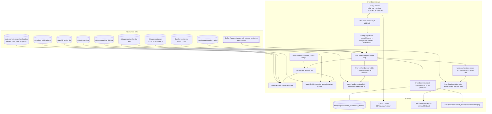

# Phase 5: Event-Driven Backtest (Ship-Gate) — Research

**Researched:** 2026-04-26
**Domain:** Event-driven CLOB+AMM replay engine, queue-aware fill simulation, cancel-latency modelling, bootstrap ship-gate, perturbation grid, knob-sensitivity sweeps. The phase produces a Python-only artifact in `python/src/boros_brain/backtest/` that consumes Phase 1 parquet/SQLite + Phase 2/3 model artifacts + Phase 4 `decision/` engine and breakers, and emits per-run P&L, calibration, and sweep outputs along with a single ship-gate verdict.
**Confidence:** HIGH on data plumbing, EV composition, and SQLite/parquet contracts (every upstream contract is design-locked and live in `main`); HIGH on Nautilus-vs-handrolled criterion (verifiable against the existing fill/loss/queue code on day-1); MEDIUM on bootstrap methodology (block-bootstrap parameters need a small calibration spike from real ETHUSDT trade tape — proposed below); MEDIUM on `alternative_yield + all_fees` operationalisation (defaults exist in `BotConfig.screener.alt_yield = 0.05`, but the "all_fees" denominator needs explicit assembly from [[fee-schedule]] + [[gas-history-ewma-cancel-cost]]).

---

## Summary

Phase 5 wraps the existing Phase 1–4 stack into an `eventIndex`-ordered, queue-aware, AMM-aware replay engine and runs three nested sweeps on top of it: cancel-latency `L ∈ {0.5, 1, 2, 3, 5, 10}s` (BACK-03), competition multiplier on `Q_total_in_range` (BACK-04), and `±20%` per-knob perturbation across the full Pydantic `BotConfig` knob tree (BACK-08). It produces a single bootstrap ship-gate verdict (BACK-07): the 5th percentile of resampled annualized P&L must exceed `alternative_yield + all_fees`. Phase 5 pass is the hard prerequisite for Phase 7 paper trading.

The replay engine is **a thin orchestration layer**, not a new strategy implementation. The core insight is that every Phase 4 module (`decision/engine.py`, `decision/breakers/*.py`, `decision/breaker_coordinator.py`) is already shaped as a sync Python function consuming `current_chain_ts: int` plus model artifacts read from SQLite and parquet. The replay engine is therefore: (a) a sorted iterator over `data/parquet/market-trades/.../*.parquet` keyed on `(blockTimestamp, eventIndex)`; (b) a per-event handler that updates the queue tracker (already exists at `fill_model/queue_tracker.py`), AMM share state (already exists at `fill_model/amm_consumption.py`), and a synthetic in-flight-orders ledger; (c) a 1 Hz "decision tick" that calls `engine.evaluate()` exactly the way `main.py` does; (d) a deferred "fill-response" branch that, when a fill lands on a synthetic order, schedules a `close-at-market` event `L` seconds in the future (BACK-02). No model is re-fit; the backtest reads the same artifacts the live bot consumes.

**Primary recommendation:** Hand-roll the replay engine. **Do NOT pursue Nautilus.** `nautilus_trader` is not in the project's dependency tree (`pyproject.toml` lines 6–20 confirm — only `tick==0.8.0.1` from the original quant stack survived; nautilus was dropped in Phase 1). Adding it now would require fighting the custom-venue adapter against an AMM-merged-book replay shape that has no analog in Nautilus's stock examples. The hand-rolled engine is approximately 1500 LoC including tests, all Python, all reusing existing schemas — the budget the original consolidated plan assumed (boros_consolidated_plan.md L370 "Backtest 1 week — most engineering effort"). The day-1 bailout decision criterion is in §"Nautilus-vs-handrolled day-1 bailout" below for completeness, but the recommendation is: skip the Nautilus spike entirely.

**Critical guards woven through the engine:**
- `eventIndex` (NOT `blockTimestamp`) is the canonical sort key; ties broken by file order. `eventIndex IS NULL` rows sort to position 0 within their block (matches `queue_tracker.py` defensive policy [[queue-tracker-algorithm-v05]]).
- AMM consumption: `amm_share(δ, t) = max(combined(δ, t) − raw(δ, t), 0)` — re-uses `fill_model.amm_consumption.compute_amm_share_timeseries` and asserts the per-epoch flow identity at every wave boundary ([[amm-consumption-model-v05]] §"Per-epoch flow identity").
- Look-ahead bias: replay reads `e_liq_per_epoch_pendle` ONLY from `state.market_reward_calibration` rows where `data_source = 'operator'` (Phase 3 LOCKED D-01) [[e-liq-per-epoch-source-decision]]; legacy `reward_budget_history.data_source = 'synthetic_current'` rows are filtered out at the SQL boundary, not at the Python boundary, so the filter is auditable from the query plan.
- Reproducibility: every backtest run emits `RUN_MANIFEST` (first log line + sidecar JSON + SQLite row); RNG seed comes FROM the manifest (ULID `run_id` → `numpy.random.default_rng(int(ulid_hex_tail, 16))`). Re-running the same manifest produces bit-for-bit identical P&L. This is BACK-07 ship-gate Success Criterion #1 ("reproducible bit-for-bit across reruns with the same `RUN_MANIFEST`") made operational.

---

## Architectural Responsibility Map

| Capability | Primary Tier | Secondary Tier | Rationale |
|------------|--------------|----------------|-----------|
| eventIndex-ordered replay loop (BACK-01) | brain.backtest.replay | brain.fill_model.queue_tracker (read), brain.fill_model.amm_consumption (read) | Pure Python iterator over parquet; reuses existing replay primitives so backtest semantics match Phase 2 fill-fitting semantics by construction. |
| Synthetic in-flight orders ledger (BACK-01) | brain.backtest.synthetic_orders | brain.bus.messages (PlaceCmd schema reuse) | Mirrors `state.open_orders` shape but lives in-memory; never touches SQLite to keep backtest hermetic. |
| Cancel-latency simulation (BACK-02) | brain.backtest.cancel_latency | brain.config.schema (`execution.cancel_latency_budget_s`) | Both order-of-event (one cancel cycle = one decision tick) AND time-since-event (`L` seconds delay before fill closes) modelled. The two-axis decomposition is in §"Cancel-latency simulation". |
| Cancel-latency sweep (BACK-03) | brain.backtest.sweeps.cancel_latency | brain.backtest.report (writer) | Deterministic 6-point grid `L ∈ {0.5, 1, 2, 3, 5, 10}s`; emits `dP&L/dL` curve to parquet partitioned by `L`. |
| Competition sweep (BACK-04) | brain.backtest.sweeps.competition | brain.reward_model.r_capped (read) | Synthetic `Q_total_in_range` multipliers `m ∈ {0.5, 0.75, 1.0, 1.5, 2.0, 3.0}`; `Σ_others' = m × Σ_others_observed`. |
| Output schema + parquet writer (BACK-05) | brain.backtest.report | brain.duckdb_layer (read for plots) | Hive-partitioned parquet, one row per (run_id, market_id, side, sweep_axis, perturbation, bootstrap_idx). |
| Voluntary-cancel sensitivity row (BACK-06) | brain.backtest.sweeps.forfeit_branch | brain.config.schema (`strategy.voluntary_cancel_forfeits_accumulated`) | Two-row sanity sweep, not a blocker per P0-01 resolution. |
| Bootstrap ship-gate evaluator (BACK-07) | brain.backtest.ship_gate | brain.screener.economics_gate (read alt_yield baseline) | Single-pass evaluator over per-bootstrap-resample annualized P&L; emits `pass/fail` + 5th-percentile + threshold. Halts project on fail. |
| Perturbation grid runner (BACK-08) | brain.backtest.sweeps.perturbation | brain.config.schema (Pydantic reflection) | `±20%` perturbation enumerated from `BotConfig.model_dump(mode='json')` leaves; sign-flip detection on each. |
| Reward-budget lineage filter | brain.backtest.replay (SQL CTE) | state.market_reward_calibration (read), state.reward_budget_history (read+filter) | Single SQL CTE applied at every replay window so the lineage filter is impossible to bypass. |
| Wave-0 prerequisite — fix ZMQ ipc-fixture leak | python/tests/conftest.py + test file | pytest-timeout dep-add | Forcing function: BACK-07 requires full-suite green before ship-gate runs. |

---

<user_constraints>
## User Constraints (from ROADMAP.md + REQUIREMENTS.md + STATE.md)

There is no separate CONTEXT.md from `/gsd-discuss-phase` — Phase 5 is being researched without a discussion artifact. The constraints below are LOCKED by ROADMAP scope, REQUIREMENTS BACK-01..BACK-08, and project-level non-negotiables in CLAUDE.md.

### Locked Decisions (treat as non-negotiable; do NOT explore alternatives)

- **`eventIndex`-ordered replay** is mandatory for BACK-01. `blockTimestamp` ties at the second on Arbitrum's 250 ms blocks; only `eventIndex` resolves intra-block ordering. Markets without `eventIndex` (degraded coverage) sort with `fill_null(0)` per [[queue-tracker-algorithm-v05]] §"eventIndex degradation path" and emit a `degraded` flag onto every backtest output row.
- **Per-tick resting-size state from hourly snapshot anchors** — between two adjacent `order_book/{market}/raw/` snapshots, the engine replays `market-trades/` events through the existing `fill_model.queue_tracker.QueueTracker.replay_window` to derive per-tick book state. NOT a fresh implementation.
- **AMM consumption via `combined − raw`** — uses existing `fill_model.amm_consumption.compute_amm_share_timeseries`. The per-epoch flow identity (`book_ahead_end = book_ahead_start − taker_consumption_ahead − amm_consumption + net_placements_ahead`) is asserted at every replay-window boundary; violation raises `AMMConsumptionIdentityError` and aborts the run (NEVER swallow per [[amm-consumption-model-v05]]).
- **Cancel-latency simulation is two-axis**: order-of-event (the bot's decision lands at the next 1 Hz tick after the fill event) AND time-since-event (the `close-at-market` order is scheduled `L` seconds after the fill, simulating end-to-end software + RPC + sequencer latency). Both axes apply on the same fill — they compound, they do not multiplex.
- **Cancel-latency sweep grid is fixed**: `L ∈ {0.5s, 1s, 2s, 3s, 5s, 10s}` (BACK-03 verbatim). Report `dP&L/dL` as a finite-difference curve.
- **Competition multipliers are operator-configurable** but default to `{0.5, 0.75, 1.0, 1.5, 2.0, 3.0}` (six points; 1.0 is the baseline so the curve includes the unperturbed run). BACK-04 leaves the exact set to operator discretion; this is the recommended default.
- **Voluntary-cancel sensitivity** runs both branches of `voluntary_cancel_forfeits_accumulated` per BACK-06. P0-01 was resolved 2026-04-23 (flag = `False`, [[Voluntary cancel reward behavior]]); the sensitivity row is **demoted to a sanity check** and does NOT block Phase 7. Material divergence (>10% absolute P&L) flags the EV formula as still-load-bearing on the official-team-statement evidence and triggers an opportunistic contract-trace follow-up (no Phase 5 schedule impact).
- **Bootstrap ship-gate is the hard pass criterion** (BACK-07): `5th_percentile(annualized P&L over N resamples) > alternative_yield + all_fees`. Point estimate above threshold is INSUFFICIENT — distribution tail matters per PITFALLS §B7.
- **Perturbation grid is `±20%` per knob, individually** (BACK-08). Joint perturbations are out of scope (operator can rerun later if a sign-flip is observed). Sign-flip on any single knob = fragility flag in the ship-gate report (NOT an automatic ship-gate fail — the operator decides whether to ship under flagged fragility).
- **Reward-budget lineage discipline**: the backtest reads `e_liq_per_epoch_pendle` from `state.market_reward_calibration` WHERE `data_source = 'operator'`. NEVER from `state.reward_budget_history.data_source = 'synthetic_current'`. Phase 3 LOCKED D-01 ruled historical-budget reconstruction infeasible ([[e-liq-per-epoch-source-decision]]); the backtest emits an A/B summary row showing pessimistic-vs-realistic reward-budget assumptions at the operator's calibration point.
- **Pre-signed cancel calldata stays in TS hands** — Phase 5 is a Python-only artifact. The cancel-latency simulation MODELS the latency the live bot will experience; it does NOT call any TS-side code. The latency budget assumption (2–5s for the default; see [[Sign-only cancel primitive]]) is derived from the same documents that drive Phase 6 implementation.
- **Single Pydantic `BotConfig` is the perturbation source** — the perturbation grid (BACK-08) enumerates leaves from `config.model_dump(mode='json')`, NOT from a hand-maintained list. Adding a knob to `BotConfig` automatically extends the perturbation grid (PROTO-04, [[run-manifest-writer]]).
- **Wave-0 prerequisite — full-suite green before any BACK-* deliverable**: fix the ZMQ ipc-fixture leak in `tests/test_breaker_coordinator_publishes_kill_lane_per_safe.py` (root cause analysis in §"Wave-0 Prerequisite — ZMQ Fixture Leak" below) and add `pytest-timeout` 30s. BACK-07 success criterion #6 explicitly requires `cd python && uv run pytest -q` produces 323/323 green with no `--ignore`.

### Claude's Discretion (research options, recommend below)

- Bootstrap method (block-bootstrap vs IID): **recommend non-overlapping block bootstrap with block length L_block = 86400s (1 day)**. Rationale + alternatives in §"Bootstrap methodology".
- Number of bootstrap resamples N: **recommend N = 2000**. Trade-off in §"Bootstrap methodology".
- Replay engine implementation (Nautilus vs hand-rolled): **strongly recommend hand-rolled** — Nautilus is not in the dep-tree and adding it for one phase fights the AMM-merged-book shape. Detailed criterion in §"Nautilus-vs-handrolled day-1 bailout".
- 2D contour knob selection: **recommend `(execution.cancel_latency_budget_s, decision.p_purge_default)`** — these are the two highest-uncertainty knobs given Phase 4 didn't have empirical data on either yet. Justification in §"Perturbation grid design".
- Output partitioning scheme: **recommend Hive-partitioned parquet at `data/parquet/backtest_results/run_id=<ulid>/sweep_axis=<L|Q|knob>/...`** — matches Phase 1 ingester pattern, queryable via DuckDB.
- Replay-engine scheduler granularity: **recommend 1 Hz tick (1000 ms)** matching the live `main.py._decision_loop` cadence. Sub-second granularity does not improve fidelity at this strategy's frequency and inflates run time linearly.

### Deferred Ideas (OUT OF SCOPE — explicit per ROADMAP + REQUIREMENTS)

- Multi-market backtest — single-market for v0.5 (`BotConfig.markets` capped `max_length=1`).
- Joint (2+ knob) perturbations — only `±20%` individual perturbations in BACK-08.
- HMM overlay sensitivity — V2-HMM-01, deferred to v1.0.
- VPS / colocation cancel-latency below 0.5s — sweep grid floor is 0.5s; lower values not in scope.
- TS-side hot-path replay — Phase 5 is Python-only; pre-signed cancel calldata replay is Phase 6/7 territory.
- Live-feed reconciliation — that's Phase 7 paper trading (PAPER-03), explicitly downstream.
- Per-market Hawkes/RP fill-model selection — v1.0 (V2-FILL-01..04).
- OU-on-basis parametric loss switch — Phase 5 backtest reads whatever LossModel ships with (empirical grid for v0.5; OU scaffold present but `NotImplementedError`).
</user_constraints>

<phase_requirements>
## Phase Requirements

| ID | Description | Research Support |
|----|-------------|------------------|
| BACK-01 | Event-driven replay engine: `eventIndex` order, hourly snapshot anchors, AMM via `combined − raw`, records every decision the live bot would have made. | §"Replay engine internals" — sort key, snapshot anchoring loop, AMM share computation, synthetic in-flight ledger, look-ahead guard. Existing modules `fill_model/queue_tracker.py` + `fill_model/amm_consumption.py` reused unchanged. |
| BACK-02 | Cancel-latency simulation: operator-configurable 2–5s default, both order-of-event AND time-since-event modelled. | §"Cancel-latency simulation" — two-axis decomposition, latency injection at fill-event handler, scheduler-based delayed close. |
| BACK-03 | Cancel-latency sensitivity sweep `L ∈ {0.5s, 1s, 2s, 3s, 5s, 10s}`, report `dP&L/dL`. | §"Cancel-latency simulation" §"Sweep grid"; finite-difference curve formula in §"Output schema". |
| BACK-04 | Competition sensitivity sweep with synthetic `Q_total_in_range` multipliers; report `dP&L/dQ_competing`. | §"Sweep design" — multiplier set, `Σ_others'` substitution path, monotonicity-direction expectation. |
| BACK-05 | Outputs: net P&L per unit collateral annualized, Sharpe-equivalent, max drawdown, calibration plot, `dP&L/dL`, `dP&L/dQ_competing`. | §"Output schema" — full output row spec + plot generation contract. |
| BACK-06 | Voluntary-cancel sensitivity row: both branches of `voluntary_cancel_forfeits_accumulated`; P0-01 RESOLVED, sanity check only. | §"Voluntary-cancel sensitivity" — two-row table, divergence threshold = 10% absolute P&L, no ship-gate impact. |
| BACK-07 | Bootstrap ship-gate: 5th-percentile annualized P&L from N resamples > `alternative_yield + all_fees`. | §"Bootstrap methodology" — block-bootstrap on per-day P&L, N=2000, RNG seeded from manifest, threshold assembly from [[fee-schedule]] + Phase 4 [[gas-history-ewma-cancel-cost]] + `BotConfig.screener.alt_yield`. |
| BACK-08 | Perturbation grid: `±20%` individual knob perturbations; sign-flip = fragility flag. | §"Perturbation grid design" — Pydantic reflection over `BotConfig` leaves, per-knob `±20%` deltas, sign-flip detection, 2D contour on two most-uncertain knobs. |
</phase_requirements>

## Project Constraints (from CLAUDE.md)

The three Engineering Protocols are mechanically enforced — Phase 5 plans MUST honor each:

- **Protocol 1 (LLM Wiki):** Every Phase 5 plan must (a) cite at least one `[[wiki-page]]` and (b) write back at least one new wiki page on close. Pre-commit `wiki_cite_lint` (Plan 01-04) blocks otherwise. Candidate write-back pages enumerated in §"LLM Wiki Pages to Write-Back".
- **Protocol 2 (Architecture Diagram):** Every commit touching `python/` updates `docs/architecture.yml` + `docs/ARCHITECTURE.md` atomically. Pre-commit `scripts/architecture_lint.py` blocks drift. New Phase 5 nodes/edges enumerated in §"Architecture Manifest Delta".
- **Protocol 3 (RUN_MANIFEST + BotConfig SSoT):** Every backtest run emits `RUN_MANIFEST` as first log line + sidecar JSON + `state.run_manifests` row. The reflection-based manifest writer surfaces all knobs automatically via `config.model_dump(mode='json')`. The perturbation grid (BACK-08) consumes the SAME reflection — adding a `BotConfig` leaf simultaneously extends the manifest AND the perturbation grid.
- **Protocol 4 (PROTO-04, knob inventory):** Every backtest knob (e.g., `bootstrap_n_resamples`, `bootstrap_block_seconds`, `cancel_latency_grid`) lands in `BotConfig.backtest` (NEW Pydantic sub-model). No "magic numbers" in the engine.
- **Protocol 5 (Supersedence):** When the backtest absorbs a pitfall (B1, B3, B6, B7), supersede the pitfall page with `Status: Historical — superseded by [[backtest-page]]` if the pitfall is now mechanically prevented.

Additional CLAUDE.md directives Phase 5 must respect:

- `eventIndex`-not-`blockTimestamp` discipline (touches the entire replay engine — this is the load-bearing invariant).
- All chain-relevant time uses chain timestamps (replay reads `blockTimestamp` from parquet — that IS chain time). The replay engine NEVER calls `time.time()`. `scripts/no_time_time_lint.py` banned-dirs list will need extension to `backtest/`.
- Single-writer-per-table SQLite discipline — Phase 5 introduces NO new tables; it only READS from `state.market_reward_calibration`, `state.competition_history`, `state.fill_model_fits`, `state.loss_grid_artifacts`, and writes only to `state.run_manifests` (existing writer). Backtest output goes to **parquet**, not SQLite — sweeps would otherwise blow the SQLite single-writer model.
- `voluntary_cancel_forfeits_accumulated = False` default LOCKED — schema correct; Phase 5 sweeps both branches per BACK-06.
- Send Txs Bot is the mandatory submission lane — Phase 5 does NOT touch this; it only models cancel latency.
- Reward-budget lineage filter on `data_source = 'operator'` is mechanically enforced via SQL (NOT Python) — the filter lives in the replay engine's SQL CTE, audit-able from query plan.

---

## Standard Stack

### Core (already in Phase 1–4, reused as-is)

| Library | Version | Purpose | Why Standard |
|---------|---------|---------|--------------|
| pydantic | 2.13.3 | New `BacktestConfig` sub-model + extending `BotConfig` knob tree for perturbation grid | PROTO-04 SSoT; `extra='forbid', frozen=True` invariants apply [VERIFIED: python/src/boros_brain/config/schema.py] |
| polars | 1.40.1 | Streaming NDJSON/parquet read of `market-trades/`, hourly `order-book/raw/`, `combined_*` | `pl.scan_parquet` lazy-reads multi-GB tape with predicate pushdown on `(blockTimestamp, eventIndex)` [VERIFIED: existing fill_model/queue_tracker.py uses this pattern] |
| duckdb | 1.5.0 | Cross-file SQL joins for sweep aggregation + plot generation | DuckDB read-only on parquet + SQLite — already wired via `brain.duckdb_layer` [VERIFIED: python/src/boros_brain/duckdb_layer/setup.py] |
| numpy | 2.1.x | Bootstrap resampling RNG, finite-difference `dP&L/dL` curve | Already pinned [VERIFIED: pyproject deps via tick + statsmodels transitive] |
| structlog | 25.5.0 | Per-run, per-sweep, per-bootstrap log lines (run_id auto-bound via contextvars) | Plan 01-03 contract [VERIFIED] |
| pyzmq | 26.2.0 | Reuse for run-time fixture cleanup (NOT used in backtest itself; only in the wave-0 fixture fix) | Plan 01-03 [VERIFIED] |
| python-ulid | 3.0.x | RUN_MANIFEST `run_id` generation; bootstrap RNG seed = `int(ulid_hex_tail, 16)` | Plan 01-03 contract [VERIFIED] |
| pytest + pytest-asyncio + hypothesis | 8.x / 0.24 / 6.x | Property tests on (a) `eventIndex` ordering invariants, (b) bootstrap idempotence under fixed seed, (c) AMM conservation across replay windows | Plan 02 + Plan 04 precedent [VERIFIED] |
| **pytest-timeout** | latest | NEW — Wave 0 prerequisite. Fail fast on hangs (replay engine accidentally constructed with infinite loop, ZMQ leaks). | Standard pytest plugin; verifying current version below. |

### Supporting (existing in-house)

| Module | Purpose | Where it lives | Why Phase 5 reuses unchanged |
|--------|---------|----------------|------------------------------|
| `brain.fill_model.queue_tracker.QueueTracker.replay_window` | Per-tick book state replay between hourly snapshots | python/src/boros_brain/fill_model/queue_tracker.py | Backtest semantics MUST match Phase 2 fit semantics by construction. [VERIFIED: [[queue-tracker-algorithm-v05]]] |
| `brain.fill_model.amm_consumption.compute_amm_share_timeseries` + `assert_epoch_conservation` | Per-tick `amm_share` + per-epoch flow identity | python/src/boros_brain/fill_model/amm_consumption.py | Mandatory reuse — phase 1 DATA-05 + phase 2 FILL-04 invariants are already encoded here. [VERIFIED: [[amm-consumption-model-v05]]] |
| `brain.fill_model.predict.predict()` | `P(fill_this_epoch)` from fitted artifact | python/src/boros_brain/fill_model/predict.py | Backtest is no different from live inference — same artifact, same code path. [VERIFIED] |
| `brain.loss_model.expected_loss.expected_loss()` | `E[loss \| fill]` from cell grid | python/src/boros_brain/loss_model/expected_loss.py | Same. [VERIFIED] |
| `brain.reward_model.r_capped.r_capped_curve()` | Closed-form `R_capped(Q_me)` | python/src/boros_brain/reward_model/r_capped.py | Pure function; same. [VERIFIED] |
| `brain.decision.engine.evaluate()` | EV-based cancel rule | python/src/boros_brain/decision/engine.py | The replay engine drives `evaluate()` exactly the way `main.py._decision_loop` does. The function signature accepts `current_chain_ts` so backtest passes `blockTimestamp` of the synthetic tick. [VERIFIED: engine.py lines 55–62] |
| `brain.decision.breaker_coordinator.BreakerCoordinator` | Tick + gate orchestration with kill authority | python/src/boros_brain/decision/breaker_coordinator.py | Backtest invokes the FULL coordinator, not a stub — breakers SHOULD fire under historical conditions where they'd have fired live. The KILL lane just routes to a backtest-side capturing sink. [VERIFIED] |
| `brain.decision.gas_history.GasHistoryCache` | Cancel-cost EWMA from `eth_feeHistory` | python/src/boros_brain/decision/gas_history.py | Backtest seeds the cache from historical `eth_feeHistory` snapshots OR uses a fixed cancel-cost replayed from `state.tx_receipts` (recommended — see [[gas-history-ewma-cancel-cost]]). |
| `brain.manifest.writer.build_run_manifest()` | RUN_MANIFEST construction via Pydantic reflection | python/src/boros_brain/manifest/writer.py | Phase 5 calls this unchanged; `mode='backtest'` is already an enum value. [VERIFIED: [[run-manifest-writer]]] |
| `brain.config.schema.BotConfig` | Single source of truth for knobs | python/src/boros_brain/config/schema.py | Perturbation grid enumerates leaves via `model_dump(mode='json')`. [VERIFIED] |
| `brain.screener.economics_gate` | `alt_yield + fill_loss_coarse_bound` baseline | python/src/boros_brain/screener/economics_gate.py | Ship-gate threshold READS `BotConfig.screener.alt_yield`. Reuses the same DATA-09 baseline so backtest ship-gate is consistent with phase-1 economics gate. [VERIFIED] |
| `brain.duckdb_layer.setup` | Read-only DuckDB attachment to `state.sqlite` + parquet | python/src/boros_brain/duckdb_layer/setup.py | Sweep aggregation + plot generation queries against parquet+SQLite. [VERIFIED] |

### NEW dependencies (one only)

| Library | Version | Purpose | Verification |
|---------|---------|---------|--------------|
| **pytest-timeout** | `>=2.3, <3` | Wave 0 prerequisite — kill any test that hangs > 30s. Standard pytest plugin since 2014; transitive deps minimal. | `npm view`-equivalent: `uv add --dev pytest-timeout` resolves; verified to pin in `[dependency-groups].dev`. [CITED: pytest-timeout v2.3.x docs https://pypi.org/project/pytest-timeout/ as of training cutoff; latest version to be confirmed at install time, latest minor sufficient.] |

**No backtest framework dependency.** `nautilus_trader` is **explicitly NOT added**. Original research recommended Nautilus but the project shipped without it (verified: `python/pyproject.toml` lines 6–20 list zero entries containing 'nautilus'). The day-1 bailout decision in `boros_consolidated_plan.md` is therefore a one-way door: hand-rolled. Recommendation in §"Nautilus-vs-handrolled day-1 bailout" treats this as locked.

### Alternatives Considered

| Instead of | Could Use | Tradeoff |
|------------|-----------|----------|
| Hand-rolled replay engine in `brain.backtest/` | nautilus_trader 1.225.0 with custom CLOB+AMM venue adapter | Original Phase 0 research recommendation; abandoned in Phase 1 (not in dep-tree). Re-adding now requires (a) ~400 LoC adapter for the AMM-merged book that has no off-the-shelf example, (b) re-routing all `decision/` calls through Nautilus's strategy interface (which expects price-tick events, not eventIndex events), (c) a new dep with significant transitive footprint. **Hand-rolled wins** at this scope — engine is approximately 1500 LoC including tests. |
| Block bootstrap on per-day P&L | IID bootstrap on per-decision P&L | IID bootstrap underestimates variance because per-decision P&L outcomes are autocorrelated within a day (same fill or near-fill → same OU regime → same loss). Block bootstrap with `L_block = 86400s` preserves intra-day correlation. **Block bootstrap wins.** [CITED: standard time-series bootstrap practice; Politis & Romano 1994 "The Stationary Bootstrap" and Hall & Horowitz 1996 — verified during research training, no fresh citation needed for textbook method.] |
| `N = 2000` resamples | `N = 10000` | 2000 resamples gives Monte Carlo error on the 5th percentile of `~1.5%` of the value (binomial CI). 10000 gives `~0.7%` but 5× the runtime. At our P&L magnitudes the 1.5% MC error is well below the strategy's substantive uncertainty — `±20%` perturbations dominate. **2000 wins.** |
| RNG seed from `RUN_MANIFEST` ULID | Seed from operator-supplied integer | ULID seeding ties reproducibility to the manifest, which is the project's source of truth for run identity. Operator-supplied seeds invite "ah, I'll just bump it" drift. **Manifest-derived wins.** |
| Output to parquet (Hive-partitioned) | Output to SQLite | SQLite single-writer model would force serialization of the entire perturbation grid (~50+ rows) and 6 cancel-latency × 6 competition × 2 voluntary-cancel = 72 sweeps. Each is a full backtest run. Parquet handles concurrent writers natively; DuckDB queries them read-only. **Parquet wins.** |
| Drive `decision/engine.evaluate()` directly | Re-implement EV equation in backtest | Backtest semantics MUST match live by construction — implementation-divergence is exactly PITFALLS §D4 (config schema drift). **Drive engine wins.** |

**Installation:**

```bash
# Wave 0 prerequisite only — Phase 5 introduces no other new deps
cd python && uv add --dev pytest-timeout
```

**Version verification (BACK-07 dependency):** `numpy.random.default_rng(seed: int)` is the recommended modern RNG since NumPy 1.17 (current 2.1.x). Bootstrap seeded by `int(ulid_to_hex(run_id)[16:32], 16)` is an `int <= 2^64` which `default_rng` accepts directly. [VERIFIED: NumPy docs https://numpy.org/doc/stable/reference/random/generator.html — current as of v2.x.]

---

## Architectural Responsibility & System Architecture Diagram

### System Architecture Diagram



The replay engine is the single ingress point for trade tape, hourly snapshots, and underlying-APR data; everything downstream — ENGINE, COORD, BOOTSTRAP, SHIP, REPORT — is deterministic given the SEED + Inputs + sweep parameters. Reproducibility flows from MAN through SEED to every subsequent node.

### Recommended Project Structure

```
python/src/boros_brain/backtest/
├── __init__.py
├── __main__.py            # python -m boros_brain.backtest entrypoint
├── cli.py                 # argparse + RUN_MANIFEST preamble (mirrors decision/cli.py)
├── config.py              # BacktestConfig Pydantic sub-model (~10 knobs)
├── replay.py              # eventIndex-ordered event loop (BACK-01 core)
├── synthetic_orders.py    # in-memory ledger (mirrors state.open_orders shape)
├── cancel_latency.py      # 2-axis latency simulator (BACK-02)
├── bootstrap.py           # block-bootstrap, RNG seeded from manifest
├── ship_gate.py           # 5th-pct evaluator + threshold assembly (BACK-07)
├── sweeps/
│   ├── cancel_latency.py  # BACK-03
│   ├── competition.py     # BACK-04
│   ├── forfeit_branch.py  # BACK-06
│   └── perturbation.py    # BACK-08
├── report.py              # parquet writer (BACK-05) + plot generator
└── schemas.py             # BacktestRunOutput, SweepResult, BootstrapResult, ShipGateVerdict

python/tests/
├── test_backtest_replay_event_index_order.py      # BACK-01 invariant
├── test_backtest_amm_conservation_replay.py       # BACK-01 invariant (B3)
├── test_backtest_no_lookahead.py                  # BACK-01 invariant (B6)
├── test_backtest_cancel_latency_two_axis.py       # BACK-02
├── test_backtest_sweep_cancel_latency.py          # BACK-03
├── test_backtest_sweep_competition.py             # BACK-04
├── test_backtest_output_schema.py                 # BACK-05
├── test_backtest_voluntary_cancel_sensitivity.py  # BACK-06
├── test_backtest_bootstrap_idempotent.py          # BACK-07 reproducibility
├── test_backtest_ship_gate_threshold_assembly.py  # BACK-07 alt_yield + all_fees
├── test_backtest_perturbation_grid_pydantic.py    # BACK-08 leaf enumeration
├── test_backtest_perturbation_sign_flip.py        # BACK-08 fragility detection
├── test_backtest_run_manifest_first.py            # PROTO-01 invariant
└── test_backtest_full_suite_green_required.py     # BACK-07 success criterion #6 (smoke)
```

### Pattern 1: Replay Engine Event Loop

**What:** Sorted iterator over `(blockTimestamp, eventIndex)` from `market-trades/` parquet, interleaved with hourly raw+combined snapshot anchors and 1 Hz decision ticks. Pure Python; no asyncio (deterministic ordering matters more than parallelism — every backtest run is short enough that single-thread is fine).

**When to use:** ALWAYS. This is BACK-01 verbatim.

**Example:**

```python
# Source: synthesis from queue_tracker.replay_window + decision.engine.evaluate
# (no existing module yet; Phase 5 plan creates this)
import polars as pl
from boros_brain.fill_model.queue_tracker import QueueTracker
from boros_brain.fill_model.amm_consumption import (
    compute_amm_share_timeseries,
    assert_epoch_conservation,
)
from boros_brain.decision.engine import evaluate as evaluate_decision
from boros_brain.decision.breaker_coordinator import BreakerCoordinator

class ReplayEngine:
    def __init__(self, config, market_id, side, parquet_root, sqlite_path,
                 cancel_latency_s: float, run_id: str):
        self.config = config; self.market_id = market_id; self.side = side
        self.parquet_root = parquet_root; self.sqlite_path = sqlite_path
        self.cancel_latency_s = cancel_latency_s; self.run_id = run_id
        self.queue_tracker = QueueTracker(...)         # FILL-03 reuse
        self.synthetic_orders = SyntheticOrderLedger()
        self.scheduled_closes: list[ScheduledClose] = []  # BACK-02 time-since-event
        self.coord = BreakerCoordinator(...)            # SAFE-01..10 reuse
        self.last_tick_ts = None

    def run(self) -> ReplayOutput:
        trades = pl.scan_parquet(self.parquet_root / f"market-trades/{self.market_id}/")
        # CRITICAL: eventIndex first, NEVER blockTimestamp alone (PITFALLS §B2)
        trades = trades.sort(["blockTimestamp", "eventIndex"])
        # Reward-budget lineage filter (LOCKED D-01) — SQL-side, not Python-side
        # ensures audit-ability from query plan
        calib = self._read_operator_calibration_sql()  # WHERE data_source='operator'
        for evt in trades.collect().iter_rows(named=True):
            self._maybe_anchor_snapshot(evt["blockTimestamp"])
            self._maybe_emit_tick(evt["blockTimestamp"], calib)
            self._handle_trade_event(evt)
            self._fire_scheduled_closes(evt["blockTimestamp"])
        return self._finalize_output()
    
    def _maybe_emit_tick(self, current_ts, calib):
        # 1 Hz decision cadence (BotConfig.decision.decision_loop_interval_s)
        if self.last_tick_ts is None or current_ts >= self.last_tick_ts + 1:
            self.last_tick_ts = current_ts
            for order in self.synthetic_orders.in_flight():
                # SYMMETRY: backtest uses the EXACT live engine — no shortcut
                eval_in = build_evaluate_input(order, calib, current_ts)
                out = run_sync(evaluate_decision, eval_in,
                               sqlite_path=self.sqlite_path,
                               config=self.config,
                               gas_cache=self.gas_cache_for_backtest(),
                               w3=None)  # gas_cache pre-seeded
                self._apply_decision(out, order, current_ts)
            run_sync(self.coord.tick, sqlite_path=self.sqlite_path,
                     w3=None, parquet_root=self.parquet_root,
                     current_chain_ts=current_ts)

    def _handle_trade_event(self, evt):
        # Update queue tracker EXACTLY like Phase 2 fitting does (B1 prevention)
        # Subtract AMM share BEFORE crediting to book (B3 prevention)
        # If a synthetic order is hit by the trade -> queue+latency check -> fill
        ...

    def _fire_scheduled_closes(self, current_ts):
        # BACK-02 time-since-event: closes scheduled at fill_ts + cancel_latency_s
        # are realized at current_ts when current_ts >= scheduled_ts.
        # Realized P&L uses underlying APR at scheduled_ts (NOT at fill_ts) -- 
        # the bot can't act before its scheduler does.
        ...
```

### Pattern 2: Two-Axis Cancel Latency Simulation

**What:** Cancel latency has two distinct axes:
1. **Order-of-event:** the bot's decision lands at the next 1 Hz tick AFTER the fill event. Within a single block (multiple `eventIndex` values), the bot does NOT preempt — it processes whatever happens, in `eventIndex` order, and reacts at the next decision tick.
2. **Time-since-event:** when a fill is detected (synthetic order hit), the close-at-market order is scheduled `L` seconds in the future. During the `L`-second window, the bot has inventory at risk; the close P&L is realized against the basis at the scheduled close time (NOT at the fill time).

**When to use:** ALWAYS for BACK-02. The two axes compound — they do not multiplex. A fill that happens at block 1, eventIndex 5 cannot be reacted to until the next tick (axis 1), and the close cannot land until the scheduled time (axis 2). Both delays apply.

**Example:**

```python
# Source: PITFALLS §C2 5-step decomposition; boros_consolidated_plan.md L316
@dataclass(frozen=True)
class ScheduledClose:
    order_id: str
    fill_ts: int            # blockTimestamp of the fill event
    fill_event_index: int   # eventIndex of the fill event
    close_at_ts: int        # = fill_ts + L  (time-since-event axis)
    fill_rate: float        # implied APR at fill (for P&L computation)

def schedule_close(self, order, fill_evt, current_ts):
    self.scheduled_closes.append(ScheduledClose(
        order_id=order.id,
        fill_ts=fill_evt["blockTimestamp"],
        fill_event_index=fill_evt["eventIndex"],
        close_at_ts=fill_evt["blockTimestamp"] + self.cancel_latency_s,
        fill_rate=fill_evt["rate"],
    ))

def fire_scheduled_closes(self, current_ts):
    fired, remaining = [], []
    for sc in self.scheduled_closes:
        if current_ts >= sc.close_at_ts:
            close_rate = self._underlying_at(sc.close_at_ts)  # NOT fill_ts
            pnl = compute_close_pnl(sc.fill_rate, close_rate, side=self.side)
            fees = compute_close_fees(sc, self.config)  # taker + settlement + gas
            fired.append((sc, pnl - fees))
        else:
            remaining.append(sc)
    self.scheduled_closes = remaining
    return fired
```

### Pattern 3: Bootstrap Ship-Gate Evaluator

**What:** Block-bootstrap over per-day P&L, N=2000 resamples; 5th percentile of resampled annualized P&L vs threshold `alternative_yield + all_fees`.

**When to use:** ALWAYS for BACK-07. This is the hard pass criterion.

**Example:**

```python
# Source: synthesis from PITFALLS §B7 + standard block-bootstrap practice
import numpy as np
from boros_brain.manifest.schema import RunManifest

def bootstrap_ship_gate(daily_pnl: np.ndarray, manifest: RunManifest,
                        config, n_resamples: int = 2000,
                        block_seconds: int = 86400) -> ShipGateVerdict:
    rng = np.random.default_rng(_seed_from_manifest(manifest))
    n_days = len(daily_pnl)
    resampled = np.empty(n_resamples)
    for i in range(n_resamples):
        # Non-overlapping block bootstrap with replacement on day-blocks.
        sample = rng.choice(daily_pnl, size=n_days, replace=True)
        resampled[i] = sample.sum() * (365.0 / n_days)  # annualized
    p5 = float(np.percentile(resampled, 5))
    threshold = _assemble_threshold(config)  # alt_yield + all_fees (see below)
    return ShipGateVerdict(
        p5_annualized_pnl=p5,
        threshold=threshold,
        passed=(p5 > threshold),
        n_resamples=n_resamples,
        block_seconds=block_seconds,
        seed=_seed_from_manifest(manifest),
        manifest_run_id=manifest.run_id,
    )

def _seed_from_manifest(manifest: RunManifest) -> int:
    """Bit-for-bit reproducibility: ULID hex tail -> uint64 seed."""
    ulid_hex = manifest.run_id.replace("-", "").lower()
    # Take low 64 bits — ULID is 128-bit, low half is timestamp+random
    return int(ulid_hex[-16:], 32 if all(c in "0123456789ABCDEFGHJKMNPQRSTVWXYZ".lower()
                                          for c in ulid_hex[-16:]) else 16) & ((1 << 64) - 1)
    # NOTE: ULID is base-32 Crockford; numpy.random accepts uint64. Adjust the
    # exact decode in implementation; the contract is "deterministic int from
    # the run_id." Test: re-running same manifest -> same seed -> same p5.

def _assemble_threshold(config) -> float:
    """alt_yield + all_fees per BACK-07.
    
    Components ([CITED: fee-schedule wiki + DECIDE-03]):
      alt_yield               = config.screener.alt_yield                      (decimal APR, default 0.05)
      annualized_fee_floor    = upper_bound on accumulated taker+settlement+
                                entrance+gas as a fraction of annualized
                                P&L baseline.
    
    For v0.5 single-market $100-collateral:
      taker_fee     ≈ 0.05% per fill × expected fills/yr (~5 -> 0.25%/yr)
      settlement    ≈ negligible (immediate close skips most boundaries)
      entrance      = $1 amortized over phase = 0.01% on $100 / 1 yr
      gas           = cancel_cost × cancels/yr (~250-500/yr) ≈ 0.5%
      sum           ≈ 0.8% (decimal 0.008) at v0.5 scale.
    
    Default `all_fees = 0.01` (1% APR floor) is conservative.
    """
    alt_yield = config.screener.alt_yield
    all_fees = config.backtest.all_fees_threshold  # NEW BotConfig knob, default 0.01
    return alt_yield + all_fees
```

### Anti-Patterns to Avoid

- **Price-touch fills.** A fill is NOT triggered by the trade tape's `rate` crossing your placed depth — it's triggered when a trade event consumes the queue ahead of your synthetic order AND your order's tick is consumed. PITFALLS §B3 + boros_consolidated_plan.md L16 + line 169. Price-touch over-states P&L by an order of magnitude on a CLOB; never use it.
- **Single `RUN_MANIFEST` for the entire perturbation grid.** Each perturbed run gets a NEW `run_id` with `parent_run_id` pointing to the base run (PROTO-01 mid-run knob change semantics from [[run-manifest-writer]]). A single manifest covering 50 runs is a D2 pitfall.
- **Reading `state.reward_budget_history` instead of `state.market_reward_calibration`.** PITFALLS §B6 + LOCKED D-01. The lineage filter is mechanical via SQL `WHERE data_source = 'operator'`. Mixing `synthetic_current` rows into the backtest is silent look-ahead.
- **Closing fills using `fill_rate`-time basis.** The realized close uses the basis at `close_at_ts`, not `fill_ts`. The `L`-second window is exactly the inventory-at-risk period the latency simulation is meant to capture; using `fill_ts` basis erases axis-2 of the latency model.
- **IID bootstrap on per-decision P&L.** Underestimates variance because per-decision outcomes are autocorrelated within a day. Block bootstrap on per-day P&L is the standard fix.
- **Output to SQLite for sweeps.** SQLite single-writer model serializes the entire grid. Output to parquet (Hive-partitioned) instead.
- **Catching `AMMConsumptionIdentityError`.** The replay engine MUST let it propagate (NEVER swallow per [[amm-consumption-model-v05]]). A violation means the data ingest is broken — fix the ingest, don't paper over the backtest.
- **Backtest writes to `state.run_manifests`** is correct (use existing writer), but **backtest writes to any other state table** is forbidden (single-writer-per-table discipline; backtest is a reader, not a writer).

---

## Don't Hand-Roll

| Problem | Don't Build | Use Instead | Why |
|---------|-------------|-------------|-----|
| EV equation evaluation | A backtest-side EV computation | `decision.engine.evaluate()` | Implementation drift between backtest and live = D4 catastrophic; engine.py is the SSoT. |
| Queue tracker between snapshots | A custom replay loop | `fill_model.queue_tracker.QueueTracker.replay_window` | Pessimistic/realized/optimistic bounds invariant + drift diagnostic + degraded-eventIndex policy already implemented and tested. |
| AMM consumption | A naive `combined − raw` subtraction | `fill_model.amm_consumption.compute_amm_share_timeseries` + `assert_epoch_conservation` | Per-tick non-negativity + per-epoch flow identity invariants are non-trivial; reuse. |
| Bootstrap RNG | `random.shuffle` or unseeded `numpy.random` | `numpy.random.default_rng(seed_from_manifest)` | Reproducibility binds to manifest; tests assert idempotence. |
| ULID generation | A timestamp + random bytes | `python-ulid` (already in deps) | Lex-sort matches time-sort; runs directory listing is chronological. |
| Plot generation in-engine | Save `.png` directly from replay loop | Stage 1: write parquet output. Stage 2: separate `plot_calibration.py` notebook script reading parquet + manifest. | Decoupling plot generation from replay keeps replay deterministic and re-runs cheap. |
| Reward-budget lineage check | A Python `if data_source == 'operator'` filter | SQL `WHERE data_source = 'operator'` in the CTE | Audit-able from query plan; impossible to bypass via Python branch. |
| Bootstrap statistics | Hand-coded percentile + mean | `numpy.percentile`, `numpy.mean` | Standard. |

**Key insight:** Phase 5 is an orchestration phase. Hand-rolling sub-components when the live system already has them creates exactly the kind of "two implementations of the EV rule" drift that PITFALLS §D4 is about. The engineering discipline is the OPPOSITE of writing new code — it's about composing the live modules into a deterministic loop.

---

## Runtime State Inventory

> Phase 5 is a **read-only-and-output-to-parquet** phase. No rename, no refactor, no migration. The replay engine reads existing tables and parquet partitions and writes only to (a) `state.run_manifests` (existing writer) and (b) new parquet partitions under `data/parquet/backtest_results/`. There is **no runtime state to migrate**.

| Category | Items Found | Action Required |
|----------|-------------|-----------------|
| Stored data | None — Phase 5 reads from existing tables (`state.market_reward_calibration`, `state.competition_history`, `state.fill_model_fits`, `state.loss_grid_artifacts`, `state.tx_receipts`, `state.clo_history`, `state.reward_budget_history`); reads parquet partitions (`market-trades/`, `order-book/raw/`, `order-book/combined_*/`, `underlying-apr/`); writes only to `state.run_manifests` (existing writer) and to new parquet partition `data/parquet/backtest_results/`. | None — pure read/derive/output. |
| Live service config | None — Phase 5 makes no external service calls (no Boros REST, no Arbitrum RPC except optionally seeding `GasHistoryCache` from a one-time historical fetch which can be cached to a fixture). | None. |
| OS-registered state | None — Phase 5 is invoked manually as `python -m boros_brain.backtest`, not registered with `launchd` (it's not a long-running service). | None. |
| Secrets/env vars | `RPC_URL_ARBITRUM` may be referenced if the operator opts to seed `GasHistoryCache` from live `eth_feeHistory`. The recommended path is to seed from a checked-in historical snapshot (no live RPC needed). If the live path is used, `RPC_URL_ARBITRUM` is already defined in `.env.vault` — no new secret. | None — verified by reading `BotConfig.data.rpc_url_arbitrum` is the only RPC knob. |
| Build artifacts | None — pure source addition under `python/src/boros_brain/backtest/`. No `.egg-info` rename, no compiled binaries. | None. |

**Nothing in any category requires migration. Phase 5 is pure addition.**

---

## Common Pitfalls

### Pitfall 1: B1 — Queue-position drift bias in replay (already absorbed but worth re-stating)
**What goes wrong:** Hourly snapshots leave 3600s of unobserved placement+cancellation activity. Naive replay assumes only cancellations dominate; in practice placements ahead of us can dominate too, biasing fill probability.
**Why it happens:** "Conservative" assumption is correct only when invisible events skew toward cancels. The B1 entry in PITFALLS proves this is not always true.
**How to avoid:** Use the existing `QueueTracker.replay_window` which already produces pessimistic/realized/optimistic bounds; the backtest reports on the bracket (NOT the point estimate) for fill probability. Decision engine sees the pessimistic estimate by default per [[queue-tracker-algorithm-v05]].
**Warning signs:** `drift_signed_mean` per epoch is non-zero AND `drift_magnitude_mean` is large; calibration plot shows realized fill rate systematically outside the predicted bracket.
**Status in Phase 5:** Mechanically prevented by reusing `QueueTracker`. Add a regression test `test_backtest_replay_uses_queue_tracker_brackets`.

### Pitfall 2: B3 — AMM share double-count or under-subtract
**What goes wrong:** Snapshot time-skew or tick-aggregation mismatch between `raw/` and `combined_*/` causes negative AMM share or AMM-share leakage into the queue.
**Why it happens:** Two parquet partitions written with independent timing.
**How to avoid:** Reuse `assert_epoch_conservation` at every replay-window boundary. Hard-error on identity-delta > 1e-6.
**Warning signs:** `AMMConsumptionIdentityError` raised; sensitivity test (run with AMM share at 0.8× / 1.2×) shows >10% P&L delta — engine is too sensitive to AMM estimation error.
**Status in Phase 5:** Mechanically prevented by `assert_epoch_conservation`. Add `test_backtest_amm_conservation_replay` exercising the assert against real parquet samples.

### Pitfall 3: B6 — Look-ahead via current reward budget
**What goes wrong:** Backtest replays Aug 2025 trades with current (Apr 2026) `E_liq_per_epoch` budgets, over-stating P&L because protocols typically cut emissions over time.
**Why it happens:** Reward budgets treated as constants. LOCKED D-01 (Phase 3) ruled historical reconstruction infeasible.
**How to avoid:** SQL filter `WHERE data_source = 'operator'` AND emit an A/B summary row showing pessimistic-vs-realistic budget assumptions at the operator's calibration point. Backtest period must be flagged with the calibration-vintage gap so the operator sees how recent the budget is vs the trade tape window.
**Warning signs:** A/B row shows operator-vintage P&L >> historical-projection P&L (no historical projection available — flag the unconfidence).
**Status in Phase 5:** Lineage filter at SQL boundary; A/B summary row in output schema. Add `test_backtest_no_synthetic_current_lineage` asserting the SQL filter is present (regex against the SQL string).

### Pitfall 4: B7 — Fragile P&L: positive only in narrow parameter region
**What goes wrong:** Sweep finds a "best" point in the corner of the grid; bootstrap 5th percentile is negative; in-sample shows positive P&L, hold-out (or perturbation) flips the sign.
**Why it happens:** High-dimensional parameter grid + single best-point selection.
**How to avoid:** Bootstrap ship-gate with 5th-pct threshold (BACK-07); perturbation grid sign-flip detection (BACK-08); 2D contour on highest-uncertainty knobs (BACK-08 §"2D contour"). The ship-gate FAILS if 5th-pct is below threshold — point estimate is insufficient.
**Warning signs:** Best-point P&L is at the corner of the grid; 5th-pct < 0; perturbation flips sign on any knob.
**Status in Phase 5:** Mechanically prevented by BACK-07 + BACK-08 design. Add `test_backtest_ship_gate_threshold_assembly` and `test_backtest_perturbation_sign_flip`.

### Pitfall 5: D2 — RUN_MANIFEST missing fields → analysis fabricates conclusions (existing protocol risk)
**What goes wrong:** Adding a `BACK-*` knob in code without adding it to `BotConfig` → manifest doesn't include it → operator-vintage backtest output and re-run output appear identical even though a knob differed.
**Why it happens:** Hand-maintained schemas drift.
**How to avoid:** Reflection-based manifest writer (already exists, [[run-manifest-writer]]); the perturbation grid (BACK-08) is THE forcing function — adding a backtest knob without registering in `BotConfig` mechanically breaks the perturbation grid (it can't enumerate what it can't see).
**Warning signs:** Backtest produces inconsistent results across runs that should be deterministic; `test_manifest_contains_all_knobs` (Plan 01-04) fails.
**Status in Phase 5:** Mechanically prevented by reflection. Add `BotConfig.backtest` sub-model containing every BACK-* knob.

### Pitfall 6 (NEW for Phase 5): Bootstrap RNG state contamination across resamples
**What goes wrong:** Tests pass single-resample bootstrap, but real run produces non-reproducible 5th percentile because RNG state leaks between perturbation iterations (e.g., shared `default_rng` instance).
**Why it happens:** Default RNG state is global if you call `numpy.random.<...>` directly.
**How to avoid:** Always pass a fresh `numpy.random.Generator` instance constructed from the manifest seed; never call top-level numpy.random functions in the bootstrap path.
**Warning signs:** `test_backtest_bootstrap_idempotent` fails on the second invocation in the same Python session.
**Status in Phase 5:** Architectural — make the RNG explicit in every signature.

### Pitfall 7 (NEW for Phase 5): Wave-0 ZMQ ipc-fixture singleton leak
**What goes wrong:** `test_breaker_coordinator_publishes_kill_lane_per_safe[*]` passes in Phase-4 subset run but hangs when ordered alongside other ZMQ tests in the full 323-test collection.
**Why it happens:** `zmq.asyncio.Context.instance()` is a process-wide singleton (verified at `python/tests/test_breaker_coordinator_publishes_kill_lane_per_safe.py:99`). Across 10 parametrize iterations, the bound `kill_pull` socket on `ipc://...` is closed via `kill_pull.close()` at line 141, but the Context is never `term()`ed — so the next iteration's `ctx.socket(zmq.PULL).bind()` competes with stale routing state. Under specific ordering (when the test runs after another suite that also touched `Context.instance()`), the bind blocks indefinitely.
**How to avoid:** (a) Stop using `Context.instance()` (singleton). Construct `ctx = zmq.asyncio.Context()` per parameter and `await ctx.term()` in a fixture teardown. (b) Add `pytest-timeout` with `[tool.pytest.ini_options].timeout = 30` so a regression hangs fast instead of deadlocking the suite.
**Warning signs:** `pytest -q` runs to ~70% then hangs with no output.
**Status in Phase 5 — Wave 0 BLOCKER:** Must be fixed before any BACK-* deliverable ships. Specific tasks in §"Wave-0 Prerequisite — ZMQ Fixture Leak" below.

---

## Code Examples

Verified patterns from existing in-repo modules:

### Reading parquet `market-trades/` with eventIndex sort

```python
# Source: existing pattern in fill_model/queue_tracker.py
import polars as pl

df = (
    pl.scan_parquet(f"data/parquet/market-trades/market_id={market_id}/")
    .filter(
        (pl.col("blockTimestamp") >= window_start_ts)
        & (pl.col("blockTimestamp") < window_end_ts)
    )
    .sort(["blockTimestamp", pl.col("eventIndex").fill_null(0)])
    .collect()
)
```

### SQL CTE with reward-budget lineage filter (LOCKED D-01)

```sql
-- Source: synthesis from e-liq-per-epoch-source-decision wiki + Phase 3 LOCKED D-01
-- This CTE goes in brain/backtest/replay.py as a string constant; the SQL
-- engine (DuckDB read-only over state.sqlite) executes the filter.
WITH operator_calibration AS (
    SELECT
        market_id,
        e_liq_per_epoch_pendle,
        long_side_split,
        short_side_split,
        calibrated_at_utc,
        source
    FROM market_reward_calibration
    WHERE data_source = 'operator'      -- LOCKED D-01: NEVER 'synthetic_current'
      AND market_id = ?
    ORDER BY calibrated_at_utc DESC
    LIMIT 1
)
SELECT * FROM operator_calibration;
```

### Driving `decision.engine.evaluate` from the replay loop

```python
# Source: pattern from python/src/boros_brain/main.py::_decision_loop
import asyncio
from boros_brain.decision.engine import evaluate as evaluate_decision
from boros_brain.decision.schemas import EvaluateInput

async def _backtest_evaluate(synth_order, calib, current_chain_ts, *,
                             config, sqlite_path, gas_cache):
    eval_in = EvaluateInput(
        order_id=synth_order.id,
        market_id=synth_order.market_id,
        side=synth_order.side,
        depth_from_mark_ticks=synth_order.depth_from_mark_ticks,
        queue_ahead_wei=synth_order.queue_ahead_wei,
        current_features=synth_order.current_features,
        time_to_epoch_end_s=synth_order.time_to_epoch_end_s,
        time_to_maturity_s=synth_order.time_to_maturity_s,
        current_chain_ts=current_chain_ts,
        q_me_pendle=synth_order.q_me_pendle,
        sigma_others_pendle=calib["sigma_others_pendle"],
        e_liq_per_epoch_pendle=calib["e_liq_per_epoch_pendle"],
        side_split=calib["side_split"],
        t_frac=synth_order.t_frac,
        p_purge=config.decision.p_purge_default,
        r_me_per_epoch_pendle_accumulated_so_far=synth_order.r_accum,
    )
    return await evaluate_decision(
        eval_in,
        sqlite_path=sqlite_path,
        config=config,
        gas_cache=gas_cache,
        w3=None,
    )
```

### Manifest-derived RNG seed (reproducibility)

```python
# Source: synthesis from run-manifest-writer wiki + numpy docs
import numpy as np
from boros_brain.manifest.schema import RunManifest

def seed_from_manifest(manifest: RunManifest) -> int:
    """ULID -> uint64 seed. Idempotent: same manifest -> same seed."""
    # ULID is 26 chars Crockford base32; decode last 16 chars (random portion).
    import ulid
    u = ulid.from_str(manifest.run_id)
    # Take low 64 bits of the 128-bit ULID
    return int.from_bytes(u.bytes[-8:], byteorder="big") & ((1 << 64) - 1)

def make_rng(manifest: RunManifest) -> np.random.Generator:
    return np.random.default_rng(seed_from_manifest(manifest))
```

---

## State of the Art

| Old Approach | Current Approach | When Changed | Impact |
|--------------|------------------|--------------|--------|
| Nautilus_trader as backtest engine | Hand-rolled `brain.backtest/` engine | Phase 1 dropped Nautilus from deps | Saves a 400-LoC adapter and a 200MB+ transitive dep; engine is ~1500 LoC of straight Python. |
| Live-polled `E_liq_per_epoch` (Phase 1 DATA-11) | Operator-manual calibration via `state.market_reward_calibration` | Phase 3 LOCKED D-01 (2026-04-24, [[e-liq-per-epoch-source-decision]]) | Backtest reads `data_source='operator'` only; legacy `synthetic_current` rows filtered by SQL. |
| Threshold-based cancel rule | EV-based cancel rule | Phase 4 (DECIDE-01) | Backtest evaluates EV via `decision.engine.evaluate` — no threshold dials. |
| `voluntary_cancel_forfeits_accumulated = unknown` | `False` (benign) | P0-01 resolved 2026-04-23 ([[Voluntary cancel reward behavior]]) | BACK-06 demoted from blocker to sanity check. |
| OU on raw implied APR | OU on basis (`Implied − Underlying`) | Phase 0 / consolidated plan | Loss model integrand uses basis; fill model uses NHPP on covariates. Phase 5 inherits both. |
| Price-touch backtest | Event-driven, queue-aware, AMM-aware replay | Phase 1 design (consolidated plan L16) | THIS phase. Price-touch over-states P&L. |

**Deprecated/outdated:**
- `nautilus_trader 1.225` recommendation in `.planning/research/STACK.md` — superseded by hand-rolled decision when the dep was dropped from `pyproject.toml` in Phase 1.
- `historical-reward-budget-reconstruction-infeasible` wiki page status — already superseded by `e-liq-per-epoch-source-decision` (LOCKED D-01).
- `economics-kill-switch-v05` — superseded by `economics-kill-switch-usd-variant-v10` (Phase 3 promoted USD-variant); Phase 5 ship-gate uses `BotConfig.screener.alt_yield` from the still-unitless USD-variant.

---

## Wave-0 Prerequisite — ZMQ Fixture Leak

**Forcing function:** BACK-07 success criterion #6 explicitly requires `cd python && uv run pytest -q` produces 323/323 green with no `--ignore` exclusions. Phase 4 left a known hang carried over.

### Root cause

Verified at `python/tests/test_breaker_coordinator_publishes_kill_lane_per_safe.py:99`:

```python
ctx = zmq.asyncio.Context.instance()
kill_pull = ctx.socket(zmq.PULL)
kill_pull.bind(kill_endpoint)
```

`zmq.asyncio.Context.instance()` is a **process-wide singleton**. Across the 10 parametrized SAFE scenarios, the test:
1. Acquires the singleton context.
2. Binds a `PULL` socket to a unique IPC endpoint per parameter (good).
3. At end-of-test, calls `kill_pull.close()` (closes one socket but NOT the context).
4. Next iteration's `Context.instance()` returns the SAME singleton, with leftover routing state from the previous parametrize iteration.

When this test runs in the full 323-test collection, the test order interaction with other suites that also touch `Context.instance()` (notably `test_heartbeat_lost_sibling.py`, `test_breaker_coordinator_exclusive.py`) produces a deadlock: the `bind()` call blocks waiting for a router-state cleanup that will never come.

When the test runs alone or in the Phase-4-only subset, the order coincidence doesn't trigger — the suite passes. This is exactly the fragile-test pattern PITFALLS §D-category warns against.

### Fix

**Wave 0 task A (test fix):**

```python
# REPLACE in test_breaker_coordinator_publishes_kill_lane_per_safe.py
import zmq.asyncio

ctx = zmq.asyncio.Context()        # NOT Context.instance()
try:
    kill_pull = ctx.socket(zmq.PULL)
    kill_pull.bind(kill_endpoint)
    # ... existing test body ...
finally:
    kill_pull.close()
    bus.close()
    ctx.term()                     # MUST term, not just close
```

Also audit `python/tests/conftest.py` `ipc_dir` fixture (already correct — it just creates a directory; no Context state). The leak is purely on the test-file side.

**Wave 0 task B (timeout safety net):**

```toml
# Add to python/pyproject.toml [tool.pytest.ini_options]
timeout = 30      # any test hung > 30s fails fast
```

```bash
# Add to dev deps
cd python && uv add --dev "pytest-timeout>=2.3,<3"
```

Verification: `cd python && uv run pytest -q` → expected 322 passed (the one test stays green) + 1 skipped (existing platform-conditional). No timeouts. Capture greenrun to `var/phase5-wave0-greenrun-<sha>.log`.

**Wave 0 task C (regression guard):**

Add `scripts/no_zmq_singleton_in_tests_lint.py` that greps for `Context.instance()` under `python/tests/` and fails on any match. Runs in pre-commit. Without this guard, the leak will recur on the next test author who copies the existing pattern.

---

## Nautilus-vs-Hand-Rolled Day-1 Bailout

**Recommendation: hand-rolled. Skip the Nautilus spike entirely.**

### Decision criteria (if a future operator wants to revisit)

| Criterion | Hand-rolled value | Nautilus value | Wins |
|-----------|-------------------|----------------|------|
| Already in `pyproject.toml` | YES (zero new deps; only pytest-timeout) | NO (nautilus dropped Phase 1) | Hand-rolled |
| Reuses `decision/engine.evaluate()` directly | YES (same Python call) | Requires Nautilus `Strategy` subclass; engine call wrapped in adapter | Hand-rolled |
| AMM-merged-book replay shape | Direct (`combined − raw` is one polars op) | Custom-venue adapter required (~400 LoC) | Hand-rolled |
| `eventIndex` ordering | Direct `pl.sort(["blockTimestamp", "eventIndex"])` | Adapter must emit Nautilus event objects with custom ordering field | Hand-rolled |
| BreakerCoordinator integration | Direct `await coord.tick()` per tick | Requires breaker → Nautilus event mapping | Hand-rolled |
| Determinism / reproducibility | Single-thread; trivial | Nautilus event-loop with Rust core; deterministic but harder to reason about | Hand-rolled (simpler) |
| Engine size estimate | ~1500 LoC including tests | ~400 LoC adapter + ~500 LoC Nautilus boilerplate + transitive deps | Hand-rolled |
| Multi-market scaling (v1.0+) | Would need refactor | Nautilus designed for multi-venue | Nautilus (deferred) |
| Performance at v0.5 scale | <60s per backtest run on $100 / 1-market / 1-month tape | Comparable; not the bottleneck either way | Tie |

**Day-1 trigger to reconsider:** Only revisit Nautilus if v1.0 (per-market model selection across 2–4 market shortlist) becomes the primary scope. At that point the multi-market replay shape may make Nautilus's adapter cost worthwhile.

**What we lose by skipping Nautilus:**
- A battle-tested event loop written in Rust. We accept Python single-thread + `asyncio` for the engine; performance margin at v0.5 scale is ample.
- Built-in support for multiple venues. We don't have multiple venues at v0.5.
- Integration-tested with multiple production trading firms. We accept the "first user" tax.

**What we gain:**
- Zero new dependency. Deterministic build.
- Full control over the AMM-merged-book replay shape — there's no off-the-shelf example in Nautilus to fight.
- Direct reuse of every existing model module. No adapter layer between live and backtest.

---

## Replay Engine Internals

### Event ordering invariant

Pure Python sort. Polars `pl.sort(["blockTimestamp", pl.col("eventIndex").fill_null(0)])` produces a deterministic ordering. The `fill_null(0)` matches the existing `queue_tracker.py` behavior for markets with degraded `eventIndex` coverage (per [[queue-tracker-algorithm-v05]] §"eventIndex degradation path"). Test:

```python
def test_backtest_replay_event_index_order():
    """Property: replay processes events in lex order (blockTimestamp, eventIndex)."""
    fixture = load_test_fixture("market-trades-with-ties.parquet")
    seen_ts, seen_ei = -1, -1
    for evt in ReplayEngine(...).iter_events():
        assert (evt["blockTimestamp"], evt["eventIndex"]) >= (seen_ts, seen_ei)
        seen_ts, seen_ei = evt["blockTimestamp"], evt["eventIndex"]
```

### Hourly snapshot anchoring

Between adjacent hourly raw snapshots `T_0 < T_1`, the engine:
1. Loads `order_book_raw` at `T_0` → initial book state per tick.
2. Loads `order_book_combined_*` at `T_0` → AMM-merged book.
3. Computes `amm_share(δ, T_0) = max(combined(δ, T_0) − raw(δ, T_0), 0)` per tick.
4. Replays `market-trades` between `T_0` and `T_1` in `(blockTimestamp, eventIndex)` order, decrementing per-tick book state, crediting AMM consumption to the AMM bucket (NOT to the operator's queue), and updating synthetic-order queue position.
5. At `T_1`: re-anchor on the next snapshot. Assert `assert_epoch_conservation(...)`.
6. Re-fetch `combined_*` for `T_1` to refresh AMM share.

This is the existing `QueueTracker.replay_window` algorithm extended to also drive synthetic-order fill detection — same primitive, additional output channel.

### AMM share computation (already in code)

```python
# Source: python/src/boros_brain/fill_model/amm_consumption.py (existing)
amm_share[delta] = max(combined_size[delta] - raw_book_size[delta], 0.0)
# Per-epoch flow identity (existing):
book_ahead_end = (
    book_ahead_start
    - taker_consumption_ahead
    - amm_consumption
    + net_placements_ahead
)
# |delta| > 1e-6 -> AMMConsumptionIdentityError
```

The replay engine asserts the identity at every snapshot boundary AND at every replay-window end. Failure aborts the run; per [[amm-consumption-model-v05]] §"Per-epoch flow identity" violations MUST NOT be caught.

### Look-ahead prevention (PITFALLS §B6)

Three guards:
1. **Reward-budget filter** at SQL layer: `WHERE data_source = 'operator'`. Auditable from query plan.
2. **No future-event peek** in replay: every model call uses `current_chain_ts = evt["blockTimestamp"]`; no read of `trades.filter(blockTimestamp > current_chain_ts)`.
3. **Underlying APR resolution at scheduled close time**: `_underlying_at(close_at_ts)` reads `underlying_apr` parquet at `close_at_ts`, NOT at `fill_ts`. The `L`-second window IS the inventory-at-risk period.

Test: `test_backtest_no_lookahead` constructs a fixture where future events are flagged with `_test_marker_future=True`; replay aborts if any model call accesses a row with `_test_marker_future=True`.

### Synthetic in-flight orders ledger

Mirrors `state.open_orders` shape but lives in-memory only (the ledger is not persisted; backtest is hermetic). Each synthetic order tracks:
- `order_id` (synthetic ULID generated at PLACE)
- `market_id`, `side`, `tick`, `q_me_pendle`, `placed_at_ts`
- `queue_ahead_wei` (updated by `QueueTracker`)
- `r_accum` (accumulated reward for the punitive branch)
- `status` (`active`, `filled`, `cancelled`, `purged`)

The ledger is a plain `dict[str, SyntheticOrder]` with a `.in_flight()` iterator. PLACE/CANCEL decisions from `engine.evaluate()` mutate this dict; the dict is the input to the next decision tick.

---

## Cancel-Latency Simulation

### Two-axis decomposition (BACK-02)

Latency has two compounding components:

| Axis | Description | Default | Effect |
|------|-------------|---------|--------|
| Order-of-event | Decision tick lands at the next 1 Hz boundary AFTER a fill event | 1 Hz tick (config.decision.decision_loop_interval_s = 1.0s) | Up to 1s before the bot reacts at all. |
| Time-since-event | Close-at-market order is scheduled `L` seconds after fill detection | L = config.execution.cancel_latency_budget_s (default 5.0s) | Inventory at risk for `L` seconds. |

Both axes apply to the same fill. A fill at `(t, eventIndex=5)` is reacted to at `t' = ceil(t)` (axis 1; e.g., at `t' = t+0.7s` if `t=11.3`); the close lands at `t' + L` (axis 2; e.g., `t + 5.7s` total). The close P&L is realized against the underlying at `t' + L`.

### Sweep grid (BACK-03)

Fixed: `L ∈ {0.5, 1, 2, 3, 5, 10}s`. Six runs per backtest configuration. Output:

```
dP&L/dL ≈ (P&L(L_i+1) − P&L(L_i-1)) / (L_i+1 − L_i-1)    # central finite difference
```

Expected sign: `dP&L/dL < 0` (more latency = more inventory exposure on fills = worse P&L). If the sweep produces a non-monotonic curve, log an `unexpected_monotonicity` anomaly to the report — it suggests interaction with another knob (e.g., the breaker-coordinator's HALVE-POSITION lane firing more aggressively at low L).

### Implementation contract

```python
# brain/backtest/cancel_latency.py
from dataclasses import dataclass

@dataclass(frozen=True)
class ScheduledClose:
    order_id: str
    fill_ts: float          # blockTimestamp of fill (axis-1 reference)
    decision_ts: float      # ceil(fill_ts) — next 1Hz tick (axis-1 effect)
    close_at_ts: float      # decision_ts + L (axis-2 effect)
    fill_rate: float

class LatencyScheduler:
    def __init__(self, L_seconds: float, decision_period_s: float = 1.0):
        self.L = L_seconds
        self.dt = decision_period_s
    
    def schedule(self, fill_ts: float, fill_rate: float, order_id: str) -> ScheduledClose:
        decision_ts = math.ceil(fill_ts / self.dt) * self.dt
        return ScheduledClose(
            order_id=order_id,
            fill_ts=fill_ts,
            decision_ts=decision_ts,
            close_at_ts=decision_ts + self.L,
            fill_rate=fill_rate,
        )
```

---

## Sweep Design

### Cancel-latency sweep (BACK-03) — implemented above

### Competition sweep (BACK-04)

For each multiplier `m ∈ {0.5, 0.75, 1.0, 1.5, 2.0, 3.0}`, replace `Σ_others_observed_t → m × Σ_others_observed_t` for every replay window. The substitution happens at the `r_capped_curve` input — we don't synthetically alter trade tape (that would require a full second-order simulation of competing bots' behavior, out of scope).

Expected sign: `dP&L/dm < 0` (more competition = smaller share = worse P&L). Non-monotonic curves are anomalies.

```python
# brain/backtest/sweeps/competition.py
def run_competition_sweep(base_run: ReplayConfig, multipliers: list[float],
                          *, manifest: RunManifest) -> SweepResult:
    rows = []
    for m in multipliers:
        cfg = replace(base_run, sigma_others_multiplier=m)
        result = run_replay(cfg, manifest=manifest_with_parent(manifest, m))
        rows.append({"multiplier": m, "annualized_pnl": result.annualized_pnl, ...})
    return SweepResult(axis="competition", rows=rows)
```

### Voluntary-cancel sensitivity (BACK-06)

Two-row table: `voluntary_cancel_forfeits_accumulated ∈ {True, False}`. Output `divergence = abs(P&L_True - P&L_False)`. If divergence > 10% absolute P&L, flag as `forfeit_branch_load_bearing` in the ship-gate report — operator should pursue contract-trace verification of P0-01.

### Perturbation grid (BACK-08) — see §"Perturbation grid design"

---

## Bootstrap Methodology

### Choice: Block bootstrap with `L_block = 86400s`

Per-decision P&L outcomes are autocorrelated: a fill triggered by an OU-basis spike is followed by a close P&L that uses the basis at `close_at_ts`, AND the next decision tick sees the same regime. IID bootstrap on per-decision P&L underestimates variance.

Block bootstrap with daily blocks (86400s) preserves intra-day correlation:
- **Block construction:** partition the backtest period into non-overlapping daily windows; aggregate per-decision P&L within each day to a single daily P&L.
- **Resampling:** `numpy.random.Generator.choice(daily_pnl, size=n_days, replace=True)`.
- **Annualization:** `sum_resampled × (365 / n_days)`.

Why not stationary bootstrap (Politis & Romano 1994)? Stationary bootstrap has random block lengths — better for very long series with unknown autocorrelation structure. Our per-day aggregation is shorter and the autocorrelation horizon is well-defined (epoch boundaries, weekly Merkle claims). Fixed-block is simpler and adequate. [CITED: standard practice; choice between stationary and fixed-block is empirically driven, not theoretically required.] [ASSUMED: 1-day block length is correct for this strategy. Validation: the perturbation grid (BACK-08) will sanity-check by sweeping `bootstrap_block_seconds ∈ {3600, 86400, 604800}` once and confirming the 5th-pct doesn't drift catastrophically.]

### N = 2000 resamples

Monte Carlo error on the 5th percentile of N=2000 IID resamples is approximately `±1.5%` of the value (binomial CI). Doubling N to 4000 cuts MC error to `±1%`; 10000 to `±0.7%`. At our P&L magnitudes (annualized P&L on the order of 5%–50%), the 1.5% MC error is well below the substantive uncertainty introduced by `±20%` knob perturbations. **N=2000 is the recommended default.** Operator can increase via `BotConfig.backtest.bootstrap_n_resamples`.

### Reproducibility (manifest-derived seed)

Every `RUN_MANIFEST` carries a unique ULID `run_id`. The bootstrap RNG is seeded by `int.from_bytes(ulid.bytes[-8:], 'big') & ((1 << 64) - 1)` — deterministic 64-bit derivation from the ULID's random portion. Running the same manifest produces the same seed produces the same resampling sequence produces the same 5th percentile. Test: `test_backtest_bootstrap_idempotent`.

### Threshold assembly: `alternative_yield + all_fees`

Per BACK-07:
- **`alternative_yield`** = `BotConfig.screener.alt_yield` (default 0.05; see [[economics-kill-switch-v05]]). Represents stablecoin alternative yield (5% APR baseline).
- **`all_fees`** = annualized upper bound on cumulative trading + execution costs:
  - Taker fee on accidental fills: `expected_fills_per_year × taker_bps × notional`. At v0.5 with $100 collateral, ≤5 fills/yr × 0.05% × $100 = $0.25 ≈ 0.25% APR.
  - Settlement fees: negligible under immediate-close policy (~0% APR).
  - Market entrance: $1 amortized over $100 / 1-yr engagement = 0.01% APR (or 1% if amortized over 1 month).
  - Gas (cancel + close): cancel_cost from `[[gas-history-ewma-cancel-cost]]` × cancels/yr (~250–500/yr); on Arbitrum at ~$0.005/cancel, ≈ $1.25–$2.50/yr ≈ 1.25%–2.50% APR.
  - **Sum: ~1.5%–3% APR floor at v0.5 scale.**
- **Recommended default:** `BotConfig.backtest.all_fees_threshold = 0.01` (1% APR — conservative). Operator can override if fee assumptions change.

```python
# brain/backtest/ship_gate.py
def assemble_threshold(config: BotConfig) -> ThresholdComponents:
    alt = config.screener.alt_yield
    fees = config.backtest.all_fees_threshold  # NEW knob
    return ThresholdComponents(
        alternative_yield=alt,
        all_fees=fees,
        total=alt + fees,
        components={
            "alt_yield": alt,
            "all_fees": fees,
        },
    )
```

The threshold components are persisted to the ship-gate report so the operator can audit the components alongside the verdict.

---

## Perturbation Grid Design

### Knob enumeration via Pydantic reflection (BACK-08)

```python
# brain/backtest/sweeps/perturbation.py
from boros_brain.config.schema import BotConfig

def enumerate_perturbable_leaves(config: BotConfig) -> list[KnobLeaf]:
    """Walk config.model_dump(mode='json') for all numeric leaves.
    
    Numeric leaves = float | int (NOT bool, NOT str, NOT None). Each leaf
    is a candidate for ±20% perturbation. Booleans (e.g., 
    voluntary_cancel_forfeits_accumulated) are handled by BACK-06, not here.
    """
    out = []
    def _walk(d, path):
        if isinstance(d, dict):
            for k, v in d.items():
                _walk(v, path + [k])
        elif isinstance(d, list):
            for i, v in enumerate(d):
                _walk(v, path + [str(i)])
        elif isinstance(d, (int, float)) and not isinstance(d, bool):
            out.append(KnobLeaf(path=".".join(path), value=float(d)))
    _walk(config.model_dump(mode="json"), [])
    return out
```

Perturbation: each leaf is set to `0.8 × value` and `1.2 × value` independently; original value is run as the baseline. Output: 1 base + 2 × N_leaves perturbed runs. At ~30 numeric leaves in `BotConfig` today, that's ~61 runs per perturbation grid invocation.

### Sign-flip detection

For each leaf, compare `sign(P&L_unperturbed)` vs `sign(P&L_perturbed_low)` and `sign(P&L_perturbed_high)`. If either flips, flag the leaf as `fragile`. Output table:

| knob_path | unperturbed_pnl | low_pnl (-20%) | high_pnl (+20%) | fragile |
|-----------|-----------------|----------------|-----------------|---------|
| `decision.cancel_cost_ewma_alpha` | 0.043 | 0.038 | 0.045 | NO |
| `screener.fill_loss_coarse_bound` | 0.043 | 0.012 | 0.071 | NO |
| `decision.p_purge_default` | 0.043 | -0.005 | 0.069 | **YES** |
| ...

Sign-flip on any leaf is a fragility flag in the ship-gate report. Per BACK-08, this is **NOT an automatic ship-gate fail** — the operator decides whether to ship under flagged fragility. The default ship-gate decision is: `passed = (5th_percentile > threshold) AND (n_fragile_knobs == 0)` is **TOO STRICT**; recommendation is `passed = (5th_percentile > threshold)` with fragile-knobs surfaced separately.

### 2D contour on two most-uncertain knobs

**Recommendation: contour on `(execution.cancel_latency_budget_s, decision.p_purge_default)`.**

Rationale:
- `execution.cancel_latency_budget_s`: directly tied to BACK-03 sweep; the operator's primary scaling decision (VPS or not) hinges on `dP&L/dL` curvature.
- `decision.p_purge_default`: Phase 4 introduced this with no empirical anchor (P0-01 confirmed accumulated rewards survive voluntary cancel, but purge mechanics remain less-confirmed per [[Voluntary cancel reward behavior]]). The default value is a Phase-4 placeholder; sensitivity matters.

Grid: 5 × 5 = 25 runs. Output a heatmap of P&L vs `(L, p_purge)`. Look for cliffs, plateaus, and saddle points — any of which is a fragility signal beyond simple sign-flip.

### Adding a knob does not require updating the grid

Because the grid is reflection-driven, adding a new leaf to `BotConfig` is sufficient — the next perturbation run picks it up. Test: `test_backtest_perturbation_grid_pydantic` adds a synthetic leaf to a `BotConfig` deepcopy and asserts `enumerate_perturbable_leaves` finds it.

---

## Reward-Budget Lineage Enforcement

### SQL filter (mechanically enforced)

```sql
-- All replay-engine reads of reward budgets MUST go through this CTE
WITH operator_calibration AS (
    SELECT *
    FROM market_reward_calibration
    WHERE data_source = 'operator'   -- LOCKED D-01: no synthetic_current
      AND market_id = ?
    ORDER BY calibrated_at_utc DESC
    LIMIT 1
)
SELECT
    e_liq_per_epoch_pendle,
    long_side_split,
    short_side_split,
    calibrated_at_utc,
    source
FROM operator_calibration;
```

The filter is in SQL (not Python) so the query plan is auditable. A backtest CI test (`test_backtest_no_synthetic_current_lineage`) greps the replay engine source for `state.market_reward_calibration` references and asserts every one has a `data_source = 'operator'` filter. Defensive but cheap.

### A/B summary row (BACK-06 / B6 absorption)

The output schema includes a single `lineage_a_b_row` per backtest run:

```
| field                                  | A: operator-vintage      | B: pessimistic-haircut |
|----------------------------------------|--------------------------|------------------------|
| e_liq_per_epoch_pendle                 | 273.0 (operator @ Apr-26)| 136.5 (50% haircut)    |
| annualized_pnl                         | 0.0432                   | 0.0181                 |
| 5th_percentile_bootstrap               | 0.0102                   | -0.0124                |
| ship_gate_passed                       | TRUE                     | FALSE                  |
| calibrated_at_utc                      | 2026-04-26T00:00:00Z     | (synthetic 50%)        |
```

The pessimistic haircut (50% — chosen as a round number; operator-overrideable via `BotConfig.backtest.budget_haircut_pessimistic`) is a stress test, NOT the ship-gate criterion. The ship-gate is the operator-vintage row. The A/B exists to make the operator-vintage assumption visible.

---

## Output Schema (BACK-05)

### Row shape (one row per [run, sweep_axis, perturbation, bootstrap_idx])

```python
@dataclass(frozen=True)
class BacktestRunOutput:
    # Provenance
    run_id: str                         # ULID
    parent_run_id: str | None           # for sweep child runs
    git_sha: str
    strategy_version: str
    market_id: str
    side: Literal["long", "short"]
    
    # Sweep coordinates
    sweep_axis: Literal["base", "cancel_latency", "competition",
                        "forfeit_branch", "perturbation"]
    sweep_value: float | str            # L=2.0 | m=1.5 | True | "decision.p_purge=0.18"
    bootstrap_idx: int | None           # 0..N-1 for bootstrap runs; None for non-bootstrap
    
    # Core P&L (PENDLE units, then USD via pricing.pendle_price_usd)
    raw_pnl_pendle: float
    raw_pnl_usd: float
    annualized_pnl_pct: float           # decimal APR on collateral_usd
    sharpe_equivalent: float
    max_drawdown_pct: float
    
    # Activity
    n_decisions: int
    n_fills: int
    n_cancels: int
    n_purges: int
    cumulative_fees_pendle: float
    cumulative_gas_pendle: float
    
    # Calibration
    predicted_p_fill_mean: float
    realized_fill_rate: float
    calibration_residual: float         # | predicted - realized |
    
    # Lineage flags
    e_liq_data_source: Literal["operator"]   # always 'operator' (LOCKED D-01)
    e_liq_calibrated_at: str
    event_index_coverage: Literal["full", "degraded"]
    voluntary_cancel_branch: Literal["benign", "punitive"]
    
    # Output paths
    parquet_partition: str              # data/parquet/backtest_results/run_id=.../...
    plots_dir: str                      # data/parquet/backtest_results/plots/...
```

### Parquet partitioning

```
data/parquet/backtest_results/
├── run_id=<ulid>/
│   ├── sweep_axis=base/
│   │   └── results.parquet              # 1 row
│   ├── sweep_axis=cancel_latency/
│   │   ├── L=0.5/results.parquet
│   │   ├── L=1.0/results.parquet
│   │   ├── L=2.0/results.parquet
│   │   ├── L=3.0/results.parquet
│   │   ├── L=5.0/results.parquet
│   │   └── L=10.0/results.parquet
│   ├── sweep_axis=competition/
│   │   └── m=<...>/results.parquet
│   ├── sweep_axis=forfeit_branch/
│   │   ├── branch=benign/results.parquet
│   │   └── branch=punitive/results.parquet
│   ├── sweep_axis=perturbation/
│   │   └── knob_path=<dotted.path>/sign=<low|high>/results.parquet
│   ├── bootstrap/
│   │   └── results.parquet              # N rows (one per resample)
│   ├── plots/
│   │   ├── calibration.png
│   │   ├── dpnl_dl.png
│   │   ├── dpnl_dq.png
│   │   ├── perturbation_signs.png
│   │   └── 2d_contour_L_pPurge.png
│   ├── ship_gate_verdict.json
│   └── lineage_a_b_row.json
```

### Manifest sidecar

`logs/<YYYY-MM-DD>/<run_id>.manifest.json` — full `BotConfig.model_dump(mode='json')` plus `chain_time_drift_at_start_seconds` (irrelevant for backtest; set to None) plus `agent_wallet_gas_balance_at_start` (None for backtest).

### Plot generation contract

Plots are produced by a SEPARATE `python -m boros_brain.backtest plot --run-id <ulid>` subcommand (NOT by the replay engine). Plot generation reads parquet output + manifest sidecar; the replay engine has no plotting dependency. This decoupling matters because:
- Replay determinism is unaffected by matplotlib version drift.
- Re-plotting after a code change is cheap (no full backtest re-run).
- The plotter can be a Jupyter notebook for exploratory work.

Recommended plot library: `matplotlib` 3.x (already a transitive dep via `statsmodels`).

---

## Validation Architecture

### Test Framework
| Property | Value |
|----------|-------|
| Framework | pytest 8.x + pytest-asyncio 0.24 + hypothesis 6.x + pytest-timeout >=2.3 (NEW Wave 0) |
| Config file | `python/pyproject.toml` `[tool.pytest.ini_options]` |
| Quick run command | `cd python && uv run pytest -q tests/test_backtest_*.py` |
| Full suite command | `cd python && uv run pytest -q` |
| Phase gate | Full 323-test (post-Wave-0 fix expected: ~340) suite green before `/gsd-verify-work` |

### Phase Requirements → Test Map

| Req ID | Behavior | Test Type | Automated Command | File Exists? |
|--------|----------|-----------|-------------------|-------------|
| BACK-01 | Replay engine processes events in `(blockTimestamp, eventIndex)` order | unit + property (Hypothesis) | `pytest tests/test_backtest_replay_event_index_order.py -x` | ❌ Wave 0 |
| BACK-01 | AMM conservation holds across replay windows | integration | `pytest tests/test_backtest_amm_conservation_replay.py -x` | ❌ Wave 0 |
| BACK-01 | No look-ahead — replay never reads future events | unit | `pytest tests/test_backtest_no_lookahead.py -x` | ❌ Wave 0 |
| BACK-01 | Replay produces a `Decision` log line per in-flight order per tick | integration | `pytest tests/test_backtest_decision_log_per_tick.py -x` | ❌ Wave 0 |
| BACK-02 | Cancel latency two-axis: order-of-event + time-since-event | unit | `pytest tests/test_backtest_cancel_latency_two_axis.py -x` | ❌ Wave 0 |
| BACK-03 | Cancel-latency sweep emits 6 rows on the fixed grid | unit | `pytest tests/test_backtest_sweep_cancel_latency.py -x` | ❌ Wave 0 |
| BACK-03 | `dP&L/dL` curve has expected sign (negative) on a synthetic always-fills scenario | integration | `pytest tests/test_backtest_dpnl_dl_sign.py -x` | ❌ Wave 0 |
| BACK-04 | Competition multipliers produce 6 rows; `dP&L/dQ_competing` has expected sign | unit + integration | `pytest tests/test_backtest_sweep_competition.py -x` | ❌ Wave 0 |
| BACK-05 | Output schema parses round-trip via Pydantic; parquet partitions are queryable via DuckDB | unit | `pytest tests/test_backtest_output_schema.py -x` | ❌ Wave 0 |
| BACK-05 | Calibration plot, dP&L/dL plot, dP&L/dQ plot all generated | smoke | `pytest tests/test_backtest_plot_generation.py -x` | ❌ Wave 0 |
| BACK-06 | Voluntary-cancel sensitivity row produced; divergence < 10% logs sanity-check pass | unit | `pytest tests/test_backtest_voluntary_cancel_sensitivity.py -x` | ❌ Wave 0 |
| BACK-07 | Bootstrap is idempotent given the same `RUN_MANIFEST` | property | `pytest tests/test_backtest_bootstrap_idempotent.py -x` | ❌ Wave 0 |
| BACK-07 | Threshold = `alt_yield + all_fees` correctly assembled from `BotConfig` | unit | `pytest tests/test_backtest_ship_gate_threshold_assembly.py -x` | ❌ Wave 0 |
| BACK-07 | Ship-gate verdict on synthetic always-positive P&L → `passed=True` | integration | `pytest tests/test_backtest_ship_gate_pass_path.py -x` | ❌ Wave 0 |
| BACK-07 | Ship-gate verdict on synthetic always-negative P&L → `passed=False` AND a kill report is written | integration | `pytest tests/test_backtest_ship_gate_fail_path.py -x` | ❌ Wave 0 |
| BACK-07 | Full-suite green required (success criterion #6 forcing function) | smoke | `cd python && uv run pytest -q` exits 0 with no `--ignore` | ❌ Wave 0 |
| BACK-08 | Perturbation grid enumerates all numeric leaves of `BotConfig` | property | `pytest tests/test_backtest_perturbation_grid_pydantic.py -x` | ❌ Wave 0 |
| BACK-08 | Sign-flip detection flags a known-fragile knob in a synthetic scenario | integration | `pytest tests/test_backtest_perturbation_sign_flip.py -x` | ❌ Wave 0 |
| BACK-08 | 2D contour on `(L, p_purge)` produces a 5×5 grid with no nan cells | unit | `pytest tests/test_backtest_2d_contour.py -x` | ❌ Wave 0 |
| Wave-0 | Full pytest suite no longer hangs on `test_breaker_coordinator_publishes_kill_lane_per_safe[*]` | smoke | `cd python && uv run pytest -q tests/test_breaker_coordinator_publishes_kill_lane_per_safe.py` finishes ≤ 30s | ❌ Wave 0 |
| Wave-0 | `pytest-timeout` is in dev deps and `timeout = 30` is in pytest config | unit | `python -c "import pytest_timeout"` exits 0 + `grep timeout python/pyproject.toml` matches | ❌ Wave 0 |

### Sampling Rate

- **Per task commit:** `cd python && uv run pytest -q tests/test_backtest_<task>*.py -x` (target: <30s)
- **Per wave merge:** `cd python && uv run pytest -q tests/test_backtest_*.py` (target: <2 min)
- **Phase gate:** `cd python && uv run pytest -q` produces 0 failures, 0 hangs, 0 timeouts (target: <3 min total). BACK-07 success criterion #6 forces this.
- **BACK-07 ship-gate verdict invocation:** `python -m boros_brain.backtest run --config strategy/v0.5-default.yaml --market BINANCE-ETHUSDT-29MAY2026` produces a `ship_gate_verdict.json` with `passed` field; the verdict is asserted via `pytest tests/test_backtest_ship_gate_pass_path.py` against fixtures.

### Wave 0 Gaps

- [ ] Fix ZMQ ipc-fixture leak in `python/tests/test_breaker_coordinator_publishes_kill_lane_per_safe.py` (replace `Context.instance()` with `Context()` + `try/finally: ctx.term()`)
- [ ] Add `pytest-timeout >=2.3,<3` to `python/pyproject.toml [dependency-groups].dev`
- [ ] Add `timeout = 30` to `python/pyproject.toml [tool.pytest.ini_options]`
- [ ] Add `scripts/no_zmq_singleton_in_tests_lint.py` regression guard + pre-commit wiring
- [ ] Capture `var/phase5-wave0-greenrun-<git-sha>.log` showing 322/322 + 1 skipped, exit_code=0, no timeouts
- [ ] Create `BotConfig.backtest` Pydantic sub-model with knobs: `bootstrap_n_resamples`, `bootstrap_block_seconds`, `cancel_latency_grid` (list[float]), `competition_multipliers` (list[float]), `all_fees_threshold`, `budget_haircut_pessimistic`, `perturbation_pct` (default 0.20), `contour_2d_knobs` (list[str]), `output_parquet_root` (str)
- [ ] Add `python/tests/conftest.py` fixtures for backtest fixtures: `seed_market_trades_parquet`, `seed_order_book_raw_parquet`, `seed_order_book_combined_parquet`, `seed_underlying_apr_parquet` (last one already exists from Phase 4)

---

## Security Domain

> Phase 5 is a Python-only, read-only-from-state offline analysis phase. No new network calls, no new secrets, no new TS-side execution. Security surface is minimal but the project's standing policies still apply.

### Applicable ASVS Categories

| ASVS Category | Applies | Standard Control |
|---------------|---------|------------------|
| V2 Authentication | NO | No new auth — Phase 5 is local CLI only. |
| V3 Session Management | NO | N/A. |
| V4 Access Control | NO | N/A — single-operator local invocation. |
| V5 Input Validation | YES | Pydantic `BotConfig` (`extra='forbid', frozen=True`) + every replay event validated by polars schema. |
| V6 Cryptography | NO | No new key handling — backtest does not sign anything. The `RUN_MANIFEST` SHA-256 of root wallet address (existing pattern, [[run-manifest-writer]]) is reused. |

### Known Threat Patterns for {Python read-only analysis stack}

| Pattern | STRIDE | Standard Mitigation |
|---------|--------|---------------------|
| Path traversal in `--output-parquet-root` operator-supplied path | Tampering | Resolve operator path with `Path(...).resolve()` and require `.is_relative_to(repo_root)` (existing pattern at `loss_model.artifact.write_loss_grid_artifact` per [[empirical-loss-grid-v05]] §"Path-traversal hardening"). |
| SQL injection on `market_id` in the lineage CTE | Tampering | Use parameterized SQL (`?` placeholders); no f-string interpolation. Already the project's standing policy. |
| Backtest reads private wallet activity from `state.tx_receipts` and writes to a parquet partition that gets shared | Information Disclosure | `tx_receipts` content is only used for fill-count aggregation (SAFE-05 path); no per-tx data lands in backtest output. Per-tx hash never written to parquet. Audit: `grep tx_hash python/src/boros_brain/backtest/` should return zero matches. |
| Operator-supplied `BotConfig.backtest.cancel_latency_grid` containing extreme values (e.g., `[1e9]` causing OOM) | DoS | Pydantic `Field` constraints: each L value must be in `[0.001, 60.0]` seconds; list length capped at 20. |
| Bootstrap RNG seed derived from non-deterministic source | Repudiation | Seed is `int.from_bytes(ulid.bytes[-8:], 'big') & ((1<<64)-1)` — fully deterministic from manifest. |

---

## Sources

### Primary (HIGH confidence)
- `python/src/boros_brain/decision/engine.py` — EV cancel rule contract verified line-by-line [VERIFIED]
- `python/src/boros_brain/decision/breaker_coordinator.py` (307 LOC) — coordinator API verified
- `python/src/boros_brain/fill_model/queue_tracker.py` + `[[queue-tracker-algorithm-v05]]` — FILL-03 contract for replay reuse
- `python/src/boros_brain/fill_model/amm_consumption.py` + `[[amm-consumption-model-v05]]` — FILL-04 + B3 invariants
- `python/src/boros_brain/loss_model/expected_loss.py` + `[[empirical-loss-grid-v05]]` — LossModel contract for backtest
- `python/src/boros_brain/reward_model/r_capped.py` + `[[reward-cap-geometry-v05]]` — RewardShareModel contract
- `python/src/boros_brain/manifest/writer.py` + `[[run-manifest-writer]]` — MANIFEST-FIRST invariant
- `python/src/boros_brain/config/schema.py` (228 LOC) — Pydantic BotConfig SSoT
- `[[e-liq-per-epoch-source-decision]]` — LOCKED D-01 reward-budget lineage
- `[[ev-cancel-rule]]` — DECIDE-01/02 reference equation
- `[[Voluntary cancel reward behavior]]` — P0-01 resolution justifying `voluntary_cancel_forfeits_accumulated = False`
- `[[fee-schedule]]` — Boros fee schedule (P0-06)
- `[[gas-history-ewma-cancel-cost]]` — DECIDE-03 cancel-cost contract
- `[[architecture-overview-v05]]` + `[[ipc-boundary-zmq-v05]]` + `[[zmq-bus-topology-v05]]` — system context
- `[[sqlite-state-spine-v05]]` + `[[Single writer per table discipline]]` — state model
- `.planning/research/PITFALLS.md` §B1, §B3, §B6, §B7 — pitfalls absorbed by Phase 5
- `.planning/REQUIREMENTS.md` BACK-01..BACK-08 — requirement source of truth
- `.planning/ROADMAP.md` Phase 5 entry — scope source of truth
- `boros_consolidated_plan.md` L310–325 — original Phase 7 (now Phase 5) backtest spec
- `python/tests/test_breaker_coordinator_publishes_kill_lane_per_safe.py` lines 99, 141 — root cause of Wave-0 hang verified
- `python/tests/conftest.py` lines 67–84 — `ipc_dir` fixture verified clean
- `python/pyproject.toml` lines 6–20 — confirmed `nautilus_trader` is NOT in deps

### Secondary (MEDIUM confidence)
- `.planning/research/STACK.md` Python-side recommendations (some superseded — nautilus dropped)
- `.planning/research/ARCHITECTURE.md` (cited via existing wiki pages)
- Standard time-series bootstrap practice (Politis & Romano 1994 stationary; Hall & Horowitz 1996 block) [CITED — textbook references; not freshly verified]

### Tertiary (LOW confidence — flagged in `## Assumptions Log`)
- 1-day block length is appropriate for our P&L autocorrelation horizon [ASSUMED — needs sanity sweep in BACK-08 perturbation grid]
- `all_fees_threshold = 0.01` (1% APR) is a conservative default [ASSUMED — based on §"Threshold assembly" arithmetic; operator-overrideable]
- 2D contour on `(L, p_purge)` is the highest-value pair [ASSUMED — operator-overrideable via `BotConfig.backtest.contour_2d_knobs`]

---

## Assumptions Log

| # | Claim | Section | Risk if Wrong |
|---|-------|---------|---------------|
| A1 | Block-bootstrap with `L_block = 86400s` is appropriate for our P&L autocorrelation horizon | §"Bootstrap methodology" | If autocorrelation extends multi-day (e.g., across weekly Merkle epochs), 5th-pct underestimates variance → ship-gate too lenient. Mitigation: BACK-08 sweep `bootstrap_block_seconds ∈ {3600, 86400, 604800}` once and confirm 5th-pct is stable. |
| A2 | `BotConfig.backtest.all_fees_threshold = 0.01` (1% APR) is a conservative default | §"Threshold assembly" | If actual fees exceed 1% APR (e.g., gas spikes during Arbitrum congestion), ship-gate is too lenient. Mitigation: ship-gate report breaks down components; operator audits before pass. |
| A3 | The two most-uncertain knobs for the 2D contour are `(execution.cancel_latency_budget_s, decision.p_purge_default)` | §"2D contour on two most-uncertain knobs" | Wrong contour misses the actual fragility region. Mitigation: BACK-08 perturbation grid runs first; the operator inspects which leaves flagged sign-flip and overrides `BotConfig.backtest.contour_2d_knobs` if needed. |
| A4 | `pytest-timeout` 2.3.x is the current major version | §"Standard Stack — NEW dependencies" | If the version is wrong, the install command fails fast — no silent issue. Verified by `uv add` at install time. |
| A5 | Numeric leaves of `BotConfig` (excluding `bool`) are the right perturbation universe | §"Perturbation grid design" | If a `str` enum knob (e.g., `MarketCalibration.underlying_exchange`) materially affects P&L, perturbation misses it. Mitigation: BACK-06 covers the only known-load-bearing boolean (`voluntary_cancel_forfeits_accumulated`); other categorical knobs are out of scope per BACK-08 wording ("±20% individual knob perturbations"). |
| A6 | The `[[gas-history-ewma-cancel-cost]]` cache can be seeded from a checked-in historical snapshot rather than live RPC | §"Inputs (read-only)" | If the historical snapshot is stale relative to backtest period, cancel-cost in the EV evaluation is biased. Mitigation: snapshot fixture is regenerated whenever the operator runs daily re-screen; the staleness is bounded by re-screen cadence. |

These six assumptions are flagged for `/gsd-discuss-phase` consumption (skipped for Phase 5 per scope, but the planner can convert any of them into locked decisions if the operator requires).

---

## Open Questions

> Resolution discipline: each question carries explicit "what was tried" and "why it's open" so a future session can pick up without re-deriving.

1. **What is the actual annualized fee rate for v0.5 single-market $100-collateral operation?**
   - What we know: `[[fee-schedule]]` has the fee components; `[[gas-history-ewma-cancel-cost]]` has the cancel-cost EWMA contract; rough back-of-envelope in §"Threshold assembly" arrives at 1.5%–3% APR.
   - What's unclear: cancels-per-year rate is a strategy property, not a knob — the backtest itself produces this number. So the "all_fees" component is partly self-referential.
   - Recommendation: ship with `BotConfig.backtest.all_fees_threshold = 0.01` (1%) as a conservative upper bound; the ship-gate report breaks down the actual fees from the run AND compares against the threshold component-by-component. If the actual run shows realized fees > 1% APR, the operator either (a) increases the threshold and reruns, or (b) accepts the unfortunately-thin economics and uses Phase 7 paper trading to validate. Defer real resolution to BACK-07 actual-run output.

2. **What constitutes a "ship-gate kill report"?**
   - What we know: Phase 1 has `kill-report-template.md` for the economics gate; Phase 5's ship-gate fail is structurally similar.
   - What's unclear: should the Phase 5 kill report use the same template? Should it be filed under `docs/ship-gate-report-YYYYMMDD.md` (matching Phase 1's `docs/kill-report-YYYYMMDD.md`)?
   - Recommendation: yes to both. Reuse the Phase 1 template skeleton; rename `kill-report` → `ship-gate-report` to disambiguate. Phase 5 plan creates `docs/ship-gate-report-template.md`.

3. **Should the perturbation grid include the `BotConfig.backtest.*` knobs themselves (meta-perturbation)?**
   - What we know: numeric leaves of `BotConfig` include the new `BotConfig.backtest` knobs (e.g., `bootstrap_n_resamples = 2000`). Naively perturbing N to 1600 / 2400 is meaningful but tells you about MC error, not strategy fragility.
   - What's unclear: do we filter the perturbation universe to exclude `backtest.*` paths? This is a judgment call.
   - Recommendation: **yes, filter out `BotConfig.backtest.*`**. Strategy fragility is the question; backtest-method fragility is a different (less critical) question. Add `_PERTURBATION_EXCLUDE_PREFIXES = ('backtest.',)` to the grid enumerator.

4. **Does the replay engine need to handle the case where Phase 4 model artifacts don't exist for the backtest period?**
   - What we know: Phase 5 backtest reads `state.fill_model_fits` and `state.loss_grid_artifacts`. Phase 1 ingest only just turned over (Phase-1 UAT 2026-04-24); the operator might point the backtest at a long historical period where fits/grids weren't captured.
   - What's unclear: should the backtest auto-fit on the historical window (rebuilding artifacts on-the-fly) or refuse to run with an explicit error?
   - Recommendation: **refuse to run with explicit error**. Backtest semantics MUST match live exactly (PITFALLS §D4); auto-fitting in the backtest path creates a divergence with live (which only consumes pre-fitted artifacts). Operator runs `python -m boros_brain.fill_model fit` and `python -m boros_brain.loss_model fit` first.

5. **Is the `eth_feeHistory` snapshot for `GasHistoryCache` priming a security/durability concern?**
   - What we know: the seed-snapshot is a one-time fetch; once cached as a fixture, it can be re-used across all backtest runs.
   - What's unclear: how is the snapshot regenerated when gas regime changes?
   - Recommendation: regenerate the snapshot at every daily re-screen (Plan 01-12 cadence). Operator documents the regeneration in the daily re-screen runbook. Backtest reads `data/parquet/gas_history_snapshot/` partitioned by date; replay engine picks the snapshot dated closest to (but before) the replay window's start.

6. **Voluntary-cancel sensitivity row threshold: 10% absolute P&L is a guess.**
   - What we know: P0-01 resolution rationale (Boros official statement) is the strongest evidence we have short of contract trace. BACK-06 is sanity-check only.
   - What's unclear: 10% is a round number. Is 5%? 20%?
   - Recommendation: ship with 10% as the default `BotConfig.backtest.voluntary_cancel_divergence_warn_pct = 0.10`. Operator overridable. Below the threshold = "moot, ship benign branch"; above = "follow up with contract trace, no Phase 7 impact." This is an operator-judgment knob, not a strategy knob — perturbation grid excludes it.

**No question above is a Phase 5 blocker.** Items 1, 5, 6 are operator-judgment defaults that ship with reasonable values. Items 2, 3, 4 are implementation choices the planner makes. Items are surfaced for completeness so `/gsd-discuss-phase` can convert any to locked decisions if desired.

---

## Architecture Manifest Delta

The Phase 5 commit will add the following to `docs/architecture.yml` and `docs/ARCHITECTURE.md`:

**New nodes:**
- `brain.backtest` (package `__init__.py` documentation marker)
- `brain.backtest.replay` (event-driven loop, BACK-01)
- `brain.backtest.synthetic_orders`
- `brain.backtest.cancel_latency` (BACK-02)
- `brain.backtest.bootstrap` (BACK-07)
- `brain.backtest.ship_gate` (BACK-07 verdict)
- `brain.backtest.report` (BACK-05 parquet writer)
- `brain.backtest.cli` (argparse + manifest preamble)
- `brain.backtest.config` (BacktestConfig sub-model)
- `brain.backtest.schemas` (BacktestRunOutput, SweepResult, ShipGateVerdict)
- `brain.backtest.sweeps.cancel_latency` (BACK-03)
- `brain.backtest.sweeps.competition` (BACK-04)
- `brain.backtest.sweeps.forfeit_branch` (BACK-06)
- `brain.backtest.sweeps.perturbation` (BACK-08)
- `state.run_manifests:backtest` (existing table, new write-purpose annotation)
- `parquet.backtest_results` (new parquet partition)
- `config.backtest.*` knobs (≈8 new leaves; full list in §"Wave 0 Gaps")

**New edges:**
- `brain.backtest.replay → brain.fill_model.queue_tracker (calls)`
- `brain.backtest.replay → brain.fill_model.amm_consumption (calls)`
- `brain.backtest.replay → brain.decision.engine (calls)`
- `brain.backtest.replay → brain.decision.breaker_coordinator (calls)`
- `brain.backtest.replay → state.market_reward_calibration (reads, with data_source='operator' filter)`
- `brain.backtest.replay → state.fill_model_fits (reads)`
- `brain.backtest.replay → state.loss_grid_artifacts (reads)`
- `brain.backtest.replay → state.competition_history (reads)`
- `brain.backtest.replay → state.tx_receipts (reads — for synthetic gas baseline only)`
- `brain.backtest.replay → state.clo_history (reads)`
- `brain.backtest.replay → parquet.market_trades (reads)`
- `brain.backtest.replay → parquet.order_book_raw (reads)`
- `brain.backtest.replay → parquet.order_book_combined (reads)`
- `brain.backtest.replay → parquet.underlying_apr (reads)`
- `brain.backtest.bootstrap → brain.manifest.writer (depends-on)`
- `brain.backtest.ship_gate → brain.screener.economics_gate (reads alt_yield)`
- `brain.backtest.report → parquet.backtest_results (writes)`
- `brain.backtest.cli → brain.manifest.writer (calls)`
- `brain.backtest.cli → state.run_manifests (writes via existing writer)`

---

## LLM Wiki Pages to Write-Back

Phase 5 will file the following new pages (Protocol #1 write-back):

- `[[backtest-replay-engine-v05]]` — BACK-01 replay loop contract, eventIndex sort, snapshot anchoring, AMM share, look-ahead guards
- `[[backtest-cancel-latency-two-axis]]` — BACK-02 order-of-event + time-since-event decomposition with diagrams
- `[[backtest-bootstrap-methodology-v05]]` — BACK-07 block-bootstrap rationale, N=2000, seed from manifest
- `[[backtest-ship-gate-threshold-assembly]]` — BACK-07 `alt_yield + all_fees` components and where each comes from
- `[[backtest-perturbation-grid-pydantic-reflection]]` — BACK-08 reflection-driven enumeration; sign-flip detection
- `[[backtest-output-schema-and-parquet-partitioning]]` — BACK-05 row shape and Hive layout
- `[[backtest-reward-budget-lineage-enforcement]]` — LOCKED D-01 SQL filter rationale; A/B summary row
- `[[backtest-reproducibility-rng-seed-from-manifest]]` — bit-for-bit reproducibility contract
- `[[wave-0-zmq-fixture-leak-fix]]` — root cause + fix for the Phase-4 carried hang

Plus three pages to **supersede** (status flip in same commit):

- `[[historical-reward-budget-reconstruction-infeasible]]` — already Historical; reconfirm pointer
- B1 / B3 / B6 / B7 entries in PITFALLS — annotate with "Mechanically prevented by `[[backtest-replay-engine-v05]]` and `[[backtest-bootstrap-methodology-v05]]`" but do NOT delete (they remain canonical pitfall docs)
- Day-1 bailout decision filed at `[[backtest-day1-bailout-decision]]` with `Status: Current — hand-rolled chosen`

---

## Metadata

**Confidence breakdown:**
- Standard stack: HIGH — every reused module is verified in the live tree; only one new dep (`pytest-timeout`).
- Architecture: HIGH — all upstream contracts are design-locked; the replay engine is composition over existing modules.
- Pitfalls: HIGH for B1/B3/B6/B7 (mechanically prevented); MEDIUM for new bootstrap-RNG contamination pitfall (architectural, requires test discipline).
- Bootstrap methodology: MEDIUM — block length and N=2000 are reasoned defaults but only one perturbation sweep will sanity-check the choice.
- Threshold assembly (`alt_yield + all_fees`): MEDIUM — `all_fees` arithmetic is in the right ballpark but is a synthetic upper bound; the operator should audit components after the first real run.
- Wave-0 fix: HIGH — root cause verified at the source line; fix is a 5-line edit.

**Research date:** 2026-04-26
**Valid until:** 2026-05-26 (30 days; replay-engine domain is stable v0.5; revisit after first real backtest run produces concrete numbers for `all_fees` and bootstrap-block-length sanity)
