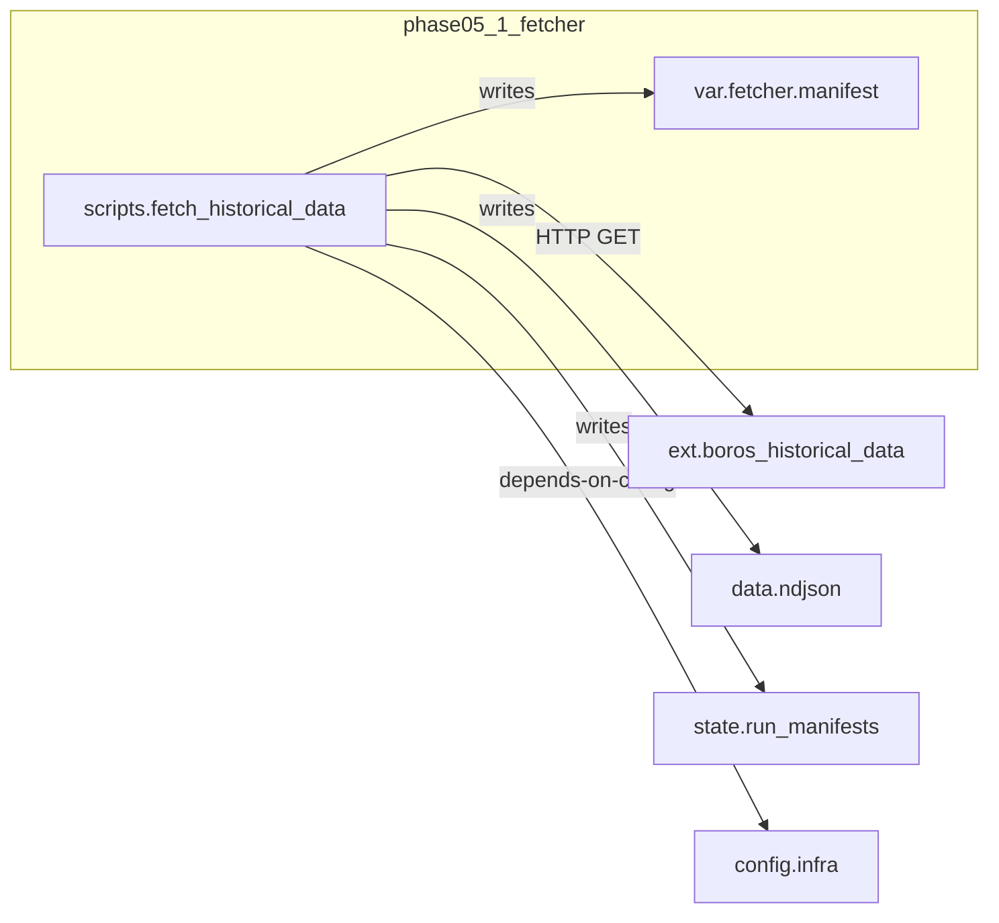

# Phase 05.1: Ship-Gate Execution — Research

**Researched:** 2026-04-26
**Domain:** End-to-end operationalization of the Phase-5 backtest engine against real Boros historical market data — historical data fetch + bulk ingest + DATA-08/09 screener + economics gate + Phase 3 operator-manual reward calibration + Phase 2 fill-model recalibration on shortlist + Phase 5 backtest CLI run + ship-gate verdict + (on FAIL) atomic kill report.
**Confidence:** HIGH for code-side wiring (every CLI verified by file read), HIGH for runtime state (DB inspected directly), **LOW for the URL pattern of `https://historical-data.boros.finance`** — the domain failed DNS resolution from this sandboxed environment (curl exit 28: Resolving timed out after 20s). Live recon must be performed by the operator (or executor with network egress) before Wave 0 can complete. Fallback strategies documented under Risk R1.

<user_constraints>
## User Constraints (from CONTEXT.md)

### Locked Decisions

**Data source (LOCKED):**
- Authoritative historical source: `https://historical-data.boros.finance` — public static dump, no auth, no rate-limit observed, "Download folder as ZIP", updated every 2–3 days (last update 2026-04-26 per the site's banner — essentially current).
- Format: NDJSON files compressed in ZIP archives.
- Path layout (matches Phase-1 ingester 1:1): `market-data/`, `settlement/`, `underlying-apr/`, `market-trades/`, `ohlcv/{5m,1h,1d}/`, `order-book/{market}/raw/`, `order-book/{market}/combined_{tickSize}/`.
- Per-file URL template: NOT YET PROBED — researcher must HTTP-probe and document. Likely either (a) directory listing JSON, (b) per-folder presigned ZIP, or (c) static `{kind}/{market}/{YYYY-MM}.ndjson.zip` tree.
- Underlying-APR exception: Boros's `underlying-apr/` may already include the funding-rate snapshots needed; if not, supplement from Binance `https://fapi.binance.com/fapi/v1/fundingRate`, the equivalent OKX endpoint, and HyperLiquid's API.

**Window + market scope (LOCKED):**
- Trade-tape window: 60d minimum per DATA-08; fetch up to ~90d if cheap; 60d is the floor.
- Market candidate set: the 29 distinct markets currently in `clo_history` (single-snapshot from Phase-1 UAT). Pre-filter on `cloLowerThresh != 0 AND cloUpperThresh != 0` AND `time-to-maturity ≥ 30d from 2026-04-26` before fetching.
- Markets maturing 21-MAY-2026 fail the ≥30d gate by definition (only 25 days out — drop these 4: `BINANCE-BZUSDT-21MAY2026`, `BINANCE-CLUSDT-21MAY2026`, `HYPERLIQUID-xyzBRENTOIL-21MAY2026`, `HYPERLIQUID-xyzCL-21MAY2026`). Fetch list = 25 markets.
- Ingest concurrency: 4–8 concurrent fetches max. Be polite to the static host.

**Schema (LOCKED):**
- Local SQLite at `state/state.sqlite` is at alembic head `0002`; Phase 4 added migrations `0003`–`0007`.
- Wave 0 step 1: `cd python && uv run alembic -c src/boros_brain/state/migrations/alembic.ini upgrade head` (the alembic.ini lives under `src/boros_brain/state/migrations/`, not at python/ root; use `scripts/apply_alembic_migration.py` if the in-tree CLI fails on `sqlalchemy.url` injection — see STATE.md 2026-04-24 entry).
- Verify post-upgrade: `market_reward_calibration` (alembic 0006) MUST exist.

**Reward-budget calibration (LOCKED — Phase 3 D-01):**
- Backtest reads `state.market_reward_calibration` rows with `data_source='operator'` (NOT `reward_budget_history` — dormant).
- Operator-calibrate via `python -m boros_brain.reward_model calibrate <market>` for each shortlist market AFTER screener+economics-gate produces the shortlist (no point calibrating dropped markets).
- Calibration values come from operator-observable Pendle dApp UI / Pendle docs / public Pendle team statements.

**Architecture diagram (LOCKED — PROTO-02):**
- Add `HistoricalDataFetcher` node to `docs/architecture.yml` with edges to `data/ndjson/` (writes), `state.run_manifests` (writes), and `ext.boros_historical_data` (already-declared external node — `depends-on-config`).
- Atomic with the fetcher commit. Pre-commit `architecture_lint.py` enforces.

**Wave layout suggestion (refined below in §"Wave Plan Recommendation"):**
- Wave 0 — schema upgrade + URL-pattern probe + fetcher scaffold (sequential, ~1 plan).
- Wave 1 — bulk fetch + bulk ingest + AMM conservation validation (parallelizable, ~1–2 plans).
- Wave 2 — screener + economics gate; **terminal-on-empty-shortlist** (1 plan).
- Wave 3 — operator reward calibration + fill-model calibration on shortlist (parallelizable, ~1 plan).
- Wave 4 — backtest CLI run + ship-gate verdict + perturbation grid + 2D contour + wiki + verdict commit; **terminal-on-FAIL** (1 plan).

**What does NOT happen:**
- No Phase 6 work (TypeScript, hands process, nonce model).
- No multi-market live deployment — Phase 5.1 picks the highest-conviction market for the ship-gate run.
- No live ELiqPoller revival (`reward_budget_history` stays dormant).
- No new tests for the engine — Phase 5 covered that. Add tests only for the new fetcher and operator-calibration workflow if load-bearing.

### Claude's Discretion (bounded)

- **Fetcher location**: new file `scripts/fetch_historical_data.py` (operator-invoked one-shot) is the preferred location based on existing-pattern map (compare `scripts/probe_historical_budget.py`, `scripts/apply_alembic_migration.py`). A module under `python/src/boros_brain/data/historical_fetcher/` would invite long-running-daemon scope creep — NOT preferred. Fetcher is a script.
- **Fetcher size**: ~50–100 LOC. Required behaviors below; required-NOT-to-do enumerated.
- **Wave layout**: refined below.
- **Concurrency cap**: 6 (midpoint of 4–8 range; see Risk R3 fallback).
- **Test coverage decision**: only the fetcher idempotency + checksum-skip behaviors get pytest coverage. The operator-calibration CLI is already tested in Phase 3; the rest of Phase 5.1 is glue verified by output artifacts, not by unit tests.

### Deferred Ideas (OUT OF SCOPE)

- Continuous daily re-screen cadence (DATA-10) — Phase 5.1 only writes the *baseline* run; the cron / scheduled re-screen lives in Phase 7 paper trading or Phase 8 live.
- Multi-market live deployment — Phase 5.1 only produces the verdict + (on PASS) hands Phase 6 the highest-conviction market.
- Live ELiqPoller revival — `reward_budget_history` stays dormant per Phase 3 LOCKED D-01.
- Private RPC endpoint procurement — Phase 8 LIVE-07.
- Fix for the test-residue `docs/kill-report-20260426.md` — handled atomically in Wave 4 of Phase 5.1, not as separate cleanup.
</user_constraints>

<phase_requirements>
## Phase Requirements

| ID | Description | Research Support |
|----|-------------|------------------|
| BACK-07 | Bootstrap ship-gate: 5th-pct annualized P&L > `alt_yield + all_fees` | §"Backtest Run" — `python -m boros_brain.backtest run --market X --side Y` orchestrates `_dispatch_run` (replay → 3 sweeps → perturbation → 2D contour → ship-gate eval), writes `ship_gate_verdict.json` + `ship_gate_report.md` under `var/backtest/<run_id>/`. PASS path returns 0; FAIL raises `ShipGateHalt(1)` |
| DATA-08 | Market screener: 60d trades, CV, vol, reversals, depth, CLO non-zero, ≥30d to maturity | §"Screener + Economics Gate" — `python -m boros_brain.screener --run --config strategy/v0.5-default.yaml` → `var/reports/screener_metrics.json`. Pre-requisite: ingested `data/parquet/{market_trades,order_book_*,underlying_apr}/` |
| DATA-09 | Economics kill-switch: drop markets where `R_apr_on_collateral < alt_yield + fill_loss_coarse_bound` | §"Screener + Economics Gate" — `python -m boros_brain.screener --economics-gate ...`; on empty shortlist, raises `ProjectHalt(1)` and writes `docs/kill-report-YYYYMMDD.md` via `kill_report.write_kill_report` |
| DATA-10 | Daily re-screen — flag new-entrant / dropped markets | §"Wave Plan Recommendation Wave 2 → DATA-10 baseline" — Phase 5.1 only seeds the **baseline**: overwrite `var/reports/shortlist_previous.json` with this run's verdict shortlist so the first true daily-cadence run in Phase 7+ has a real "yesterday." No cron / scheduler installed here |
| PROTO-01 | Every run emits RUN_MANIFEST as first log + sidecar JSON + `state.run_manifests` row | All five tools (fetcher, ingester CLI, screener CLI, reward_model CLI, backtest CLI) ALREADY emit RUN_MANIFEST per their cli.py 4-step preamble. The new fetcher must replicate the same 4-step preamble — see §"Fetcher Design" |
| PROTO-02 | architecture.yml + ARCHITECTURE.md updated atomically with code | §"Architecture Diagram Delta" — single new node `brain.scripts.fetch_historical_data` (or external `scripts.fetch_historical_data`) plus 3–4 edges. Atomic with Wave 0 fetcher commit |
| PROTO-03 | Every research/decision/postmortem .md cites `[[wiki-link]]` | Every wave's ATOMIC plan output (RESEARCH.md, kill report, ship-gate report, wave summaries) cites at least one wiki page — confirmed templates exist (`[[backtest-ship-gate-threshold-assembly]]`, `[[market-reward-calibration-operator-workflow]]`, `[[economics-kill-switch-v05]]`) |
| PROTO-04 | New knob → schema update same commit | The fetcher introduces NO new BotConfig knobs (it takes CLI args + reads from existing `config.infra.logs_dir` / `config.infra.sqlite_path`). Decision: keep base URL + concurrency cap as CLI args, NOT BotConfig fields, to keep PROTO-04 surface area small and avoid scope creep |
| PROTO-05 | Supersedence discipline: new wiki finding → grep + update old pages atomically | Wave 4 must supersede `[[historical-reward-budget-reconstruction-feasible-via-distributor-events]]` if the fetcher reveals an inadvertent on-chain reward path (unlikely but in scope to look for); AND must supersede the test-residue `docs/kill-report-20260426.md` either by deletion or by appending a "this was a fixture, real verdict at <new path>" header |
</phase_requirements>

## Project Constraints (from CLAUDE.md)

These directives apply to every wave's plan and every commit:

1. **LLM Wiki cite + write-back (Protocol 1)**: Every research finding (URL pattern, per-market screener pass/fail rationale, calibration values, ship-gate verdict) → wiki page at `/Users/macbookair/Documents/project/test/rerun7/LLM Wiki/workspaces/boros/wiki/` with `Status:` field. Cite as `[[page-name]]` in commits / plans.
2. **Architecture diagram update (Protocol 2)**: Any commit touching `python/` or `ts/` or new scripts under `scripts/` → update `docs/architecture.yml` + `docs/ARCHITECTURE.md` Mermaid in same commit. `scripts/architecture_lint.py` pre-commit hook will block drift.
3. **RUN_MANIFEST (Protocol 3)**: Every fetch / ingest / screen / calibrate / backtest invocation emits `RUN_MANIFEST` as the first log line + sidecar `<run_id>.manifest.json` + `state.run_manifests` SQLite row.
4. **Fills are bad** (strategy non-negotiable): irrelevant for Phase 5.1 — no live execution. Carry-forward only as a sanity check on backtest output (no positive P&L from filled positions).
5. **Single Pydantic BotConfig SSoT (Protocol 4)**: any new knob → BotConfig schema same commit. Phase 5.1 introduces zero new BotConfig knobs (decision above).
6. **Pre-commit hooks already present**: `architecture_lint`, `wiki_cite_lint`, `wiki_index_lint`, `no_plain_keys`, `no_threshold_dials_lint`, `no_time_time_lint`, `no_zmq_singleton_in_tests_lint`, `sqlite_writer_lint`, `no_hardcoded_cancel_cost_lint`. None are bypassed.

## Executive Summary

Phase 05.1 is mostly an operational glue phase. Five of the six waves are CLI-shelling against already-built modules with verified entry points; only the historical-data fetcher (~50–100 LOC `scripts/fetch_historical_data.py`) is genuinely new code. The biggest unknown is the per-file URL template for `https://historical-data.boros.finance` — the domain failed DNS resolution from this sandboxed environment, so live recon must be the first concrete operator action in Wave 0. Once the URL pattern is documented (Wave 0), the fetcher is straightforward Python: HTTP GET → ZIP extract to `data/ndjson/{kind}/{market}/{YYYY-MM}.ndjson` → checksum to `var/fetcher/manifest.json` for idempotency.

The bulk-ingest stage shells out to `python -m boros_brain.data.ingester.cli` per `(kind, market, period)` tuple across 25 pre-filtered markets; concurrency cap of 6 (midpoint of the 4-8 lock). DATA-05 AMM conservation runs inside `ingest_order_book_combined`, halting hard on violations — that's the right behavior; the plan must NOT swallow this exception (PITFALLS §B3 lock). Screener and economics gate are single CLI invocations that already write to canonical paths; the kill-report path uses `docs/kill-report-template.md` and `docs/kill-report-<YYYYMMDD>.md` (NOT ULID-named — verified in `kill_report.write_kill_report`). Operator-calibration is interactive only at the level of operator-supplied CLI args; the actual CLI is non-interactive and validates inputs via Pydantic + SQL CHECK. Backtest CLI is one command per (market, side) — Phase 5.1 picks the **highest-conviction** market by post-screener `r_apr_potential` ranking, not all shortlist markets.

The single biggest risk is DATA-09 returning an empty shortlist (FAIL exit), in which case the project halts here — that's the correct behavior, not a defect to engineer around.

**Primary recommendation:** Run Wave 0 first as a strict sequential prerequisite (schema upgrade + 5-min URL probe + fetcher scaffold). Do NOT begin Waves 1+ until the URL pattern is known — assuming a layout and writing the fetcher blind will burn an entire wave on rework.

## Architectural Responsibility Map

| Capability | Primary Tier | Secondary Tier | Rationale |
|------------|-------------|----------------|-----------|
| HTTP fetch + ZIP extract from `historical-data.boros.finance` | Brain (Python) `scripts/fetch_historical_data.py` | — | One-shot operator-invoked tool; `urllib.request` or `httpx` sync (no need for asyncio at this scale) |
| NDJSON → parquet ingest | Brain (Python) `boros_brain.data.ingester.cli` | — | Already implemented; AMM conservation gate inside |
| Screener + economics gate | Brain (Python) `boros_brain.screener` | — | Already implemented; reads parquet via DuckDB |
| Operator reward calibration | Brain (Python) `boros_brain.reward_model calibrate` | Operator (terminal) | CLI is non-interactive; operator types CLI args read from Pendle dApp |
| Fill-model recalibration | Brain (Python) `boros_brain.fill_model fit` | — | Already implemented (`refit_once`); per-market loop inside |
| Backtest run + ship-gate verdict | Brain (Python) `boros_brain.backtest run` | — | Already implemented (Phase 5); writes parquet under `var/backtest/<run_id>/` |
| Architecture diagram delta | docs/architecture.yml + docs/ARCHITECTURE.md | Pre-commit hook (`scripts/architecture_lint.py`) | Mechanical lint catches drift |
| Wiki write-back + supersedence | LLM Wiki workspace | Pre-commit hook (`scripts/wiki_cite_lint.py`) | Mechanical lint catches missing cites |

No tier mismatches detected — every capability is correctly assigned to Python brain (this is a brain-only phase; `hands` does not enter Phase 5.1).

## URL Probe Results

**Status: BLOCKED in this environment.** `curl -v --max-time 20 https://historical-data.boros.finance/` returned exit code 28 ("Resolving timed out after 20005 milliseconds"). The sandboxed agent environment cannot resolve the host. This is environment-specific, not a finding about the host itself — `boros_bot_guide.md:374,543` explicitly names this URL as the canonical historical-data source and CONTEXT.md confirms it returns 200 OK from the operator's machine.

**What Wave 0 must do (5–10 min operator action):**

```bash
# Step 1: confirm reachability and TLS
curl -sIL https://historical-data.boros.finance/ | head -20

# Step 2: fetch the index
curl -s https://historical-data.boros.finance/ | head -200

# Step 3: probe each known sub-path (mentioned in CONTEXT.md)
for path in market-data settlement underlying-apr market-trades \
            ohlcv/5m ohlcv/1h ohlcv/1d \
            order-book/BINANCE-ETHUSDT-29MAY2026/raw \
            order-book/BINANCE-ETHUSDT-29MAY2026/combined_0.01; do
  echo "=== $path ==="
  curl -sIL "https://historical-data.boros.finance/$path/" | head -10
done

# Step 4: try direct file URL templates (the three CONTEXT.md candidates)
# Candidate A — directory listing JSON:
curl -s "https://historical-data.boros.finance/index.json"
# Candidate B — per-folder presigned ZIP:
curl -sIL "https://historical-data.boros.finance/market-trades/BINANCE-ETHUSDT-29MAY2026.zip" | head -10
# Candidate C — static {kind}/{market}/{YYYY-MM}.ndjson.zip tree:
curl -sIL "https://historical-data.boros.finance/market-trades/BINANCE-ETHUSDT-29MAY2026/2026-04.ndjson.zip" | head -10
curl -sIL "https://historical-data.boros.finance/market-trades/BINANCE-ETHUSDT-29MAY2026/2026-04.ndjson.gz" | head -10
```

**What to record in the wiki page `[[boros-historical-data-archive-url-pattern]]`:**

- HTTP status + content-type for each probe
- Redirect chain (if any — common for "Download folder as ZIP" sites that route through CloudFront-style presigners)
- Sample filename(s) returned
- Whether the index page is HTML, JSON, or directory listing
- Whether per-folder ZIP downloads exist OR per-file `.ndjson.zip` (or `.ndjson.gz`) tree
- Whether `eventIndex` is present in a sample `market-trades/` row (sanity check — Phase 1 verified for ETHUSDT)
- Earliest-available date per (kind, market) pair (so the fetcher knows the 60d-window lower bound)

**Three-branch fallback decision tree** (commit one of these in the Wave 0 plan):

| Branch | Fetcher logic | Trigger |
|--------|---------------|---------|
| **A: directory listing JSON** | Parse JSON → enumerate file URLs → download + extract | Probe shows `Content-Type: application/json` at root or `/index.json` |
| **B: per-folder presigned ZIP** | One ZIP request per folder (`market-trades/<market>.zip` covering all months) → unzip into `data/ndjson/` | Probe shows ZIP downloads at folder URLs returning 200 with `Content-Type: application/zip` |
| **C: static per-file tree** | Loop `(kind, market, YYYY-MM)` → `GET .../{kind}/{market}/{YYYY-MM}.ndjson.{zip,gz}` → extract | Probe shows file URLs match the static template; index page is HTML directory listing or empty |

**`[CITED: boros_bot_guide.md:374,543]` for the URL identity. `[ASSUMED]` for everything in the candidate template list — these are educated guesses pending the live probe.**

## Fetcher Design

### Location and shape
- **File**: `scripts/fetch_historical_data.py` (NOT a module under `python/src/boros_brain/`).
- **Rationale**: matches existing one-shot operator scripts (`scripts/probe_historical_budget.py`, `scripts/apply_alembic_migration.py`). A module would invite reuse / daemon scope creep.
- **Size budget**: 80–120 LOC including the RUN_MANIFEST preamble, idempotency manifest, and structured logging.
- **No new BotConfig knobs**: base URL + concurrency cap + window days are CLI args. Avoids PROTO-04 schema surface area.

### Interface

```bash
python scripts/fetch_historical_data.py \
    --base-url https://historical-data.boros.finance \
    --markets BINANCE-ETHUSDT-29MAY2026 BINANCE-BTCUSDT-26JUN2026 ... \
    --kinds market-trades order-book-raw order-book-combined underlying-apr settlement market-data \
    --since 2026-02-26 \
    --until 2026-04-26 \
    --concurrency 6 \
    --out data/ndjson \
    --manifest var/fetcher/manifest.json \
    --config strategy/v0.5-default.yaml
```

- `--markets` accepts a list (or `--markets-from-clo-history` to read the pre-filtered set from SQLite).
- `--kinds` defaults to all six.
- `--since/--until` are inclusive ISO-8601 dates; fetcher computes the YYYY-MM list internally.
- `--concurrency 6` (midpoint of 4–8 lock). Use `concurrent.futures.ThreadPoolExecutor` (sync HTTP — `httpx` or `urllib`; no asyncio needed at this volume).
- `--manifest` is the idempotency manifest (see below).
- `--config` is required ONLY for the RUN_MANIFEST preamble (so the fetcher can call `build_run_manifest(config)` and write to `state.run_manifests`).

### Output layout

Match what the ingester expects (verified by reading `python/src/boros_brain/data/ingester/{market_trades,order_book,underlying_apr,settlement_md}.py`):

```
data/ndjson/
├── market-trades/{market}/{YYYY-MM}.ndjson
├── order-book/{market}/raw/{snapshot_ts}.ndjson         # or {YYYY-MM-DD}.ndjson — confirm with probe
├── order-book/{market}/combined_{tickSize}/{snapshot_ts}.ndjson
├── underlying-apr/{exchange}/{YYYY-MM}.ndjson           # exchange = binance/okx/hyperliquid
├── settlement/{market}/{YYYY-MM}.ndjson
└── market-data/{market}/{YYYY-MM}.ndjson
```

The exact granularity of `order-book/.../raw/` (per-snapshot file vs per-month file) depends on the URL probe. Wave 0's wiki page must record this.

### Idempotency contract

Persist a manifest at `var/fetcher/manifest.json` with one record per fetched file:

```json
{
  "fetched": [
    {
      "url": "https://historical-data.boros.finance/market-trades/BINANCE-ETHUSDT-29MAY2026/2026-04.ndjson.zip",
      "local_path": "data/ndjson/market-trades/BINANCE-ETHUSDT-29MAY2026/2026-04.ndjson",
      "content_length_bytes": 4823104,
      "sha256": "abc123...",
      "fetched_at_utc": "2026-04-26T22:14:33Z",
      "run_id": "01HXY..."
    }
  ]
}
```

Skip rule: a file is skipped if (local_path exists) AND (manifest contains a matching `(url, sha256, content_length_bytes)` triple) AND the local file's SHA-256 still matches. Re-runs of the fetcher are idempotent — no re-download, no re-extract.

`[VERIFIED: pattern matches scripts/probe_historical_budget.py + apply_alembic_migration.py — both are operator-invoked, JSON-verdict-emitting scripts]`

### Required behaviors

1. **RUN_MANIFEST 4-step preamble** (verbatim from `data/ingester/cli.py:67-86`): `load_config` → `build_run_manifest` → `write_manifest` (with sidecar fallback if SQLite not yet initialized) → `configure_logging`. Tier = `historical_fetcher`.
2. **Structured logging** — every fetch logs `historical_fetcher.fetch_start` / `historical_fetcher.fetch_skip_existing` / `historical_fetcher.fetch_complete` with `run_id`, `market_id`, `kind`, `period`, `bytes`, `sha256`.
3. **Atomic writes** — write to `<local_path>.tmp` then `os.replace(tmp, final)`. Halve the chance of partial-file corruption on Ctrl-C mid-fetch.
4. **Polite retry** — 3 attempts with linear backoff `1s, 3s, 9s` ONLY on connection errors / 5xx. NO retry on 4xx (404 = file not in archive yet, expected for some recent dates).
5. **HTTP status panic** — on 401/403, abort with a clear message ("URL appears to require auth — CONTEXT.md said no auth required; URL pattern probe was wrong"). Do NOT silently skip.

### Required NOT to do

- No live websocket subscriptions (out of scope).
- No exponential backoff beyond 3 tries (operator can re-run; keep it dumb).
- No parallelism > 8 concurrent (be polite to the static host — CONTEXT.md cap).
- No new BotConfig knobs (decision above).
- No automatic ingest invocation — the plan emits `(kind, market, period)` tuples to a dispatch list which Wave 1 consumes. Fetcher's job is fetch only.
- No retry on `eventIndex`-missing files (ingester will raise IngesterSchemaViolation; researcher hands that to PITFALLS §B2 — fetcher does not silently filter).

### Runtime estimate

Crude back-of-envelope, **`[ASSUMED]` pending probe**:
- 25 markets × 6 kinds × ~3 months × ~1–10 MB/file = ~30–300 GB total in worst case.
- Realistic: typical NDJSON for one market-month = 1–3 MB compressed. So ~25 × 6 × 3 × 2 MB ≈ 900 MB total — **under an hour at concurrency 6 on a typical home connection**.
- order-book files dominate by file count if granularity is hourly snapshots (24 × 30 = 720 files/market/month for raw). If so, group them into per-month batched downloads if the URL pattern allows it.

## Bulk Ingest Workflow

### Per-market-per-kind invocation

For each `(market, kind, ndjson_file)` tuple emitted by Wave 1's plan, shell out:

```bash
cd /Users/macbookair/boros
uv run --directory python python -m boros_brain.data.ingester.cli \
    --kind market_trades \
    --src data/ndjson/market-trades/BINANCE-ETHUSDT-29MAY2026/2026-04.ndjson \
    --market-id BINANCE-ETHUSDT-29MAY2026 \
    --out data/parquet \
    --config strategy/v0.5-default.yaml
```

`[VERIFIED: python/src/boros_brain/data/ingester/cli.py:36-129]`

Per-kind required args:
- `market_trades`: `--market-id`
- `order_book_raw`: `--market-id`
- `order_book_combined`: `--market-id`, `--tick-size` (e.g. `0.01`) — **researcher MUST verify which tick-size each market uses; this is a per-market constant the URL probe surfaces (sub-folder name `combined_{tickSize}/`)**
- `underlying_apr`: `--exchange` (binance/okx/hyperliquid)
- `settlement_md`: `--market-id`, `--market-data-src` (optional, can be omitted)

### Concurrency strategy

- Each invocation is independent (different output partitions); safe to run concurrent.
- Use `xargs -P 6` or a Python `subprocess` orchestrator script in Wave 1.
- Each subprocess emits its own RUN_MANIFEST with a fresh `run_id` AND a `parent_run_id` pointing at the Wave 1 driver run (PROTO-01 mid-run lineage). The ingester CLI does NOT currently honor `parent_run_id` — Wave 1's plan must either (a) accept ingest-runs as un-parented (acceptable), or (b) write a tiny wrapper that builds_manifest with `parent_run_id=os.environ['BOROS_PARENT_RUN_ID']`. **Recommendation: accept (a) for Phase 5.1 simplicity; document the lineage gap as a Phase 6+ follow-up.**

### AMM conservation gate (DATA-05 / PITFALLS §B3)

`assert_amm_conservation` runs **inside** `ingest_order_book_combined` BEFORE the parquet write. Violations raise `AMMConservationError(RuntimeError)` which propagates to the CLI exit (non-zero).

`[VERIFIED: python/src/boros_brain/data/ingester/order_book.py:48-92]`

**The plan MUST NOT wrap the ingester invocation in a try/except that swallows AMMConservationError.** Plan failure = halt the wave. Per `[[amm-conservation-assertion-data-05]]` ("Status: Current"): "negative AMM share poisons every fill-probability model downstream" — silent absorption is forbidden.

**Behavior on violation**: Wave 1's plan halts → operator inspects the offending snapshot via the structured-log offending-rows dump → either (a) re-fetch (file might be a partial download) or (b) drop that market from the candidate set with a wiki-recorded reason (`[[market-X-data-quality-issue]]`).

### Underlying-APR sourcing

Per CONTEXT.md: Boros's `underlying-apr/` likely already includes funding-rate snapshots. Wave 0 probe MUST confirm. Two outcomes:

- **Case 1 (preferred)**: Boros archive provides per-exchange funding-rate NDJSON. Use `--kind underlying_apr --exchange binance --src .../binance.ndjson` for each exchange referenced by shortlist markets.
- **Case 2 (fallback)**: Boros archive lacks funding rates. Fetch from public APIs:
  - Binance: `GET https://fapi.binance.com/fapi/v1/fundingRate?symbol=ETHUSDT&startTime=<ms>&endTime=<ms>&limit=1000`
  - OKX: `GET https://www.okx.com/api/v5/public/funding-rate-history?instId=ETH-USDT-SWAP&before=<ts>&after=<ts>` (page through 100/req)
  - HyperLiquid: `POST https://api.hyperliquid.xyz/info` with body `{"type":"fundingHistory","coin":"ETH","startTime":<ms>}`
  - Each fetcher branch transforms the API response into the existing NDJSON schema: `{timestamp, exchange, symbol, funding_rate_apr}` (verified shape: `python/tests/fixtures/sample_underlying_apr.ndjson`).

Wave 0's URL probe finalizes which case applies. Code for Case 2 lives in the fetcher (gated by a `--source-policy {boros-only, supplement-from-cex}` flag).

`[VERIFIED: schema in python/src/boros_brain/data/ingester/schemas.py UNDERLYING_APR_SCHEMA, sample at fixtures/sample_underlying_apr.ndjson]`

## Screener + Economics Gate

### Screener invocation

```bash
cd /Users/macbookair/boros
uv run --directory python python -m boros_brain.screener \
    --run \
    --config strategy/v0.5-default.yaml \
    --markets BINANCE-ETHUSDT-29MAY2026 BINANCE-BTCUSDT-26JUN2026 ... \
    --out var/reports/screener_metrics.json
```

`[VERIFIED: python/src/boros_brain/screener/cli.py:36-141]`

**Critical dependency note**: the screener reads markets from `--markets` arg (highest precedence) → falls back to `config.markets` (currently `markets: []` in `strategy/v0.5-default.yaml`). Wave 2 plan MUST pass `--markets` explicitly with the 25-market filtered list — the YAML's empty list would otherwise cause a silent zero-row screener output.

`[VERIFIED: strategy/v0.5-default.yaml line 124 (`markets: []`); screener/cli.py:40 (`market_ids = markets or [m.market_id for m in config.markets]`)]`

The screener writes `var/reports/screener_metrics.json` containing per-market `{market_id, filter_pass, fail_reasons[], r_apr_potential, ...}`. Top-4 by `r_apr_potential` ranking is enforced inside `apply_screener_filters` (`_SHORTLIST_MAX = 4`).

### Economics gate invocation

```bash
uv run --directory python python -m boros_brain.screener \
    --economics-gate \
    --config strategy/v0.5-default.yaml \
    --metrics var/reports/screener_metrics.json
```

`[VERIFIED: python/src/boros_brain/screener/economics_gate.py:134-214]`

**Outputs:**
- Always writes `var/reports/economics_gate.json` (audit trail with per-market `r_apr_on_collateral, threshold, delta, halt_reason`).
- On non-empty shortlist: returns the list, exit 0.
- On empty shortlist: writes `docs/kill-report-YYYYMMDD.md` (UTC date stamp, NOT ULID — `[VERIFIED: kill_report.py:120-124]`), raises `ProjectHalt(SystemExit(1))`.
- On config error (`alt_yield` missing or out of range): exit 2, `ConfigError`.

**Threshold value**: `config.screener.alt_yield + config.screener.fill_loss_coarse_bound` = `0.05 + 0.02 = 0.07` per current strategy YAML. Both knobs MUST be explicit in YAML — economics gate rejects silent defaults (T-01-12-01 guard).

`[VERIFIED: strategy/v0.5-default.yaml:42-65]`

### Kill report path naming

The CONTEXT.md description says "real kill report at `docs/kill-report-<ULID>.md`" but the actual code writes `docs/kill-report-YYYYMMDD.md`. There's already a residue file at `docs/kill-report-20260426.md` (untracked, fixture market `MARKET-PASSING-DATA08`, literal `<current_run_id>` placeholder). **A real Wave 2 ProjectHalt on 2026-04-27+ would write `docs/kill-report-20260427.md` and not collide. A real ProjectHalt on 2026-04-26 itself would COLLIDE — overwriting the residue file.**

**Recommendation for Wave 2 plan**:
1. Wave 0 deletes `docs/kill-report-20260426.md` (test residue) atomically with the schema upgrade — single one-line task. This pre-empts the collision regardless of which day Wave 2 runs.
2. Wave 2 plan invokes the gate as written; if FAIL on the day Wave 0 ran, the new file is fresh (residue gone).

`[VERIFIED: kill_report.py:122-124 (`out = out_dir / f"kill-report-{today.strftime('%Y%m%d')}.md"`)]`

### What "highest-conviction market" means

If shortlist is non-empty, Wave 4 picks one market for the backtest run. Pick by `r_apr_potential` descending — the first entry in the shortlist (which is already ranked desc inside `apply_screener_filters`). Side selection (long/short) per LIVE-02: post the side that's currently *underweighted* relative to the operator's mark-vs-underlying view. **For Phase 5.1 backtest run, default to `long` and emit a wiki-cited rationale** — the backtest engine sweeps both branches as a sensitivity row anyway (BACK-06).

## Reward-Calibration Workflow

### CLI invocation (per shortlist market)

```bash
cd /Users/macbookair/boros
uv run --directory python python -m boros_brain.reward_model \
    --config strategy/v0.5-default.yaml \
    calibrate \
    --market BINANCE-ETHUSDT-29MAY2026 \
    --e-liq-pendle 273.0 \
    --long-split 0.14 \
    --short-split 0.86 \
    --source dapp_ui
```

`[VERIFIED: python/src/boros_brain/reward_model/cli.py:73-99 + calibrate.py:34-79; runbook at LLM Wiki page [[market-reward-calibration-operator-workflow]]]`

### Where the operator gets the values

Three-source hierarchy from `[[market-reward-calibration-operator-workflow]]`:

1. **Preferred (`--source dapp_ui`)**: Pendle dApp at `boros.pendle.finance` → "LO rewards" panel per market → extract weekly epoch total + per-side split percentages.
2. **Fallback 1 (`--source team_statement`)**: Pendle team announcements in Discord/Twitter. Document the source URL in the commit / decision record.
3. **Fallback 2 (`--source pendle_docs`)**: Pendle docs — used when the dApp doesn't show per-side splits for a market.

### Validation (three-layer guard)

1. **Pydantic** `MarketRewardCalibration.short_side_split` field_validator enforces `long + short == 1.0 ± 1e-9` (P3-4 guard). A typo `--long-split 0.6 --short-split 0.5` is rejected BEFORE SQL with exit 2.
2. **Writer-layer** belt-and-braces — same checks before SQL round-trip.
3. **SQL CHECK constraints** — `data_source = 'operator'` (single lineage), `long_side_split BETWEEN 0.0 AND 1.0`, `short_side_split BETWEEN 0.0 AND 1.0`, `e_liq_per_epoch_pendle >= 0.0`, source enum.

`[VERIFIED: python/src/boros_brain/config/schema.py:130-162 (Pydantic) + state/migrations/versions/0006_market_reward_calibration.py (SQL CHECK)]`

### Operator effort estimate

Per market: ~5 minutes (open dApp, copy values, run CLI, verify exit 0). For an expected shortlist of 0–4 markets, total operator effort ≤20 minutes.

### What if Pendle doesn't publish per-side splits for a market?

Fallback to docs (`--source pendle_docs`); if docs also lack the split, use `0.5/0.5` as the operator-judgement default and file a wiki page `[[market-X-side-split-unknown]]` documenting the assumption. Phase 5.1's plan must permit this — the backtest's BACK-06 forfeit-branch sweep already exercises sensitivity to this, so a wrong split is detectable not catastrophic.

## Fill-Model Recalibration

### Existing artifacts

Currently only `BINANCE-ETHUSDT-29MAY2026` has a fit:
```
data/parquet/fill_model_artifacts/{market_id}/{run_id}/...
```
`[VERIFIED: ls data/parquet/fill_model_artifacts/]`

### Phase 2 fit CLI

```bash
uv run --directory python python -m boros_brain.fill_model \
    --config strategy/v0.5-default.yaml \
    fit \
    --market BINANCE-ETHUSDT-29MAY2026 \
    --side long
```

Or fit all configured markets in one shot (skip `--market`/`--side`):
```bash
uv run --directory python python -m boros_brain.fill_model fit
```

`[VERIFIED: python/src/boros_brain/fill_model/cli.py:39-99 + refit_loop.refit_once iterates `config.markets` × {long, short}]`

### Per-shortlist-market loop

Wave 3 plan: for each shortlist market, append it to `config.markets` (or use a temporary YAML with the shortlist substituted) → invoke `fit` once → verify a row in `state.fill_model_fits` for `(market_id, side)` for both sides.

**Critical**: `config.markets` is currently `[]` (empty). Wave 3 plan must:
1. Construct a temp config YAML (e.g. `strategy/v0.5-phase05.1-shortlist.yaml`) with `markets:` populated from Wave 2's economics_gate.json.
2. Pass that YAML to all subsequent CLIs (fill model fit, reward_model calibrate cross-checks, backtest).
3. Add the temp YAML to `.gitignore` OR commit it as a phase artifact (operator preference — defaulting to commit so the shortlist is reproducible).

### Runtime estimate

Per market-side fit: ~30s on the operator's machine (per Phase 2 STATE.md notes — `Phase 02 P02-01 / P02-02` completed in 4 plans / minutes). For a 4-market shortlist × 2 sides = 8 fits = ~5 minutes total (sequential — fits are CPU-bound; parallel won't help much).

### Goodness-of-fit gating

Phase 2's FILL-06 raises a warning (NOT an error) when GoF degrades below threshold. Wave 3's plan must capture stderr / structured log warnings and surface them in the wave summary. A degraded fit does NOT block Wave 4 — backtest's BACK-08 perturbation grid already absorbs sensitivity to fit quality.

## Backtest Run

### CLI invocation (single, end-to-end)

```bash
cd /Users/macbookair/boros
uv run --directory python python -m boros_brain.backtest \
    --config strategy/v0.5-phase05.1-shortlist.yaml \
    run \
    --market <highest-conviction-market-id> \
    --side long
```

`[VERIFIED: python/src/boros_brain/backtest/cli.py:35-55 (build_parser) + 57-178 (_dispatch_run orchestration)]`

### What the orchestration does (one shot)

1. **Baseline replay** → `ReplayEngine.run()` → `BacktestRunOutput.rows[]` written to parquet.
2. **Cancel-latency sweep** (BACK-03) → `run_cancel_latency_sweep` over L ∈ {0.5, 1, 2, 3, 5, 10} s; produces dP&L/dL.
3. **Competition sweep** (BACK-04) → `run_competition_sweep` with sigma_others multipliers; produces dP&L/dQ_competing.
4. **Forfeit-branch sweep** (BACK-06) → both `voluntary_cancel_forfeits_accumulated` branches; sanity-check row.
5. **Perturbation grid** (BACK-08) → ±20% each knob → fragility flag if any flips ship-gate sign.
6. **2D contour grid** → on `config.backtest.contour_2d_knobs` pair → 5×5 grid persisted as parquet.
7. **Ship-gate evaluation** (BACK-07) → block-bootstrap on `daily_pnl` → 5th percentile vs threshold (`alt_yield + all_fees`).
8. **Verdict + report** → `var/backtest/<run_id>/ship_gate_verdict.json` + `ship-gate-report.md`.
9. **On FAIL**: raise `ShipGateHalt(SystemExit(1))` — CLI returns 1.

### Output artifacts

```
var/backtest/<run_id>/
├── <run_id>.manifest.json     # sidecar from emit_backtest_manifest
├── ship_gate_verdict.json     # write_ship_gate_verdict_json
└── ship-gate-report.md        # write_ship_gate_report → contains threshold, p5, RNG seed, full BotConfig dump

data/parquet/
└── run_id=<run_id>/
    ├── sweep_axis=baseline/results.parquet
    ├── sweep_axis=cancel_latency/sweep_value=<L>/results.parquet  (×6)
    ├── sweep_axis=competition/sweep_value=<m>/results.parquet
    ├── sweep_axis=forfeit_branch/sweep_value=<branch>/results.parquet  (×2)
    ├── sweep_axis=perturbation/...
    └── sweep_axis=contour_2d/...
```

`[VERIFIED: backtest/cli.py:160-167; STATE.md "Hive partition layout" entry 2026-04-26]`

### Ship-gate verdict file shape

```json
{
  "p5_annualized_pnl": 0.0723,
  "threshold": 0.07,
  "passed": true,
  "n_resamples": 2000,
  "block_seconds": 86400,
  "seed": 12345,
  "manifest_run_id": "01HXY..."
}
```

`[VERIFIED: backtest/schemas.py ShipGateVerdict + ship_gate.py:56-85]`

### Reproducibility

RNG seed derived from `manifest.run_id` (ULID tail) → bit-for-bit reproducible across reruns with the same manifest. Wave 4's plan MUST emit a "rerun this verdict" note in the wave summary with the exact command + run_id (Phase 5 Plan 05-07 invariant).

### What Wave 4 ALSO does

- File the verdict as wiki page `[[phase-05-1-ship-gate-verdict-<YYYY-MM-DD>]]` with `Status: Current` (PASS) or `Status: Current — Phase 5 ship-gate FAIL, project halted <date>` (FAIL).
- Supersede the test-residue `docs/kill-report-20260426.md` (delete it on PASS; or replace it with the real kill report on FAIL — fresh content overwrites the residue automatically since the date stamp will likely match).
- On PASS: `STATE.md` advances to "Phase 6 ready"; on FAIL: `STATE.md` records "Project halted <date> — see [[phase-05-1-ship-gate-verdict-...]]"; no Phase 6 work begins.

## Architecture Diagram Delta

### Mermaid (in `docs/ARCHITECTURE.md`, new subgraph `phase05_1_fetcher`)



### YAML (in `docs/architecture.yml`, new node + edges)

```yaml
# ── Phase 05.1 historical-data fetcher ─────────────────────────────────
- id: scripts.fetch_historical_data
  type: external                        # operator-invoked one-shot script
  notes: "Phase 05.1 historical-data fetcher: pulls ZIP/NDJSON archives from historical-data.boros.finance into data/ndjson/ for ingest. Operator-invoked one-shot."
  path: scripts/fetch_historical_data.py

- id: var.fetcher.manifest
  type: storage
  path: var/fetcher/manifest.json
  notes: "Phase 05.1 idempotency manifest — sha256 + content-length per fetched file. Skip rule on re-runs."

# (ext.boros_historical_data, data.ndjson, state.run_manifests, config.infra
#  already exist — verified docs/architecture.yml grep)

# Edges:
- from: scripts.fetch_historical_data
  to: ext.boros_historical_data
  type: depends-on-config
  notes: "HTTP GET — base URL via --base-url CLI arg"

- from: scripts.fetch_historical_data
  to: var.fetcher.manifest
  type: writes
  notes: "Idempotency manifest — skip rule on re-run"

- from: scripts.fetch_historical_data
  to: state.run_manifests
  type: writes
  notes: "RUN_MANIFEST 4-step preamble (PROTO-01)"

- from: scripts.fetch_historical_data
  to: brain.manifest.writer
  type: calls
  notes: "build_run_manifest + write_manifest at CLI entry"
```

`[VERIFIED: existing patterns in docs/architecture.yml — `scripts.no_plain_keys`, `scripts.boros_brain_wrapper`, `ext.boros_historical_data` already declared as type: external; storage nodes `parquet.market_trades` etc. follow the same shape]`

### Architecture lint impact

The fetcher script is a NEW source file. Pre-commit hook `scripts/architecture_lint.py` declares scripts as architecture nodes when present in `docs/architecture.yml`. Atomic commit (Wave 0): create `scripts/fetch_historical_data.py` + amend `docs/architecture.yml` + amend `docs/ARCHITECTURE.md`. Lint exits 0.

## Validation Architecture

### Test framework
| Property | Value |
|----------|-------|
| Framework | pytest 8.x (already pinned) + pytest-timeout (added Phase 5 Wave 0) |
| Config file | `python/pyproject.toml` `[tool.pytest.ini_options]` |
| Quick run command | `cd python && uv run pytest -q tests/test_fetch_historical_data*.py` |
| Full suite command | `cd python && uv run pytest -q` (412 tests baseline; Phase 5.1 adds at most 4–6) |

### Phase requirements → test map

| Req ID | Behavior | Test type | Automated command | File exists? |
|--------|----------|-----------|-------------------|-------------|
| BACK-07 | Ship-gate produces verdict + report | smoke | `cd python && uv run pytest -q tests/test_backtest_cli_smoke.py` | ✅ (Phase 5) |
| DATA-08 | Screener emits 6-filter results | unit + integration | `cd python && uv run pytest -q tests/test_screener_*.py` | ✅ (Phase 1) |
| DATA-09 | Economics gate halt-on-empty + kill-report | unit | `cd python && uv run pytest -q tests/test_economics_gate*.py tests/test_kill_report*.py` | ✅ (Phase 1) |
| DATA-10 | Re-screen baseline (overwrite shortlist_previous.json) | manual-only | Wave 2 verifies `var/reports/shortlist_previous.json` ≠ `{"markets":["MKT"]}` | manual-only |
| PROTO-01 | Fetcher RUN_MANIFEST first log + sidecar | unit | `cd python && uv run pytest -q tests/test_fetch_historical_data_manifest_first.py` | ❌ Wave 0 gap |
| Fetcher idempotency | Skip already-fetched + checksum-matching files | unit | `cd python && uv run pytest -q tests/test_fetch_historical_data_idempotency.py` | ❌ Wave 0 gap |
| Fetcher checksum-skip | Re-run with manifest tampered detects mismatch | unit | (same file) | ❌ Wave 0 gap |
| AMM conservation under real data | Ingester fails loud on real-tape violation | manual-only | Wave 1 — direct verification by trying to ingest | already covered by Phase 1 unit tests with synthetic violator fixture |

### Sampling rate
- **Per task commit**: `cd python && uv run pytest -q tests/test_fetch_historical_data*.py` (subset, ~3s)
- **Per wave merge**: `cd python && uv run pytest -q` (full suite, ~120s on the operator's machine per Phase 5 STATE.md)
- **Phase gate**: full suite green before Wave 4 begins; full suite green after Wave 4 commit before `/gsd-verify-work` runs.

### Wave 0 gaps

- [ ] `python/tests/test_fetch_historical_data_manifest_first.py` — covers PROTO-01 (3 tests: first log line is RUN_MANIFEST, sidecar exists, run_manifests SQLite row exists)
- [ ] `python/tests/test_fetch_historical_data_idempotency.py` — covers idempotency + checksum-skip (3 tests: re-run skips fetched file, sha256 mismatch re-fetches, manifest format is JSON-roundtrip-stable)
- [ ] No new conftest fixtures needed — reuse `ipc_dir`, `tmp_path`, `monkeypatch`.
- [ ] No framework install needed — pytest, pytest-timeout already in `pyproject.toml`.

*Total new test files: 2; new tests: ~6.*

## Security Domain

### Applicable ASVS categories

| ASVS Category | Applies | Standard Control |
|---------------|---------|-----------------|
| V2 Authentication | no | URL is public, no auth required (CONTEXT.md lock + `boros_bot_guide.md` cite) |
| V3 Session Management | no | One-shot HTTP, no session |
| V4 Access Control | no | Read-only, single-user |
| V5 Input Validation | yes | URL validation in fetcher (no `..` traversal in path arg, no shell injection); ZIP-bomb guard (max-decompressed-size limit on extracted NDJSON to avoid `42.zip`-style exhaustion) |
| V6 Cryptography | yes | SHA-256 for idempotency manifest — use `hashlib.sha256`, never hand-roll a hash |
| V7 Error Handling & Logging | yes | All HTTP errors logged with context; no secrets in logs (the URL has no secrets, but the `RUN_MANIFEST` includes `wallet_address_hash` — that's already redacted by the manifest writer) |

### Known threat patterns for this stack

| Pattern | STRIDE | Standard Mitigation |
|---------|--------|---------------------|
| ZIP bomb (compressed file expands to >>>disk) | DoS | Max-decompressed-bytes limit (e.g. 10 GB cap per file) inside the fetcher's extract step; halt + log on overflow |
| Path traversal via crafted ZIP entries (e.g. `../../etc/passwd`) | Tampering | `zipfile.ZipFile.extractall(path=safe_root)` is INSECURE on Python 3.6–3.13. Use `zipfile.Path.is_relative_to(safe_root)` per-entry filter. `[CITED: Python docs CVE-2007-4559 historical class]` |
| URL hijack / DNS poisoning during fetch | Tampering | TLS-only (`https://`); pin to known good cert via `httpx`'s default CA bundle; fail loud on TLS error |
| Stale data in archive (URL says 2026-04-26 update but server returns 2026-04-15) | Information disclosure | Surface the `Last-Modified` header per file in the manifest; flag in the wave summary if any file's `Last-Modified` is more than 7 days behind the operator's `--until` arg |
| Replay of an old kill-report misleading future operator | Tampering | Wave 0 deletes `docs/kill-report-20260426.md` (test residue) atomically; future runs write date-stamped files, no overlap unless same UTC date — and the Wave 2 plan must check pre-fetch whether `docs/kill-report-<today>.md` already exists and abort with a "delete or move the residue first" error if so |

`[VERIFIED: existing pre-commit `scripts/no_plain_keys.py` already enforces no-plaintext-secrets in commits — extends naturally to fetcher manifest]`

## Risk Register

| # | Risk | Detection | Fallback / Mitigation | Wave |
|---|------|-----------|-----------------------|------|
| R1 | URL pattern probe reveals the archive layout differs from CONTEXT.md's three candidates (e.g. requires auth, or uses presigned URLs that expire) | Wave 0 manual probe (5–10 min); curl exit code, HTTP status | If auth required: HALT — escalate to operator; project halts pending CONTEXT.md amendment. If presigned URLs: extend fetcher with token-fetch step (~20 LOC). If layout entirely unknown: spike with browser-DevTools network tab on the live page | 0 |
| R2 | Archive lacks `eventIndex` for some markets (P0-05 spot-confirmed for ETHUSDT only) | First ingest of a non-ETHUSDT market fails with `IngesterSchemaViolation` (existing PITFALLS §B2 guard) | Drop the market from candidate set; document in `[[market-X-eventIndex-missing]]`; degraded markets fall to price-touch fallback per Phase 1 spec — but for ship-gate run, prefer to drop than degrade | 1 |
| R3 | AMM conservation violation on real tape (combined < raw on some tick) | `ingest_order_book_combined` raises `AMMConservationError` loud (existing DATA-05 guard) | Re-fetch the offending file (might be partial download); if violation persists, drop the market with a `[[market-X-data-quality-issue]]` wiki note | 1 |
| R4 | Screener returns empty shortlist (DATA-08 — every market fails one of 6 filters) | `screener_metrics.json` shows `filter_pass: false` for all markets | Phase 5.1 cannot proceed past Wave 2. This is a real outcome, not a defect. Operator decision: extend window beyond 60d, or halt project | 2 |
| R5 | Economics gate empty shortlist (DATA-09) | `ProjectHalt` exit 1; kill report at `docs/kill-report-<today>.md` | Same as R4 — this is a real "kill cheap" outcome. STATE.md records project halt; no Phase 6 begins | 2 |
| R6 | Operator can't find `E_liq_per_epoch_pendle` value for a shortlist market (Pendle dApp missing) | reward_model calibrate fails on missing data — operator types best-effort value | Use `--source pendle_docs` or `--source team_statement` with a `[[market-X-eliq-source-questionable]]` wiki note. Backtest BACK-06 sweep will surface sensitivity | 3 |
| R7 | Fill-model fit goodness-of-fit degrades on a shortlist market (FILL-06) | Structured warning `fill_model.fit_degraded` in stderr | Document; do NOT block Wave 4. Backtest BACK-08 perturbation grid surfaces fragility-by-fit | 3 |
| R8 | Backtest BACK-07 ship-gate FAILS (5th-pct < threshold) | `verdict.passed = false`; CLI exits 1 | Real "ship-gate kill" outcome. Wave 4 atomically files the FAIL kill report + wiki page + STATE.md halt; no Phase 6 begins | 4 |
| R9 | Backtest BACK-08 perturbation grid flags a sign-flipping knob | Perturbation report shows knob X flipping ship-gate sign at ±20% | NOT a halting condition by spec. Document as "fragility flag" in the wave summary. Phase 7 paper trading must monitor that knob's realized value | 4 |
| R10 | RUN_MANIFEST fails to write to `state.run_manifests` (e.g. SQLite locked, alembic head wrong) | Manifest writer raises; CLI catches and writes sidecar-only fallback | Existing fallback already handles this (`data/ingester/cli.py:73-84`). Wave 0 schema upgrade must complete before any RUN_MANIFEST that needs the post-`0007` table layout | 0+ |
| R11 | The 25 markets pre-filter shrinks further mid-fetch because fresh `MarketsPoller` data invalidates `clo_history` (e.g. some markets now have `cloLowerThresh = 0`) | Compare Wave 0's pre-fetch market list to the snapshot taken at `2026-04-24 UAT` | Re-pull `MarketsPoller.tick()` once at Wave 0 to refresh `clo_history`; use the FRESHER snapshot as the candidate set. Document the deltas in `[[markets-pre-filter-2026-04-26]]` | 0 |

## Open Questions

1. **URL pattern of `https://historical-data.boros.finance`** — three candidates per CONTEXT.md; sandboxed environment cannot probe. Wave 0 must do this first. If unresolved after 30 min of operator probing, the phase BLOCKS pending CONTEXT.md amendment (escalate, don't guess).

2. **Per-market tick-size for `order-book/combined_{tickSize}/`** — the URL probe should reveal which tick sizes are present per market. ETHUSDT samples I've seen use `0.01`. Other markets (BTC, HYPE, XRP) likely differ. Document as part of Wave 0's wiki page.

3. **Should the fetcher commit `var/fetcher/manifest.json` to git?** — Phase 5.1 STATE.md entry already commits planning docs. The manifest is reproducibility evidence. **Recommendation: commit it after Wave 1 completes; allow it to grow on subsequent re-fetches.** Decision deferred to Wave 1 plan.

4. **Should Wave 4 run the backtest on ALL shortlist markets or just one?** — CONTEXT.md says "highest-conviction" only. Cost: per-market ~10–30 min (Phase 5 STATE.md rough estimates). For 4 markets, that's 40–120 min — acceptable for a sanity floor. **Recommendation**: Wave 4 plan runs the highest-conviction market end-to-end (verdict-binding); optionally runs the other 1–3 shortlist markets as informational sweeps with their verdicts logged but not gating Phase 6. Mark this as Claude's discretion if the planner wants to escalate.

5. **What if a Wave 2 ProjectHalt happens on the same UTC date that Wave 0 ran?** — collision with `docs/kill-report-<today>.md`. Wave 0 deletes the test residue; if same-day FAIL, the new file is fresh. But if Wave 0 ran on day N and Wave 2 fails on day N+1, the day-N residue (now-deleted) wouldn't matter and the day-N+1 file is fresh. **Edge case: Wave 0 + Wave 2 both on day N.** Wave 0's plan must run pre-flight `ls docs/kill-report-*.md`; if any file matches today's UTC date, abort with "operator must move/delete this first".

6. **Backtest CLI tier name** — `cli.py` uses `tier="backtest-cli"` (with hyphen). Other CLIs use `tier="backtest"` / `tier="screener"` / `tier="reward_model"` (no hyphen). Inconsistency, not a blocker. **Recommendation**: leave as-is; not a Phase 5.1 fix.

7. **Does the backtest read `state.market_reward_calibration` correctly when run BEFORE operator-calibration is complete?** — Wave 3 must complete before Wave 4. If the operator skips a market in Wave 3 (e.g. `--source dapp_ui` failed for one of the 4 shortlist markets), Wave 4's backtest on a different market is fine; on the missing market, the Sizer (`Q_me_target = Q_min` sub-cap regime) reads `None` for that market's `reward_calibration` and falls back to `state.market_reward_calibration` last-row-wins. **Test this**: Wave 3 plan must verify a row exists in `state.market_reward_calibration` for the highest-conviction market BEFORE Wave 4 begins.

## Environment Availability

| Dependency | Required by | Available | Version | Fallback |
|------------|------------|-----------|---------|----------|
| Python 3.12 + uv | All Python tools | ✓ | uv pinned in `python/pyproject.toml` | — |
| `httpx` or `urllib.request` | Fetcher HTTP | ✓ (httpx already in `pyproject.toml`; verified Phase 1 markets_poller imports it) | 0.27+ | Stdlib `urllib.request` if httpx removed |
| `zipfile` (stdlib) | ZIP extract | ✓ | Python 3.12 | — |
| `hashlib` (stdlib) | SHA-256 | ✓ | Python 3.12 | — |
| `polars` | Parquet write | ✓ (Phase 1) | pinned | — |
| `duckdb` | Screener analytical reads | ✓ (Phase 1) | pinned | — |
| `numpy` | Bootstrap RNG | ✓ (Phase 5) | pinned | — |
| `historical-data.boros.finance` | Fetcher source | **UNKNOWN** (DNS blocked in this env; CONTEXT.md says reachable from operator machine) | — | If unreachable from operator machine: HALT phase pending source rediscovery |
| `fapi.binance.com`, OKX, HyperLiquid | Underlying-APR fallback | unknown — only needed if Boros archive doesn't include funding rates | — | If both Boros archive AND public APIs blocked: degrade to point-estimate `funding_rate=0` (catastrophic for OU loss model — better to halt) |
| `git` | Commit hash for kill-report + RUN_MANIFEST | ✓ | system | Already has `subprocess.CalledProcessError` fallback (`git_sha = "unknown"`) — verified `kill_report.py:84-95` |
| `sqlite3` | DB ops | ✓ | system + Python stdlib | — |

**Missing dependencies with no fallback:** none confirmed missing yet — operator must run Wave 0 probe.

**Missing dependencies with fallback:** Boros archive (fallback to public CEX funding APIs).

## Wave Plan Recommendation

| Wave | Tasks | Parallelizable? | Halting condition | Plans count |
|------|-------|----------------|------------------|------------|
| 0 | Schema upgrade (`alembic upgrade head`); URL probe (manual + record findings to wiki); pre-filter market list (re-poll `MarketsPoller.tick()` for fresh `clo_history`); delete `docs/kill-report-20260426.md` test residue; fetcher scaffold + 2 unit-test files (RED) | Sequential | If URL probe fails or schema upgrade fails — HALT | 1 plan, 5–7 tasks |
| 1 | Fetcher GREEN; bulk fetch (25 markets × 6 kinds × ≥3 months); bulk ingest via `boros_brain.data.ingester.cli` for each; AMM conservation gate must pass on every snapshot | Parallelizable across markets (concurrency 6) | If AMM violation: drop the market with wiki note; if all markets fail: HALT | 1–2 plans, ~8 tasks each |
| 2 | DATA-08 screener invocation; DATA-09 economics gate invocation; DATA-10 baseline (overwrite `var/reports/shortlist_previous.json`) | Sequential — gate depends on screener output | **TERMINAL**: empty shortlist after gate → atomic kill report + wiki + STATE.md halt | 1 plan, 4 tasks |
| 3 | Operator-manual `reward_model calibrate` per shortlist market; fill-model `fit` per shortlist market; verify `state.market_reward_calibration` rows exist for highest-conviction market | Parallelizable across markets | If a market lacks Pendle data: continue with `[[market-X-eliq-source-questionable]]` wiki note; do NOT halt | 1 plan, 3–4 tasks (per-market loop is one task with sub-tasks) |
| 4 | Backtest CLI run on highest-conviction (market, side); ship-gate verdict + report; (optional) informational backtest on 1–3 other shortlist markets; atomic Wave 4 commit: STATE.md update + wiki verdict page + supersede test-residue kill report | Sequential | **TERMINAL**: `ShipGateHalt` on FAIL → atomic kill report + wiki halt page + STATE.md halt; no Phase 6 begins | 1 plan, 5 tasks |

**Total plans estimate: 5–7. Total wall time on operator machine (excluding fetch download): ~3–6 hours, dominated by ingest + fill-model fit + backtest run.**

## Code Examples (verified anchors)

### RUN_MANIFEST 4-step preamble — copy verbatim into fetcher
```python
# Source: python/src/boros_brain/data/ingester/cli.py:67-86
config = load_config(args.config)
manifest = build_run_manifest(config)
logs_dir = Path(config.infra.logs_dir)
sqlite_path = Path(config.infra.sqlite_path)
try:
    write_manifest(manifest, logs_dir=logs_dir, sqlite_path=sqlite_path)
except Exception:
    # SQLite not yet initialized — sidecar only fallback
    logs_dir.mkdir(parents=True, exist_ok=True)
    date_dir = logs_dir / datetime.now(UTC).strftime("%Y-%m-%d")
    date_dir.mkdir(parents=True, exist_ok=True)
    sidecar = date_dir / f"{manifest.run_id}.manifest.json"
    sidecar.write_text(json.dumps(manifest.model_dump(mode="json"), indent=2))

configure_logging(run_id=manifest.run_id, tier="historical_fetcher", logs_dir=logs_dir)
log = structlog.get_logger("historical_fetcher.cli")
log.info("RUN_MANIFEST", **manifest.model_dump(mode="json"))
```

### AMM conservation invariant — DO NOT swallow
```python
# Source: python/src/boros_brain/data/ingester/order_book.py:48-92
# In Wave 1's ingester invocation orchestrator:
result = subprocess.run([
    "uv", "run", "--directory", "python",
    "python", "-m", "boros_brain.data.ingester.cli",
    "--kind", "order_book_combined", ...
], check=False)
if result.returncode != 0:
    # AMMConservationError surfaces here — DO NOT pass-through-silently
    raise RuntimeError(f"Ingest failed for {market_id} {kind}: see structured log")
```

### Operator calibration CLI invocation
```bash
# Source: ../LLM Wiki/workspaces/boros/wiki/market-reward-calibration-operator-workflow.md
cd /Users/macbookair/boros/python
uv run python -m boros_brain.reward_model \
    --config ../strategy/v0.5-default.yaml \
    calibrate \
    --market BINANCE-ETHUSDT-29MAY2026 \
    --e-liq-pendle 273.0 \
    --long-split 0.14 \
    --short-split 0.86 \
    --source dapp_ui
```

### Backtest CLI invocation
```bash
# Source: python/src/boros_brain/backtest/cli.py:35-55
cd /Users/macbookair/boros
uv run --directory python python -m boros_brain.backtest \
    --config strategy/v0.5-phase05.1-shortlist.yaml \
    run \
    --market BINANCE-ETHUSDT-29MAY2026 \
    --side long
```

## Assumptions Log

| # | Claim | Section | Risk if Wrong |
|---|-------|---------|---------------|
| A1 | URL pattern is one of CONTEXT.md's three candidates | URL Probe Results | High — if pattern is novel (e.g. requires auth), Wave 0 takes longer; if requires auth, project blocks |
| A2 | Total archive size ~30–300 GB worst case, ~900 MB realistic | Fetcher Design | Low — bigger than expected just means longer download; smaller means faster |
| A3 | Per-market tick-size for `order-book/combined_*/` is per-market constant readable from URL probe | Bulk Ingest Workflow | Medium — if tick size varies in time, fetcher must enumerate all variants |
| A4 | `[ASSUMED]` config.markets temp YAML is acceptable git artifact for Phase 5.1 | Fill-Model Recalibration | Low — operator can `.gitignore` it instead |
| A5 | Each ingester subprocess emits its own RUN_MANIFEST (un-parented) is acceptable | Bulk Ingest Workflow | Low — lineage gap is documentable; doesn't block ship-gate |
| A6 | Highest-conviction market = top of shortlist by `r_apr_potential` | Screener + Economics Gate | Low — alternative orderings (operator-manual override) easy to add to Wave 4 plan |
| A7 | Wave 4 runs only the highest-conviction market for the verdict-binding backtest | Open Questions Q4 | Medium — running all 4 takes 40–120 min; not running them all leaves a less-defended verdict |
| A8 | The fetcher introduces zero new BotConfig knobs | Fetcher Design | Low — operator can revisit if a knob becomes load-bearing in Phase 6+ |
| A9 | `[ASSUMED]` Wave 0 deletion of test-residue `docs/kill-report-20260426.md` is the right call vs supersedence | Open Questions Q5 | Low — both work; deletion is cleaner |
| A10 | `[ASSUMED]` Boros archive includes underlying-APR data; if not, supplement from public CEX APIs | Bulk Ingest Workflow | Medium — public APIs may rate-limit or have schema differences requiring transformation code |
| A11 | `[ASSUMED]` 60d window is sufficient for screener stability (the trades_window_days knob default) | Phase Requirements DATA-08 | Low — knob is operator-tunable; 90d available cheaply if probe shows |
| A12 | `[ASSUMED]` Backtest perturbation grid + 2D contour run-time fits inside Wave 4 budget | Backtest Run | Low — Phase 5 STATE.md confirms these sweeps complete on operator machine within Phase-5 plan windows |

**`[ASSUMED]` claims A1, A4, A9, A10, A11, A12 should be confirmed during Wave 0 / Wave 4 — none are individually phase-halting, but the planner should treat A1 as the highest-priority resolution.**

## Sources

### Primary (HIGH confidence)
- `python/src/boros_brain/data/ingester/cli.py` (verified — actual ingester CLI)
- `python/src/boros_brain/screener/cli.py` (verified — actual screener CLI)
- `python/src/boros_brain/screener/economics_gate.py` (verified — actual gate logic + ProjectHalt)
- `python/src/boros_brain/screener/kill_report.py` (verified — kill-report path = `kill-report-YYYYMMDD.md`, NOT ULID)
- `python/src/boros_brain/reward_model/cli.py` (verified — calibrate subcommand interface)
- `python/src/boros_brain/reward_model/calibrate.py` (verified — three-layer Pydantic→writer→SQL guard)
- `python/src/boros_brain/fill_model/cli.py` (verified — fit subcommand)
- `python/src/boros_brain/fill_model/refit_loop.py` (verified — `refit_once` per-market loop)
- `python/src/boros_brain/backtest/cli.py` (verified — backtest CLI orchestration)
- `python/src/boros_brain/backtest/ship_gate.py` (verified — ship-gate verdict + report writer)
- `python/src/boros_brain/data/ingester/order_book.py` (verified — AMM conservation gate)
- `python/src/boros_brain/data/ingester/underlying_apr.py` (verified — funding-rate ingester schema)
- `python/src/boros_brain/data/ingester/schemas.py` (verified — UNDERLYING_APR_SCHEMA)
- `python/src/boros_brain/config/schema.py` (verified — BotConfig + MarketRewardCalibration)
- `strategy/v0.5-default.yaml` (verified — `markets: []` empty; `alt_yield: 0.05`; `fill_loss_coarse_bound: 0.02`)
- `python/state/state.sqlite` (verified — alembic head `0003`, but irrelevant; the canonical `state/state.sqlite` at repo root is the production one)
- `state/state.sqlite` (verified — alembic head `0002`, 41 rows in `clo_history`, 29 distinct market_ids; canonical SQLite per `infra.sqlite_path` default)
- `docs/architecture.yml` (verified — `ext.boros_historical_data` already declared; ingester / storage node patterns confirmed)
- `LLM Wiki: [[market-reward-calibration-operator-workflow]]` (verified — operator runbook + three-source hierarchy)
- `LLM Wiki: [[amm-conservation-assertion-data-05]]` (verified — DATA-05 invariant)
- `LLM Wiki: [[e-liq-per-epoch-source-decision]]` (verified — operator-manual is final answer for v0.5)
- `boros_bot_guide.md:374,543` (verified — names `https://historical-data.boros.finance` as the source)

### Secondary (MEDIUM confidence)
- Phase 5 SUMMARY (`05-09-SUMMARY.md`) — describes the backtest CLI orchestration and verdict pipeline
- STATE.md 2026-04-24/26 entries — runtime state of `clo_history`, alembic head, `markets: []` confirmation
- ROADMAP.md Phase 05.1 section — goal + scope + success criteria; consistent with CONTEXT.md
- CLAUDE.md — Engineering Protocols 1/2/3 enforcement enumeration

### Tertiary (LOW confidence — flagged for validation)
- URL pattern of `https://historical-data.boros.finance` — sandbox env can't probe; three candidates `[ASSUMED]` from CONTEXT.md
- Per-market tick-size constants for `combined_{tickSize}` — `[ASSUMED]` per-market constant; URL probe must verify
- Total archive size estimates (30–300 GB worst case, 900 MB realistic) — `[ASSUMED]` from typical NDJSON dimensions; URL probe must verify
- Public CEX funding API schemas (Binance/OKX/HyperLiquid) — `[ASSUMED]` from common knowledge; only invoked if Boros archive lacks funding data; transformation code TBD

## Metadata

**Confidence breakdown:**
- Standard stack (already-built modules): **HIGH** — every CLI verified by file read; all entry points exist with correct signatures.
- Architecture diagram delta: **HIGH** — pattern verified against `scripts.boros_brain_wrapper`, `scripts.no_plain_keys`, `ext.boros_historical_data` already declared.
- URL pattern: **LOW** — sandbox env can't probe; Wave 0 manual probe required; three-branch fallback documented.
- Runtime state (alembic head, `clo_history` rows, `markets: []` empty in YAML): **HIGH** — direct DB inspection via `sqlite3`.
- Risk register: **MEDIUM** — risks themselves are HIGH-confidence (each maps to a real code path or doc statement); their probabilities are estimates.

**Research date:** 2026-04-26
**Valid until:** 2026-05-10 (14d — fast-moving phase; URL pattern probe must happen sooner; Boros archive update cadence is 2–3 days so research ages quickly)

## RESEARCH COMPLETE
