# Boros Bot — Architecture

This is the single human-facing map of the Boros bot. It shows every long-lived
process, every module that already exists (plans 01-01 / 01-02 / 01-03), the
SQLite state spine, the ZMQ cmd/events bus, the RUN_MANIFEST trail, and every
external dependency the bot currently reaches.

The machine-readable companion is `docs/architecture.yml` — `scripts/architecture_lint.py`
parses that file at every commit and fails the commit if the declared manifest
drifts from what the source tree actually contains. The two files MUST move
together. If you add a module, add its node here AND in `architecture.yml` in
the same commit (or the pre-commit hook blocks you).

> **Engineering Protocol #2.** Before changing code, open this diagram, trace
> upstream (what feeds the node you're changing) and downstream (what the node
> feeds), and enumerate the blast radius in your plan or PR description. A
> change that cannot name its affected nodes has not been thought through.

## System Diagram (Phase 1 seed)

```mermaid
flowchart TB
    subgraph ext["External dependencies"]
        ext_boros["ext.boros_rest<br/>api.boros.finance/open-api/v1"]
        ext_rpc["ext.arbitrum_rpc<br/>arb1.arbitrum.io/rpc"]
        ext_hist["ext.boros_historical_data<br/>historical-data.boros.finance"]
    end

    subgraph supervision["Process supervision (launchd, 01-06)"]
        launchd_brain["launchd.brain<br/>com.boros.brain.plist<br/>KeepAlive + ThrottleInterval=30"]
        launchd_hands["launchd.hands<br/>com.boros.hands.plist<br/>KeepAlive + ThrottleInterval=30"]
        keychain["macos.keychain<br/>login Keychain<br/>boros-bot-dotenvx-key"]
        brain_wrapper["scripts.boros_brain_wrapper<br/>boros-brain-wrapper.sh"]
        hands_wrapper["scripts.boros_hands_wrapper<br/>boros-hands-wrapper.sh"]
        no_plain_keys["scripts.no_plain_keys<br/>no_plain_keys.py<br/>pre-commit hook"]
        no_time_time["scripts.no_time_time_lint<br/>no_time_time_lint.py<br/>pre-commit hook (INFRA-14)"]
    end

    subgraph brain["brain — Python process (asyncio, 1 Hz)"]
        brain_main["main.py<br/>entrypoint"]
        brain_cfg_loader["config/loader.py<br/>load_config"]
        brain_cfg_schema["config/schema.py<br/>BotConfig (Pydantic v2)"]
        brain_manifest_writer["manifest/writer.py<br/>build_run_manifest, write_manifest"]
        brain_manifest_schema["manifest/schema.py<br/>RunManifest"]
        brain_log_setup["logging/structlog_setup.py<br/>configure_logging, get_logger"]
        brain_log_schema["logging/schema.py<br/>LogRecord"]
        brain_log_redaction["logging/redaction.py<br/>redact_sensitive (01-06)"]
        brain_data_rpc["data/rpc_client.py<br/>make_arbitrum_rpc, get_latest_block_timestamp (01-07)"]
        brain_data_chain_time["data/chain_time.py<br/>ChainTimeCache, now_cached, startup_check,<br/>drift_monitor_tick (INFRA-14, 01-07)"]
        brain_data_rest_client["data/rest_client.py<br/>make_boros_rest_client, BorosApiError (01-09)"]
        brain_data_findex_reader["data/findex_reader.py<br/>FIndexReader, decode_findex_bytes,<br/>fIndex_display (DATA-07, 01-09)"]
        brain_data_poller_schemas["data/poller/schemas.py<br/>MarketsResponse, Market, MarketConfig (01-09)"]
        brain_data_poller_markets["data/poller/markets_poller.py<br/>MarketsPoller, run_markets_poller (DATA-06, 01-09)"]
        brain_data_poller_e_liq["data/poller/e_liq_poller.py<br/>ELiqPoller (DATA-11, 01-10)<br/>NO cross-poll cache — PITFALLS §A2"]
        brain_duckdb_setup["duckdb_layer/setup.py<br/>open_analytical_conn (INFRA-04, 01-07)<br/>ANALYTICAL ONLY — not on hot path"]
        brain_bus_cmd["bus/cmd.py<br/>CmdBus (ZMQ PUSH)"]
        brain_bus_events["bus/events.py<br/>EventBus (ZMQ PUB/SUB)"]
        brain_bus_heartbeat["bus/heartbeat.py<br/>HeartbeatMonitor"]
        brain_bus_messages["bus/messages.py<br/>PlaceCmd / CancelCmd / KillCmd / Heartbeat / LostSibling / RunManifestAnnounce"]
        brain_state_db["state/db.py<br/>open_connection (WAL, chmod 600)"]
        brain_writers_decisions["state/writers/decisions.py"]
        brain_writers_queue["state/writers/queue_positions.py"]
        brain_writers_runmanifests["state/writers/run_manifests.py"]
        brain_writers_epoch["state/writers/epoch_rewards.py"]
        brain_writers_clo["state/writers/clo_history.py"]
        brain_writers_budget["state/writers/reward_budget_history.py"]
    end

    subgraph hands["hands — TypeScript process (Node 24)"]
        hands_main["main.ts<br/>entrypoint"]
        hands_logger["logger.ts<br/>configureHandsLogger, log"]
        hands_bus_cmd["bus/cmd_listener.ts<br/>CmdListener"]
        hands_bus_events["bus/event_publisher.ts<br/>EventPublisher"]
        hands_bus_heartbeat["bus/heartbeat.ts<br/>HeartbeatMonitor"]
        hands_bus_messages["bus/messages.ts<br/>Zod mirror"]
        hands_state_writer["state/sqlite_writer.ts<br/>openHandsDb, upsertOpenOrder, insertTxReceipt"]
    end

    subgraph state[("state.sqlite (WAL, chmod 600)")]
        state_open_orders[("open_orders")]
        state_decisions[("decisions")]
        state_tx_receipts[("tx_receipts")]
        state_queue[("queue_positions")]
        state_runmanifests[("run_manifests")]
        state_epoch[("epoch_rewards")]
        state_clo[("clo_history")]
        state_budget[("reward_budget_history")]
    end

    subgraph logs_dir["logs/ (JSON, run_id-stamped)"]
        logs_brain["brain-*.log.jsonl"]
        logs_hands["hands-*.log.jsonl"]
        logs_manifest["{run_id}.manifest.json (sidecar)"]
    end

    %% supervision wiring (01-06)
    launchd_brain --> brain_wrapper
    launchd_hands --> hands_wrapper
    brain_wrapper -- "security find-generic-password" --> keychain
    hands_wrapper -- "security find-generic-password" --> keychain
    brain_wrapper -- "exec dotenvx run -- uv run python -m boros_brain.main" --> brain_main
    hands_wrapper -- "exec dotenvx run -- pnpm start:hands" --> hands_main

    %% redaction processor (01-06) — node declared in brain subgraph above
    brain_log_redaction -- "extra_processor before JSONRenderer" --> brain_log_setup

    %% chain-time + RPC client (01-07 INFRA-14)
    brain_data_chain_time -- "get_latest_block_timestamp()" --> brain_data_rpc
    brain_data_rpc -- "AsyncHTTPProvider(rpc_url_arbitrum)" --> ext_rpc
    brain_data_chain_time -- "halt_callback → KILL lane on drift > 30s" --> brain_bus_cmd
    no_time_time -- "pre-commit: rejects time.time() in brain/{decision,data,screener}" --> brain

    %% DATA-11 E_liq poller (01-10)
    brain_data_poller_e_liq -- "GET /markets E_liq_per_epoch" --> brain_data_rest_client
    brain_data_poller_e_liq -- "get_chain_time_cached() chain_ts" --> brain_data_chain_time
    brain_data_poller_e_liq -- "insert_reward_budget_row one row/cycle/market" --> brain_writers_budget
    brain_writers_budget -- writes --> state_budget

    %% DATA-06 /markets poller + DATA-07 fIndexOracle reader (01-09)
    brain_data_poller_markets -- "make_boros_rest_client GET /markets" --> brain_data_rest_client
    brain_data_rest_client -- "httpx.AsyncClient" --> ext_boros
    brain_data_poller_markets -- "MarketsResponse.model_validate_json" --> brain_data_poller_schemas
    brain_data_poller_markets -- "now_cached() snapshot_ts" --> brain_data_chain_time
    brain_data_poller_markets -- "FIndexReader.get_latest_fIndex()" --> brain_data_findex_reader
    brain_data_findex_reader -- "eth_call getLatestFIndex bytes32" --> brain_data_rpc
    brain_data_poller_markets -- "insert_clo_history on change only" --> brain_writers_clo

    %% DuckDB analytical layer (01-07 INFRA-04)
    brain_duckdb_setup -- "sqlite_scanner read-only attach" --> state_clo
    brain_duckdb_setup -- "reads views.sql DDL at runtime" --> brain_duckdb_setup

    %% DATA-01..04 NDJSON ingesters (01-08)
    ingester_cli["data/ingester/cli.py<br/>main (--kind dispatch, RUN_MANIFEST)<br/>--raw-src activates DATA-05 gate for order_book_combined"]
    ingester_base["data/ingester/base.py<br/>write_partitioned_parquet, IngestResult"]
    ingester_schemas["data/ingester/schemas.py<br/>MARKET_TRADES_SCHEMA etc."]
    ingester_mt["data/ingester/market_trades.py<br/>ingest_market_trades (DATA-01)"]
    ingester_ob["data/ingester/order_book.py<br/>ingest_order_book_raw/combined (DATA-02)<br/>assert_amm_conservation (DATA-05, 01-10)"]
    ingester_exc["data/ingester/exceptions.py<br/>AMMConservationError (DATA-05, 01-10)"]
    ingester_apr["data/ingester/underlying_apr.py<br/>ingest_underlying_apr (DATA-03)"]
    ingester_smd["data/ingester/settlement_md.py<br/>ingest_settlement_md (DATA-04)"]

    parquet_mt[("parquet/market_trades<br/>market_id / year_month")]
    parquet_ob_raw[("parquet/order_book_raw<br/>market_id / snapshot_ts")]
    parquet_ob_comb[("parquet/order_book_combined<br/>market_id / tick_size / snapshot_ts")]
    parquet_apr[("parquet/underlying_apr<br/>exchange / year_month")]
    parquet_sett[("parquet/settlement<br/>market_id / year_month")]
    parquet_md[("parquet/market_data<br/>market_id / year_month")]

    ingester_cli --> ingester_mt
    ingester_cli -- "--raw-src → DATA-05 gate" --> ingester_ob
    ingester_cli --> ingester_apr
    ingester_cli --> ingester_smd
    ingester_cli -- "write_manifest RUN_MANIFEST" --> brain_manifest_writer
    ingester_mt --> ingester_base
    ingester_ob --> ingester_base
    ingester_apr --> ingester_base
    ingester_smd --> ingester_base
    ingester_mt -- reads --> ingester_schemas
    ingester_ob -- reads --> ingester_schemas
    ingester_apr -- reads --> ingester_schemas
    ingester_smd -- reads --> ingester_schemas
    ingester_ob -- "raise AMMConservationError (DATA-05 / PITFALLS §B3)" --> ingester_exc
    ingester_mt -- writes --> parquet_mt
    ingester_ob -- writes --> parquet_ob_raw
    ingester_ob -- writes --> parquet_ob_comb
    ingester_apr -- writes --> parquet_apr
    ingester_smd -- writes --> parquet_sett
    ingester_smd -- writes --> parquet_md
    brain_duckdb_setup -- "market_trades VIEW" --> parquet_mt
    brain_duckdb_setup -- "order_book_raw VIEW" --> parquet_ob_raw
    brain_duckdb_setup -- "order_book_combined VIEW" --> parquet_ob_comb
    brain_duckdb_setup -- "underlying_apr VIEW" --> parquet_apr
    brain_duckdb_setup -- "settlement VIEW" --> parquet_sett
    brain_duckdb_setup -- "market_data VIEW" --> parquet_md
    ingester_cli -- "NDJSON --src from" --> ext_hist

    %% A6 historical budget spike (01-10 — one-shot script, not a long-lived task)
    spike_a6["scripts/probe_historical_budget.py<br/>A6 spike — distributor event probe<br/>(one-shot operator command)"]
    verdict_a6[("var/reports/a6_historical_budget_verdict.json<br/>feasible/infeasible verdict")]
    spike_a6 -- "eth_getLogs distributor events (live only)" --> ext_rpc
    spike_a6 -- writes --> verdict_a6

    %% E4 n_fills=0 audit (05.2-W0)
    audit_n_fills["scripts/audit_n_fills_against_edges.py<br/>E4 audit — implied APR vs CLO edges<br/>verdict: real_no_fills|sim_bug_under_counting|inconclusive"]
    verdict_n_fills[("var/reports/n_fills_audit_verdict.json<br/>n_crossings + APR stats + verdict_label")]
    audit_n_fills -- "pl.scan_parquet on market_trades" --> parquet_mt
    audit_n_fills -- writes --> verdict_n_fills

    %% E6 OI-vs-maturity proxy audit (05.2-W0)
    audit_oi["scripts/audit_oi_vs_maturity.py<br/>E6 audit — daily mean notionalOI vs days-to-expiry<br/>verdict: oi_ramps_toward_expiry|oi_flat_across_maturity|inconclusive"]
    verdict_oi[("var/reports/oi_vs_maturity_verdict.json<br/>per-market growth rates + verdict_label")]
    audit_oi -- "pl.read_ndjson on market-data/{market}/*.ndjson" --> data_ndjson
    audit_oi -- writes --> verdict_oi

    %% DATA-08 screener metrics (01-11 Task 1)
    screener_metrics["screener/metrics.py<br/>compute_inter_arrival_cv, compute_realized_vol,<br/>compute_reversal_count, compute_depth_at_clo_edge,<br/>compute_outside_range_wall_ratio, compute_days_to_maturity<br/>(DATA-08, 01-11)"]
    screener_metrics -- "reads market_trades (CV, vol, reversal)" --> parquet_mt
    screener_metrics -- "reads order_book_combined (depth, wall ratio)" --> parquet_ob_comb
    screener_metrics -- "reads clo_lower_thresh/clo_upper_thresh" --> state_clo

    %% DATA-08 SCALE calibration (01-11 Task 2)
    screener_scale_cal["screener/scale_calibration.py<br/>calibrate_scale, get_calibration_pairs<br/>(A8 mitigation: per-market SCALE from 2 clo_history rows, 01-11)"]
    screener_scale_cal -- "reads snapshot_ts/clo_lower_thresh/f_index_raw" --> state_clo
    screener_scale_cal -- "fIndexOracle bytes decoded by poller, stored as f_index_raw" --> brain_data_rpc

    %% DATA-08 filter + report + CLI (01-11 Task 3)
    screener_filter["screener/filter.py<br/>apply_screener_filters — 6 filters + A8 wall flag<br/>T-01-11-03: shortlist cap at 4 by r_apr_potential rank<br/>(DATA-08, 01-11)"]
    screener_report["screener/report.py<br/>write_screener_metrics_report<br/>(DATA-08, 01-11)"]
    screener_cli["screener/cli.py<br/>main, run_screener<br/>--run DATA-08, --economics-gate DATA-09<br/>RUN_MANIFEST-first (01-11 + 01-12)"]
    screener_out[("var/reports/screener_metrics.json<br/>shortlist + full metric tree")]
    screener_filter -- "calls all 6 compute_* fns" --> screener_metrics
    screener_filter -- "get_calibration_pairs + calibrate_scale (non-blocking)" --> screener_scale_cal
    screener_filter -- "reads clo_lower_thresh/clo_upper_thresh" --> state_clo
    screener_filter -- "reads e_liq_per_epoch_pendle for r_apr_potential ranking (LOCKED D-01)" --> state_cal
    screener_report -- writes --> screener_out
    screener_cli -- "apply_screener_filters" --> screener_filter
    screener_cli -- "write_screener_metrics_report" --> screener_report
    screener_cli -- "build_run_manifest + write_manifest (PROTO-01)" --> brain_manifest_writer

    %% DATA-09 economics kill-switch (01-12 Task 1)
    screener_economics_gate["screener/economics_gate.py<br/>compute_r_apr_on_collateral_pendle<br/>run_economics_gate, ConfigError, ProjectHalt<br/>(DATA-09, 01-12)"]
    screener_kill_report["screener/kill_report.py<br/>write_kill_report<br/>(T-01-12-04, 01-12)"]
    kill_report_template[("docs/kill-report-template.md<br/>template for halt artifact")]
    kill_report_out[("docs/kill-report-YYYYMMDD.md<br/>halt artifact: R_apr table + knob tree")]
    economics_gate_out[("var/reports/economics_gate.json<br/>per-market DATA-09 decisions")]
    screener_cli -- "--economics-gate: run_economics_gate" --> screener_economics_gate
    screener_economics_gate -- "load_raw_yaml + load_config" --> brain_cfg_loader
    screener_economics_gate -- "reads r_apr_potential for each filter_pass market" --> screener_out
    screener_economics_gate -- "calls write_kill_report on empty shortlist" --> screener_kill_report
    screener_economics_gate -- writes --> economics_gate_out
    screener_kill_report -- "reads template" --> kill_report_template
    screener_kill_report -- writes --> kill_report_out

    %% DATA-10 daily re-screen (01-12 Task 2)
    screener_rescreen["screener/rescreen.py<br/>run_daily_rescreen<br/>ingest -> screener -> economics gate -> diff<br/>(DATA-10, 01-12)"]
    launchd_rescreen["launchd.com.boros.rescreen<br/>CalendarInterval 03:00 UTC<br/>KeepAlive=false (one-shot daily)"]
    rescreen_diff_out[("var/reports/rescreen_diff.json<br/>new_entrants + dropped + unchanged")]
    launchd_rescreen -- "python -m boros_brain.screener.rescreen" --> screener_rescreen
    screener_rescreen -- "run_screener (DATA-08 stage)" --> screener_cli
    screener_rescreen -- "run_economics_gate (DATA-09 stage)" --> screener_economics_gate
    screener_rescreen -- writes --> rescreen_diff_out

    %% brain wiring
    brain_main --> brain_cfg_loader --> brain_cfg_schema
    brain_main --> brain_manifest_writer --> brain_manifest_schema
    brain_manifest_writer -- reads model_dump(mode='json') --> brain_cfg_schema
    brain_manifest_writer --> brain_writers_runmanifests
    brain_writers_runmanifests -- writes --> state_runmanifests
    brain_writers_decisions -- writes --> state_decisions
    brain_writers_queue -- writes --> state_queue
    brain_writers_epoch -- writes --> state_epoch
    brain_writers_clo -- writes --> state_clo
    brain_writers_budget -- writes --> state_budget
    brain_writers_decisions --> brain_state_db
    brain_writers_queue --> brain_state_db
    brain_writers_runmanifests --> brain_state_db
    brain_writers_epoch --> brain_state_db
    brain_writers_clo --> brain_state_db
    brain_writers_budget --> brain_state_db
    brain_main --> brain_log_setup --> brain_log_schema
    brain_log_setup --> logs_brain
    brain_manifest_writer --> logs_manifest
    brain_main --> brain_bus_cmd
    brain_main --> brain_bus_events
    brain_main --> brain_bus_heartbeat
    brain_bus_cmd --> brain_bus_messages
    brain_bus_events --> brain_bus_messages
    brain_bus_heartbeat --> brain_bus_messages

    %% hands wiring
    hands_main --> hands_logger --> logs_hands
    hands_main --> hands_bus_cmd --> hands_bus_messages
    hands_main --> hands_bus_events --> hands_bus_messages
    hands_main --> hands_bus_heartbeat --> hands_bus_messages
    hands_main --> hands_state_writer
    hands_state_writer -- writes --> state_open_orders
    hands_state_writer -- writes --> state_tx_receipts

    %% cross-process ZMQ edges
    brain_bus_cmd -- "ZMQ PUSH ipc:///tmp/boros.cmd" --> hands_bus_cmd
    brain_bus_cmd -- "ZMQ PUSH ipc:///tmp/boros.cmd.kill (priority lane)" --> hands_bus_cmd
    hands_bus_events -- "ZMQ PUB ipc:///tmp/boros.events.hands" --> brain_bus_events
    brain_bus_events -- "ZMQ PUB ipc:///tmp/boros.events.brain" --> hands_bus_events

    %% external edges (stubs for the pollers + readers that land in later Phase-1 plans)
    brain -- "HTTPS GET /markets, /epoch-rewards" --> ext_boros
    brain -- "eth_call fIndexOracle" --> ext_rpc
    brain -- "NDJSON download market-trades, order-book" --> ext_hist

    %% Phase 2 Fill Model (Plans 02-01 + 02-02 + 02-03 + 02-04)
    subgraph fill_model["Fill Model (Phase 2, Plans 02-01/02/03/04)"]
        fill_features_mod["fill_model/features.py<br/>build_features_table (FILL-02)"]
        fill_config_mod["fill_model/config.py<br/>FillModelConfig (11 knobs)"]
        fill_constants_mod["fill_model/constants.py<br/>ALLOWED_COVARIATES + DEFAULT_*"]
        parquet_fill_features[("parquet/fill_features<br/>market_id / side")]
        fill_queue_tracker["fill_model/queue_tracker.py<br/>QueueTracker + compute_drift_diagnostic (FILL-03)"]
        fill_amm_consumption["fill_model/amm_consumption.py<br/>compute_amm_share_timeseries + assert_epoch_conservation (FILL-04)"]
        fill_schemas["fill_model/schemas.py<br/>ReplayResult + EpochFlowSnapshot +<br/>AMMConsumptionIdentityError +<br/>FitArtifact + PredictInput/Output +<br/>FillModelStaleFeatureError + FillModelNoFreshFitError"]
        FitMod["fill_model/fit.py<br/>fit_market_side (FILL-01)"]
        PredictMod["fill_model/predict.py<br/>predict() SYNC (FILL-05)"]
        Artifact["fill_model/artifact.py<br/>write_fit_artifact"]
        FillFitsWriter["state/writers/fill_model_fits.py<br/>insert_fit_artifact + get_latest_fit"]
        StateFillFits[("state.fill_model_fits<br/>SQLite table — PK market/side/end_ts")]
        ParquetFitArtifacts[("parquet/fill_model_artifacts<br/>market_id / side / window_end_ts")]

        fill_features_mod -->|writes| parquet_fill_features
        fill_config_mod -->|reads| fill_constants_mod
        fill_queue_tracker -->|calls| fill_amm_consumption
        fill_queue_tracker -->|uses| fill_schemas
        fill_amm_consumption -->|uses| fill_schemas
        FitMod -->|calls| Artifact
        Artifact -->|calls single-writer| FillFitsWriter
        Artifact -->|writes parquet-first| ParquetFitArtifacts
        FillFitsWriter -->|writes| StateFillFits
        PredictMod -->|reads| FillFitsWriter
        parquet_fill_features -->|consumed by| FitMod
        CalibrationMod["fill_model/calibration.py<br/>gof_rosenblatt + bootstrap_gof_threshold + run_calibration (FILL-06)"]
        RefitLoopMod["fill_model/refit_loop.py<br/>refit_once (async boot) + run_fill_model_refit_loop"]
        ReportMod["fill_model/report.py<br/>write_fill_model_report"]
        CliMod["fill_model/cli.py + __main__.py<br/>fit/predict/calibration-report/force-degrade (MANIFEST-FIRST)"]
        CalibrationMod -->|calls| FitMod
        CalibrationMod -->|calls| PredictMod
        CalibrationMod -->|reads| FillFitsWriter
        RefitLoopMod -->|calls| fill_features_mod
        RefitLoopMod -->|calls| FitMod
        ReportMod -->|reads| FillFitsWriter
        CliMod -->|calls| RefitLoopMod
        CliMod -->|calls| PredictMod
        CliMod -->|calls| ReportMod
        CliMod -->|calls| FitMod
    end

    parquet_mt -->|"DuckDB market_trades view"| fill_features_mod
    parquet_ob_comb -->|"DuckDB order_book_combined view"| fill_features_mod
    parquet_apr -->|"DuckDB underlying_apr view"| fill_features_mod
    state_clo -->|"sqlite_scanner read-only"| fill_features_mod
    fill_features_mod -->|"open_analytical_conn"| brain_duckdb_setup
    brain_cfg_schema -->|"BotConfig.fill_model attach-point"| fill_config_mod
    parquet_mt -->|"eventIndex-ordered replay"| fill_queue_tracker
    parquet_ob_raw -->|"hourly anchors"| fill_queue_tracker
    parquet_ob_raw -->|"per-tick raw size"| fill_amm_consumption
    parquet_ob_comb -->|"per-tick combined size"| fill_amm_consumption

    %% Phase 3: Loss + Reward-Share + Sizer (Plans 03-01/02/03/04)
    subgraph phase3["Phase 3: EV inputs + Sizer (Plans 03-01/02/03/04)"]
        loss_replay["loss_model/replay.py<br/>replay_historical_fills (LOSS-01)"]
        loss_fit["loss_model/fit.py<br/>fit_loss_grid +<br/>build_loss_grid_artifact_from_fills"]
        loss_expected["loss_model/expected_loss.py<br/>expected_loss SYNC sub-10ms (LOSS-02)<br/>3-tier fallback exact|nn|coarse_bound"]
        loss_artifact["loss_model/artifact.py<br/>write_loss_grid_artifact dual-write"]
        loss_refit["loss_model/refit_loop.py<br/>refit_once + run_loss_model_refit_loop"]
        loss_ou["loss_model/ou_parametric.py<br/>OUBasisLossModel Protocol +<br/>fit_ou_basis (NotImplementedError v0.5)"]
        loss_cli["loss_model/cli.py + __main__.py<br/>fit / expected-loss / force-degrade"]
        loss_writer["state/writers/loss_grid_artifacts.py<br/>insert_loss_grid_artifact +<br/>get_latest_loss_grid"]
        state_loss_grid[("state.loss_grid_artifacts<br/>SQLite — PK market/side/end_ts<br/>Alembic 0004")]
        parquet_loss_grid[("parquet/loss_grid_artifacts<br/>market_id / side / window_end_ts")]

        rcap["reward_model/r_capped.py<br/>r_capped_curve (REWARD-01)<br/>regime: sub_cap | cap_binding | market_saturated"]
        qcap["reward_model/q_cap.py<br/>compute_q_cap (REWARD-04)"]
        comp_tracker["reward_model/competition_tracker.py<br/>CompetitionTracker +<br/>run_competition_tracker_loop (REWARD-02)<br/>5s REST + parquet (T-03-06 AMM exclude)"]
        comp_writer["state/writers/competition_history.py<br/>insert_competition_row +<br/>get_latest_competition"]
        state_comp[("state.competition_history<br/>SQLite — Alembic 0005")]
        cal_writer["state/writers/market_reward_calibration.py<br/>insert_market_reward_calibration +<br/>get_latest_market_reward_calibration"]
        calibrate["reward_model/calibrate.py<br/>insert_operator_calibration (LOCKED D-01)"]
        state_cal[("state.market_reward_calibration<br/>SQLite — Alembic 0008<br/>+effective_at_utc +next_refresh_at_utc<br/>data_source='operator' CHECK")]
        reward_cli["reward_model/cli.py + __main__.py<br/>curve / competition-snapshot / calibrate"]

        pricing_cfg["pricing/config.py<br/>PricingConfig — pendle_price_usd +<br/>price_source + staleness bands"]

        sizer_opt["sizer/optimizer.py<br/>q_me_target SYNC sub-10ms (REWARD-03)<br/>grid + scipy polish + NaN guard"]
        sizer_cli["sizer/cli.py + __main__.py<br/>target subcommand"]

        loss_replay -->|calls| loss_fit
        loss_fit -->|calls| loss_artifact
        loss_artifact -->|single-writer| loss_writer
        loss_artifact -->|writes parquet-FIRST| parquet_loss_grid
        loss_writer -->|writes| state_loss_grid
        loss_expected -->|reads latest grid| loss_writer
        loss_refit -->|calls| loss_fit
        loss_cli -->|calls| loss_refit
        loss_cli -->|calls| loss_expected

        comp_tracker -->|single-writer| comp_writer
        comp_writer -->|writes| state_comp
        calibrate -->|single-writer| cal_writer
        cal_writer -->|writes| state_cal
        reward_cli -->|calls| rcap
        reward_cli -->|calls| comp_tracker
        reward_cli -->|calls| calibrate

        sizer_opt -->|calls| loss_expected
        sizer_opt -->|calls| rcap
        sizer_opt -->|calls| qcap
        sizer_cli -->|calls| sizer_opt
    end

    %% Phase 3 cross-subgraph wiring
    parquet_mt -->|"DuckDB no-look-ahead replay"| loss_replay
    state_clo -->|"latest CLO bounds"| comp_tracker
    parquet_ob_raw -->|"Σ_others — RAW not COMBINED (T-03-06)"| comp_tracker
    state_open_orders -->|"fallback Q_me when REST degraded"| comp_tracker
    PredictMod -->|"Phase-2 LOCKED predict()"| sizer_opt
    loss_replay -->|"PENDLE-unit discipline boundary"| pricing_cfg
    sizer_opt -->|"USD-boundary single point of conversion"| pricing_cfg
    rcap -.->|"PENDLE-unit cap_budget formula"| pricing_cfg
    qcap -.->|"REWARD-04 algebra"| pricing_cfg
    brain_main -->|"Plan 03-04: spawn refit + tracker tasks"| loss_refit
    brain_main -->|"Plan 03-04: spawn comp_task"| comp_tracker
    brain_cfg_schema -->|"BotConfig.{loss_model,pricing,reward_share_model,sizer} attach-points"| pricing_cfg

    %% Phase 4 placeholder — DecisionEngine consumes Sizer output
    sizer_opt -.->|"Phase 4: DecisionEngine.evaluate consumes SizerOutput at 1 Hz"| brain_main
```

### Phase 3 EV inputs + Sizer (Plans 03-01 / 03-02 / 03-03 / 03-04)

Phase 3 lands the three EV-equation inputs (`E[loss|fill]`, `R_capped`,
`P(fill) × Q_me`) plus the Sizer that composes them. **All three terms share a
PENDLE-unit basis**; USD enters at exactly one boundary —
`config.pricing.pendle_price_usd`. See [[unit-consistency-pendle-units-v05]] for
the full discipline.

**Plan 03-01 (Wave 1):** `LossModel` — empirical `(depth, tau)` grid with
sparse-cell k-NN + coarse_bound fallback (LOSS-01/02), plus the
`OUBasisLossModel` Protocol scaffold (LOSS-03 v1.0 drop-in point). DuckDB
no-look-ahead SQL on `parquet.market_trades` enforces T-03-05; A6 fee absorption
inside `expected_loss` per [[fee-cost-term-in-expected-loss]]. Dual-write
parquet-FIRST / SQLite-SECOND keeps the artifact orphan-tolerant.

**Plan 03-02 (Wave 1):** `RewardShareModel` — closed-form capped pro-rata
`r_capped_curve` with regime classification (REWARD-01) + `compute_q_cap`
algebra (REWARD-04). `CompetitionTracker` polls REST + parquet at 5s cadence —
reads `parquet.order_book_raw` (NOT combined) per T-03-06 AMM exclusion. The
LOCKED D-01 operator-manual calibration writes to `state.market_reward_calibration`
with `data_source='operator'` CHECK (Plan 03-02 closed the Phase-1 ELiqPoller
carried concern). Plan 03-02 also attaches `BotConfig.{loss_model, pricing,
reward_share_model}` from the Phase-3 schema delta.

**Plan 03-03 (Wave 2):** `Sizer` — sync sub-10ms `q_me_target` composing
`fill_model.predict` × `loss_model.expected_loss` × `reward_model.r_capped_curve`
× `compute_q_cap` (REWARD-03). Three-regime shortcut + 50-pt log-spaced grid +
optional scipy polish; T-03-09 propagates upstream errors uniformly; T-03-10
NaN guards + divergence-revert. Plan 03-03 attaches `BotConfig.sizer`.

**Plan 03-04 (Wave 3):** Atomic Phase-3 wire-up — `brain.main.run()` spawns
`run_loss_model_refit_loop` + `run_competition_tracker_loop` alongside the
existing fill_model refit loop; all three join the shutdown-cancel tuple.
`loss_model.replay.replay_historical_fills` sources `pendle_price_usd` from
`config.pricing` (replaces Plan 03-01 placeholder). `scripts/no_time_time_lint.py`
extends to `loss_model/`, `reward_model/`, `sizer/`. This file's Mermaid plus
`docs/architecture.yml` carry the full Phase-3 node + edge delta atomically.

See [[empirical-loss-grid-v05]], [[ou-on-basis-loss-scaffold]],
[[reward-cap-geometry-v05]], [[competition-tracker-data-sources-v05]],
[[market-reward-calibration-operator-workflow]], [[e-liq-per-epoch-source-decision]],
[[sizing-optimizer-sub-cap-regime-v05]], [[economics-kill-switch-usd-variant-v10]],
[[unit-consistency-pendle-units-v05]], and [[fee-cost-term-in-expected-loss]].
```

### Phase 2 Fill Model (Plans 02-01 + 02-02 + 02-03 + 02-04)

The fill model consumes Phase 1's data pipeline outputs through a DuckDB-joined
feature table. `build_features_table` (in `brain.fill_model.features`) produces
per-(market, side, bin) rows with 5 covariates: `basis_spread`, `imbalance`,
`sin_settlement`, `cos_settlement`, `ewma_vol`. The EWMA uses a strict
left-closed window (`ROWS BETWEEN 5 PRECEDING AND 1 PRECEDING`) — no
look-ahead (T-02-F-02). `FillModelConfig` carries 11 knobs; all auto-surface
in RUN_MANIFEST via reflection (T-02-R-01).

**Plan 02-02 additions:** `QueueTracker` runs a tri-track replay
(pessimistic / realized / optimistic) on `(blockTimestamp, eventIndex)`-ordered
market-trades, reconciling against hourly `order_book_raw` snapshots. Drift
diagnostic and bracket-width warnings are emitted as
`fill_model.queue_drift_reconciliation` and `fill_model.bracket_width_warn`
log events. `AMMConsumption` is the runtime analogue of Phase 1's `DATA-05`
ingest-time assertion — per-tick `amm_share = max(combined - raw, 0.0)` and a
per-epoch flow-identity check that raises `AMMConsumptionIdentityError` on
violation. PITFALLS §B1 (queue-drift blindness) and §B3 (AMM double-count) are
defused.

**Plan 02-03 additions:** `fit_market_side` (in `brain.fill_model.fit`) runs
`statsmodels.GLM(Poisson, log, exposure=bin_duration_s)` on feature rows from
Plan 02-01's `build_features_table`. The `FitArtifact` is written atomically
via `brain.fill_model.artifact.write_fit_artifact` — parquet sidecar first (for
orphan-tolerance), then a SQLite row via `brain.state.writers.fill_model_fits.
insert_fit_artifact` (single-writer-per-table; only module allowed to INSERT).
`brain.fill_model.predict` is the sync entry point Phase 4's DecisionEngine
calls at 1 Hz; NaN covariates raise `FillModelStaleFeatureError` (never silent
fallback; see [[known-issues-nan-covariate-silent-fallback-do-not]]); stale fits
raise `FillModelNoFreshFitError`. The `fill_model_fits` SQLite schema is
installed via Alembic migration `0003_fill_model_fits`.

**Plan 02-04 additions:** `calibration.py` implements Rosenblatt's time-change
theorem — the KS statistic between integrated-compensator inter-arrival gaps and
Exp(1) (`scipy.stats.kstest`). `bootstrap_gof_threshold` derives the 5th-
percentile LR threshold from 100 in-sample resamples rather than an
intuition-picked constant (PITFALL #8). `fill_model.fit_degraded` is emitted
when `gof_ks_pval < gof_ks_pval_threshold` — grepp-able by `run_id` and
surfaced by `force-degrade` smoke test. `refit_loop.py` exposes `refit_once`
(async coroutine awaited at brain boot to guarantee an artifact before the 1 Hz
loop starts) and `run_fill_model_refit_loop` (15-min cadence asyncio task spawned
from `brain.main.run()`). `cli.py` / `__main__.py` provide the operator CLI
(`python -m boros_brain.fill_model fit|predict|calibration-report|force-degrade`)
with MANIFEST-FIRST boot (PROTO-01).

See [[fill-model-library-decision-tick-vs-statsmodels]], [[covariate-selection-v05]],
[[queue-tracker-algorithm-v05]], [[amm-consumption-model-v05]],
[[nhpp-log-linear-glm-fit-procedure]], [[fill-model-predict-contract]],
[[fill-model-goodness-of-fit-rosenblatt-time-change]], and
[[rolling-14-day-refit-cadence-and-staleness]].

- **Bug C fix (Phase 05.4-03):** `fill_model.refit_loop.refit_once` accepts `current_chain_ts: int | None = None` keyword. Backtest replay passes the current tick's chain_ts to bound `window_end_ts <= current_chain_ts`. Live-mode callers pass `None` (unchanged behavior). Read-side guard at `fill_model/predict.py:91-106` becomes dormant in backtest mode. See [[phase-05-4-bug-c-look-ahead-fix]].

- **Predict-layer look-ahead fix (Phase 05.5-01, 2026-05-07):** the chain-ts upper bound is now applied at the SQL layer of both retrievals — `state.writers.fill_model_fits.get_latest_fit` and `state.writers.loss_grid_artifacts.get_latest_loss_grid` accept a keyword-only `current_chain_ts: int | None = None` (`None` = live-mode unbounded SELECT, byte-identical to HEAD; `int` = backtest mode `AND fit_window_end_ts <= ?` / `AND window_end_ts <= ?`). Production read sites — `fill_model.predict`, `loss_model.expected_loss`, and both `decision.breakers.loss_fit_degraded` reads (the public call AND the private `_get_any_latest_loss_grid` fallback, RESEARCH §Pitfall 3 read site #4) — now plumb `req.current_chain_ts`. Operator paths (`fill_model.cli:142`, `fill_model.report:40`) keep the default `None`. Phase-4 contract amendment (Option A): the post-filter `fit_age_s < 0` / `grid_age_s < 0` branch raises `RuntimeError` (was: silent `*_age_s = 0.0` coerce). See `[[fill-model-predict-look-ahead-read-path]]` and `[[loss-model-expected-loss-look-ahead-read-path]]`.

- **Fill multi-close per-tick guard (Phase 05.5-02, 2026-05-07):** `ReplayEngine` now tracks `_pending_close_order_ids: set[str]` (plus `_last_handle_trade_chain_ts: int | None`). Both `_handle_trade_event` and `_detect_inter_event_fills` consult and update the set; it clears in `_handle_trade_event` whenever `current_ts` differs from `_last_handle_trade_chain_ts` (i.e., on tick-boundary advance). Per RESEARCH §Pitfall 5, clearing in `_handle_trade_event` (NOT `_maybe_emit_tick`, which runs BEFORE `_handle_trade_event` per replay.py:386-402) is correct. Empirical motivation: PID 18460 in run_id `01KQTMW2VE7HF408T4V6XV5TDW` scheduled 11 redundant closes for a single fill on `initial_01KQTMW2VE7HF408T4V6XV5TDW_long` at ts=1775637304, inflating reported fill_loss ~11×. See `[[fill-multi-close-per-tick-guard-2026-05-06]]`.

- **loss_model.refit_once write-side mirror (Phase 05.5-02, 2026-05-07):** `loss_model.refit_loop.refit_once` accepts the same keyword-only `current_chain_ts: int | None = None` as `fill_model.refit_once` (mirror of d954bc5 from Phase 05.4-03 Bug C). `None` default = live mode (uses `chain_time.now_cached` — byte-identical to HEAD); `int` = bounds `window_end_ts` to the supplied chain_ts. The backtest does NOT currently invoke `loss_model.refit_once` — backtest replay uses the `expected_loss` read path with stored grids (closed by Phase 05.5-01). The kwarg is wired now to preserve write-side discipline for future backtest invocations and to prevent live-mode clock-rollback from poisoning `state.loss_grid_artifacts`. See `[[loss-model-expected-loss-look-ahead-read-path]]`.

- **fill_model refit-during-replay path fixes (Phase 05.5-03, 2026-05-07 — Rule 3 blocking fixes):** Three related bugs surfaced when Plan 01's chain-ts filter caused the backtest to reject all future-dated fit artifacts and fail at the first tick. (1) `fill_model.features.build_features_table`: DuckDB `fetchnumpy()` returns Object-dtype arrays for empty result sets, which polars cannot write to parquet — fixed by using an explicit schema `{market_id: String, side: String, bin_start: Float64, ...}` for the empty-df write path. (2) `fill_model.fit.fit_market_side`: the no-data degraded artifact used `fit_window_end_ts=0` (sentinel), causing `predict()` staleness check (`fit_age_s = current_chain_ts - 0 ≈ 56 years >> fit_max_staleness_s=3600s`) to raise `FillModelNoFreshFitError` — fixed by adding a keyword-only `window_end_ts: int | None = None` parameter; when provided, the degraded artifact records the correct window end. (3) `fill_model.refit_loop.refit_once`: used `Path(str(config.infra.sqlite_path))` (relative) which resolves to `python/state/state.sqlite` when the CLI process runs from `python/`, while `predict()` reads from `boros/state/state.sqlite` (absolute via `_repo_root / config.infra.sqlite_path`) — fixed by adding `_REFIT_PROJECT_ROOT = Path(__file__).resolve().parents[4]` and using `_REFIT_PROJECT_ROOT / config.infra.sqlite_path` for the sqlite write. (4) `state.writers.fill_model_fits.insert_fit_artifact`: `float('nan')` is treated as NULL by SQLite, violating `NOT NULL` on `log_likelihood`, `deviance`, `aic` — fixed by `_nan_to_sentinel()` coercing NaN to `-1.0` sentinel before the INSERT. See `[[fill-model-predict-look-ahead-read-path]]`.

## What's declared in `docs/architecture.yml`

The YAML manifest enumerates:

- **2 process nodes** — `brain` (Python), `hands` (TypeScript).
- **~22 module nodes** — every `.py` under `python/src/boros_brain/` and every
  `.ts` under `ts/src/boros_hands/` that exists today.
- **10 storage nodes** — one per SQLite table (`open_orders`, `decisions`,
  `tx_receipts`, `queue_positions`, `run_manifests`, `epoch_rewards`,
  `clo_history`, `reward_budget_history`, `fill_model_fits`) plus parquet
  artifact store (`parquet.fill_model_artifacts`).
- **N config_knob nodes** — one per leaf of `BotConfig` / `StrategyConfig` /
  `ExecutionConfig` / `DataConfig` / `InfraConfig` / `ScreenerConfig`. Every
  leaf that exists in the Pydantic schema is a node here too. Adding a knob
  without declaring it fails the lint.
- **3 external dependency nodes** — `ext.boros_rest`, `ext.arbitrum_rpc`,
  `ext.boros_historical_data`.

The `edges:` list carries every link established by plans 01-01 / 01-02 / 01-03
so far: `calls`, `reads`, `writes`, `emits-event`, `subscribes-to`. Config-knob
`depends-on-config` edges are sparse at Phase 1 because most consumers land in
Phase 2+ — they are added in-commit by the plans that introduce the consumers.

## How to extend this diagram

When a Phase 2+ plan lands a new module or config knob, in the same commit
that adds the source file:

1. Add the node to `docs/architecture.yml` under `nodes:` (with `type:`,
   `process:`, `path:`, and `public_functions:` if applicable).
2. Add the `edges:` entries pointing into and out of the new node (every
   `calls`, `reads`, `writes`, `emits-event`, `depends-on-config` relationship
   it participates in).
3. Update the Mermaid block above — add the node to the correct subgraph,
   draw the edges, keep the labelling consistent with the existing nodes.
4. Run `python scripts/architecture_lint.py` locally before committing — the
   pre-commit hook will also run it.

The sole documented exception to this rule is the bootstrap commit that first
creates `docs/architecture.yml` itself. See `docs/override-log.md`.

## Phase 4 additions (Plan 04-01 — scaffolding)

Phase 4 Plan 04-01 registers two new lint scripts:
`scripts.no_hardcoded_cancel_cost_lint` (DECIDE-03 enforcement — rejects
literal `cancel_cost = <scalar>` assignments in `decision/`, directing all
callers to `gas_history.GasHistoryCache`) and `scripts.no_threshold_dials_lint`
(DECIDE-04 enforcement — rejects generic `_threshold` / `_dial` / `_cutoff`
field names outside the `decision.breakers.*` BreakerConfig family). Both are
skeleton-only in Plan 04-01; regex + `ALLOWED_FILES` are tightened in Plan
04-03 once `decision/gas_history.py` and `decision/config.py` exist.

## Phase 4 Wave 1 — Decision Engine + Breakers Foundation (Plan 04-02)

Plan 04-02 lands the foundation that every Wave 2 plan depends on:
BotConfig schema delta (~25 new knob leaves), alembic migration 0007 (4 tables),
three new state writers, the MarginPoller (1 Hz REST), the Breaker ABC and
BreakerSignal Pydantic shapes, and EvaluateInput/Output schemas.

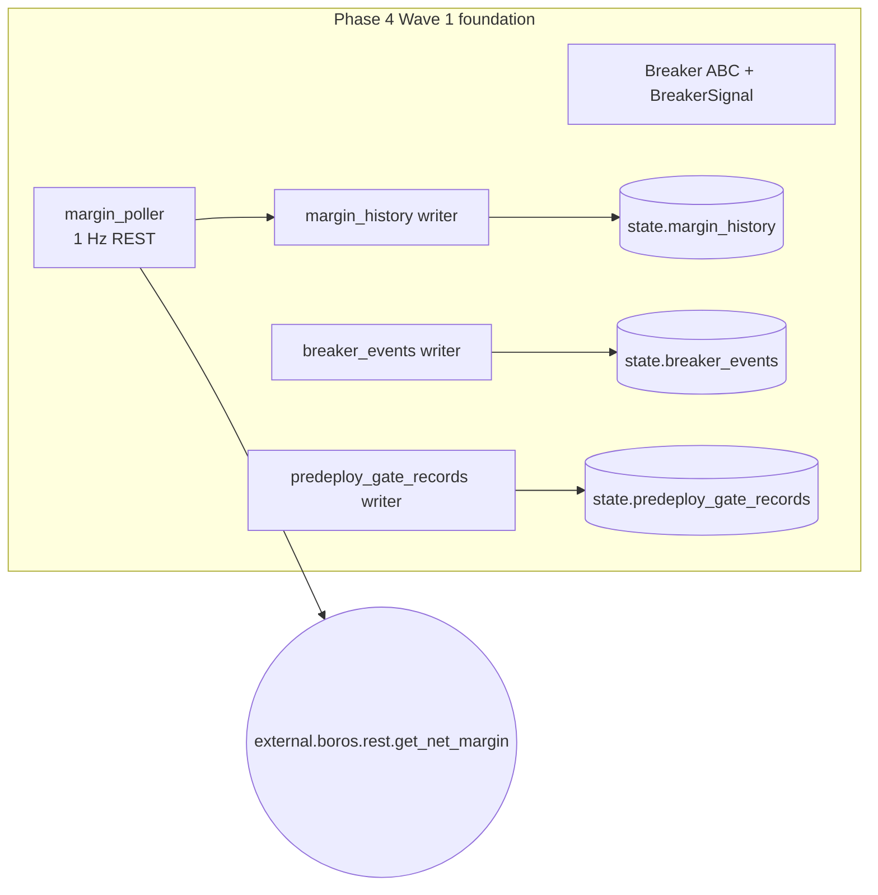

Phase 4 Wave 2 (engine + breakers) and Wave 3 (coordinator + main.py wiring)
extend this in plans 04-03..04-06 [[ev-cancel-rule]] [[circuit-breakers-v05]].

## Phase 4 Wave 2A — DecisionEngine + GasHistoryCache (Plan 04-03)

Plan 04-03 implements the core EV cancel rule and the gas cost oracle:

- `brain.decision.engine` — async `evaluate()` composing predict() + expected_loss()
  + r_capped_curve() + gas_cache.cancel_cost_pendle(); benign/punitive branch on
  `voluntary_cancel_forfeits_accumulated`; errors propagate per Pitfall #7.
- `brain.decision.gas_history` — `GasHistoryCache` TTL-cached EWMA of
  `eth_feeHistory` (100-block window, alpha=0.1, 60s TTL) converted to
  PENDLE-units cancel cost. The `no_hardcoded_cancel_cost_lint` pre-commit hook
  enforces this as the only legitimate owner of cancel_cost assignments.
- `external.arbitrum.fee_history` — AsyncWeb3.eth.fee_history JSON-RPC endpoint.

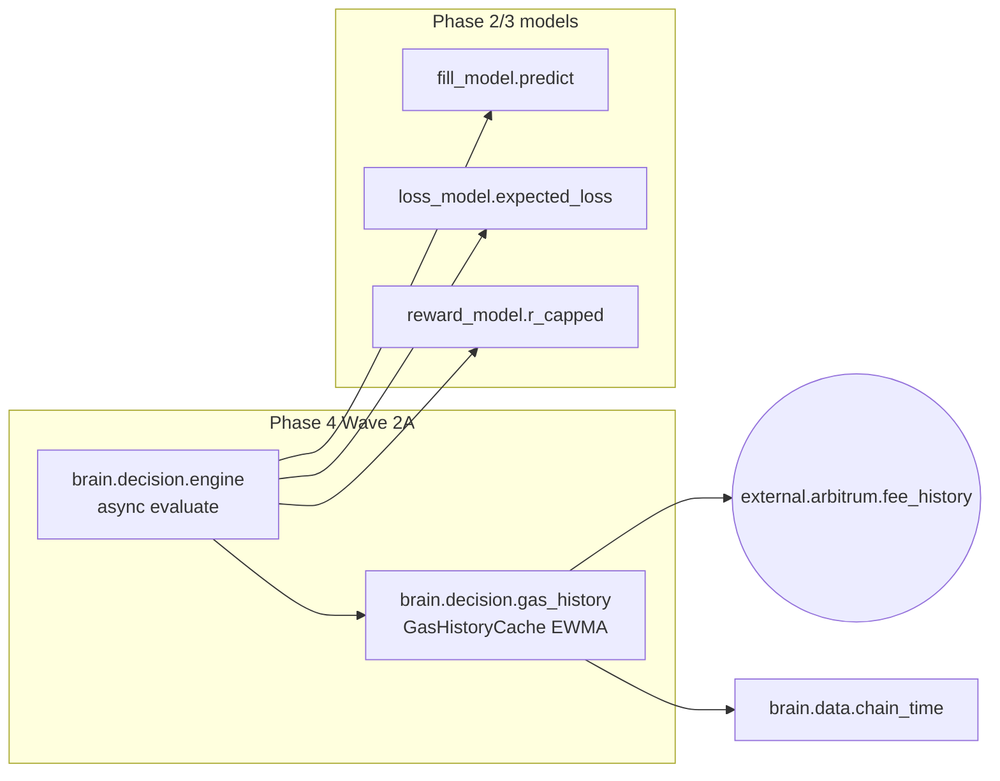

[[ev-cancel-rule-implementation-v05]] [[gas-history-ewma-cancel-cost]]

## Phase 4 Wave 2 Plan B — Six Predictive Circuit Breakers (Plan 04-04)

Plan 04-04 lands SAFE-01..05 + B5 absorbed (six breaker modules) under
`decision/breakers/`. Each subclasses the Breaker ABC from Plan 04-02 and
returns `BreakerSignal`. Architecture edges for all 10 breakers are registered
atomically in the plan 04-06 delta task to avoid Wave-2 merge conflicts.

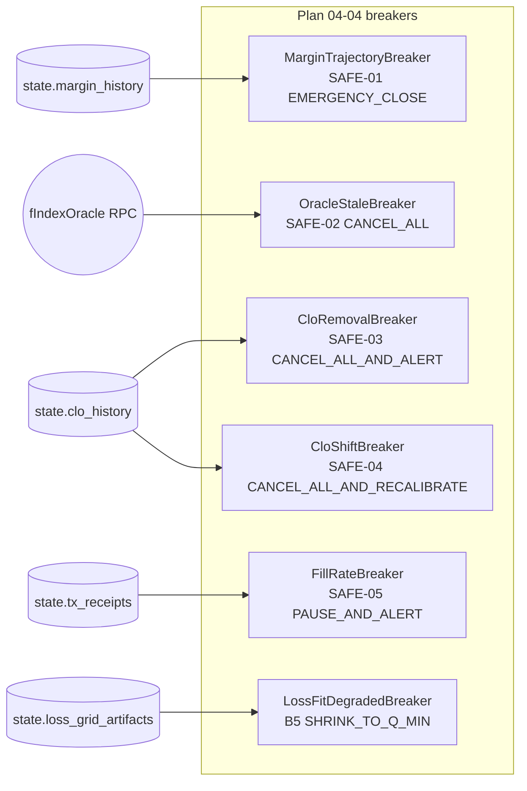

See [[circuit-breakers-v05]] and [[breaker-margin-trajectory]] for specs.

## Phase 4 Wave 2C — MaturityBreaker gas_cache mandatory (Plan 04-07)

Plan 04-07 closes VERIFICATION.md Gap #1: the `brain.decision.breakers.maturity`
module's dependency on `brain.decision.gas_history` is now mandatory (no
`gas_cache=None` fallback). The DECIDE-03 invariant (cancel_cost sourced
exclusively from GasHistoryCache) is enforced on the live code path.

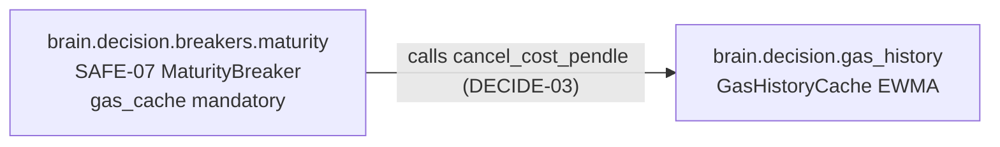

The `architecture.yml` edge `brain.decision.breakers.maturity → brain.decision.gas_history`
(type: calls) was added in Plan 04-07. Prior to this plan the edge was missing
from the Wave 2C edge block. See [[gas-history-ewma-cancel-cost]] and
[[breaker-maturity-migration]] for specs.

## Phase 5 Wave 1 — Backtest Engine (Plans 05-01 / 05-02 / 05-03)

Plans 05-01..03 land the event-driven replay engine under `backtest/`.
BACK-01 (replay), BACK-02 (cancel_latency scheduler), BacktestConfig (05-01),
and supporting schemas/synthetic_orders land in Wave 1.

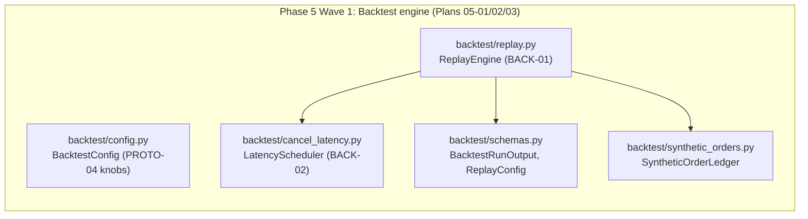

[[backtest-replay-engine-v05]] [[backtest-cancel-latency-two-axis]]

## Phase 5 Wave 2 — Sweep Dispatchers (Plan 05-04)

Plan 05-04 lands BACK-03 (cancel-latency sweep) and BACK-04 (competition sweep)
under `backtest/sweeps/`. Each sweep emits one `BacktestRunOutput` row per grid
value and a central-finite-difference dP&L/dL or dP&L/dQ curve.

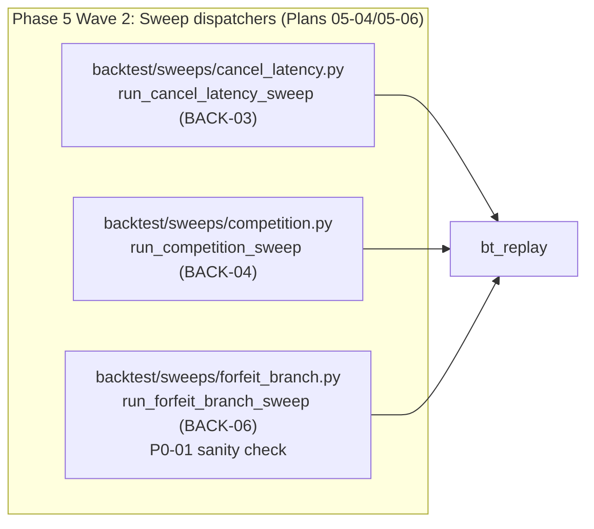

[[backtest-cancel-latency-sweep]] [[backtest-competition-sweep]] [[backtest-voluntary-cancel-sensitivity-row]]

## Phase 5 Wave 2 — Output Schema + Parquet Writer + Plot Generators (Plan 05-05)

Plan 05-05 lands BACK-05: the Hive-partitioned parquet writer and plot helpers under
`backtest/report.py`. Plot generation is a SEPARATE subcommand (Plan 05-09); the replay
engine has no matplotlib dependency — replay determinism is unaffected by matplotlib version
drift. Path-traversal guard mirrors `loss_model/artifact.py:51-62`.

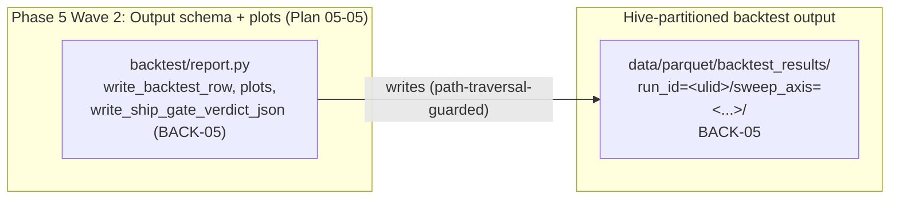

[[backtest-output-schema-and-parquet-partitioning]]

## Phase 5 Wave 3 — Bootstrap + Ship-Gate Verdict (Plan 05-07)

Plan 05-07 lands BACK-07: the hard pass/fail criterion for Phase 5. Block-bootstrap
(N=2000 resamples, block_seconds=86400) over per-day P&L, seeded deterministically from
`RUN_MANIFEST.run_id` ULID tail bytes. 5th-percentile annualized P&L must exceed
`screener.alt_yield + backtest.all_fees_threshold` (default 0.06 = 5% + 1%) to ship.
Fail path writes `var/backtest/<run_id>/ship-gate-report.md` and raises `ShipGateHalt(SystemExit)`
with exit code 1. PITFALL #6 prevention: `block_bootstrap_pnl` requires an explicit
`np.random.Generator` — never calls top-level `numpy.random.*`.

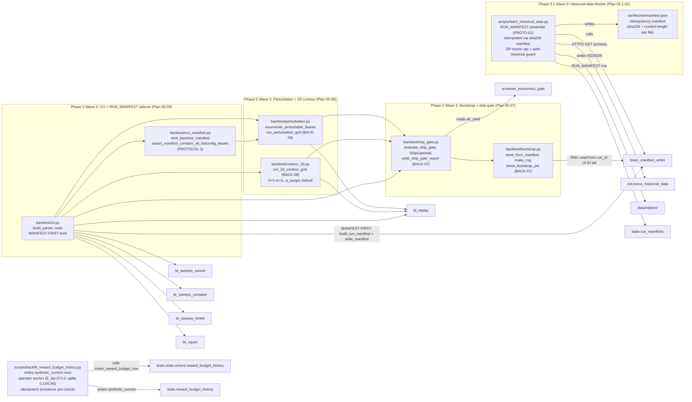

[[backtest-bootstrap-methodology-v05]] [[backtest-ship-gate-threshold-assembly]] [[backtest-reproducibility-rng-seed-from-manifest]]
[[backtest-perturbation-grid-pydantic-reflection]] [[backtest-fragility-and-sign-flip-detection]]
[[backtest-cli-and-run-manifest-emission]] [[backtest-architecture-manifest-delta-phase-5]]

## Phase 05.2 Wave 3 — Bug #3 Fix: sigma_others from parquet (Plan 05.2-05)

Bug #3 fix: the silent `bare-except sigma_others=0` at `replay.py:489-500` caused infinite
reward share (~330,000× APR inflation). The fix reads `sigma_others` per-tick from
`data/parquet/order_book_raw` — mirroring the live `CompetitionTracker._read_sigma_others_from_parquet`.
Empty parquet now raises `EmptyCompetitionPoolError` (no silent zero default).

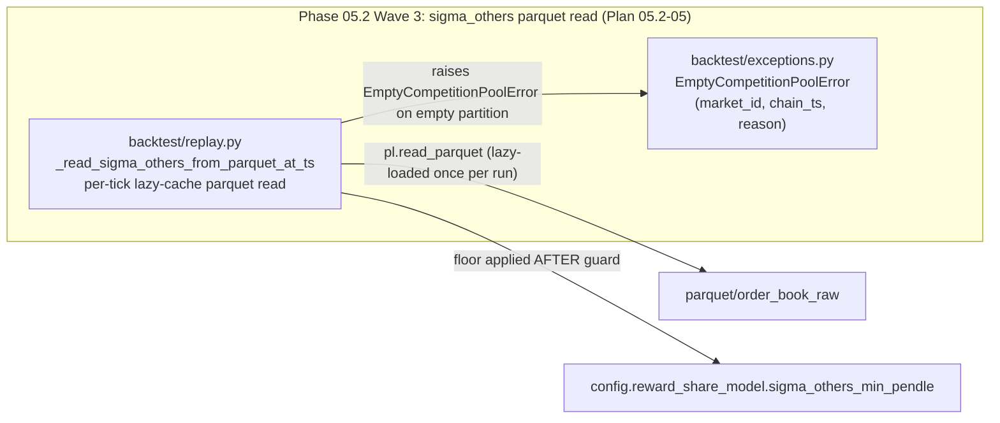

[[backtest-sigma-others-parquet-read-2026-04-30]]

## Phase 05.2 Wave 4 — Bug #4 Fix: 1 Hz Sparse-Tick Synthesis (Plan 05.2-06)

Bug #4 fix: `_maybe_emit_tick` previously only fired on real trade events (~9/day on the
binding market), suppressing reward accrual by ~10,000×. Wave 4 adds `_iter_chain_seconds`,
a generator that yields `(chain_ts, evt_or_None)` for every tick at `tick_period_s` cadence
between consecutive real events. The main `run()` loop iterates this instead of the raw event
iterator, dispatching real vs synthesised ticks separately.

Performance: 1 Hz × 26 days = 2.25M ticks. Per-tick cost is dict-lookup + `evaluate_decision`
+ append ≈ 1–3 μs. `decision_log` is streamed to Hive-partitioned parquet at 100k boundaries
to bound peak memory. Sigma cache + AMM cache loaded once per run.

The Wave 0 E4 verdict (`sim_bug_under_counting`) also wires inter-event fill detection: if the
implied APR crosses an edge price between consecutive real trade events, a fill is now emitted
before the trade event at the tick where the crossing first occurs.

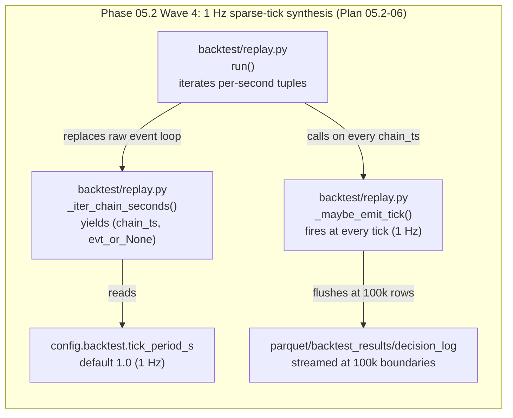

[[backtest-1hz-tick-synthesis-2026-04-30]]

## Phase 05.2 Wave 5 — Binding Ship-Gate Re-Run + parent_run_id Chain (Plan 05.2-07)

Wave 5 adds `--parent-run-id` to the `boros_brain.backtest` CLI `run` subcommand. The flag
passes a predecessor ULID directly into `build_run_manifest(config, parent_run_id=...)` so
the resulting sidecar JSON carries an unbroken audit trail across successive re-runs after
engine fixes (PROTO-01 mid-run knob-change semantics, D2 anti-pattern guard).

The manifest schema already had `parent_run_id: str | None = None` (INFRA-06). Wave 5 wires
the flag so an operator can stamp a successor run with its predecessor's ULID from the CLI.

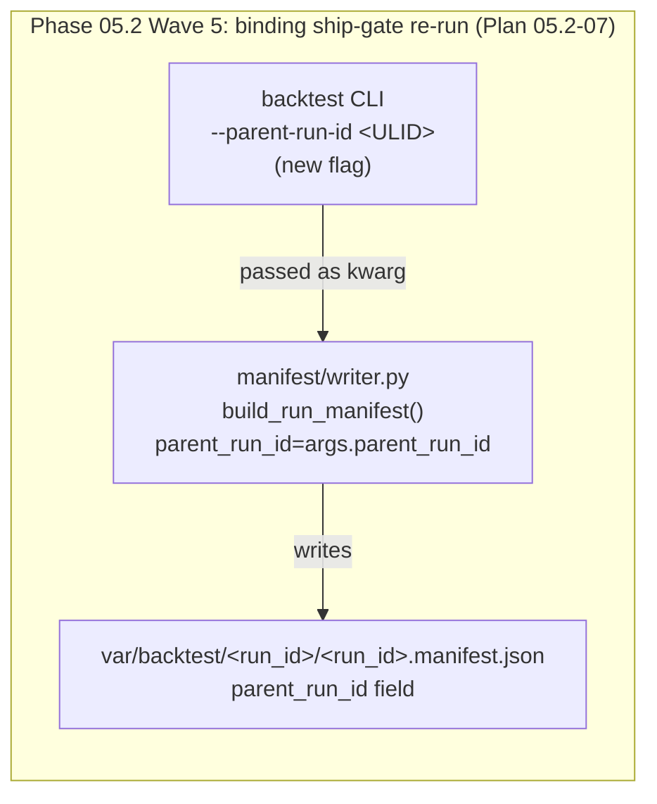

[[ship-gate-verdict-20260430-engine-corrected]]

## Phase 05.2 Bug #6 Fix — Chain-ts-aware Calibration Read

Bug #6 was discovered post-Wave-5 during operator verdict review: the binding ship-gate
run (`01KQEZ6M0SWVXX3H4G5W7RNFS8`) returned `p5 = 970.6% USD-APR` vs predicted ~415%, a
2.34× overshoot. Root cause: `_read_operator_calibration_sql` ordered by
`calibrated_at_utc DESC LIMIT 1` and was called once at startup, so a single calibration
row was applied to every tick across the 26-day historical replay window. The current-epoch
`long_side_split = 0.760` was retroactively applied to historical ticks from prior epochs
(actual split ≈ 0.327). Inflation factor: 0.760 / 0.327 = 2.32× — exact match to the observed
overshoot. The W2a `effective_at_utc` column was added precisely to enable epoch-keyed reads
but the read site was never converted; this fix completes the W2a contract.

`_calibration_at_chain_ts(chain_ts)` loads all operator rows for the market once, sorted by
`effective_at_utc` ASC, and returns the row whose `effective_at_utc <= chain_ts`. The earliest
row is used (with a one-shot warning) when `chain_ts` predates all rows. `_build_evaluate_input`
calls this method per tick instead of using the static dict from `_read_operator_calibration_sql`
(retained for the synthetic-current warning path and `_finalize_output` metadata).

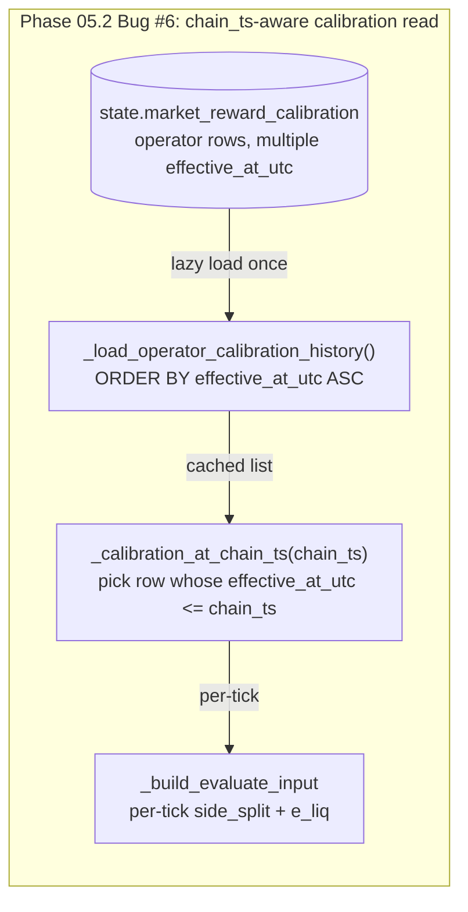

[[ship-gate-bug-6-epoch-keyed-calibration]]

## Phase 05.3 — Fill-Path Repair (Plan 05.3-01)

Phase 05.2 Bug #6 (commit `cad821f`) corrected the reward leg of the EV
equation. The fill leg was structurally broken in three coupled ways and
produced `n_fills = 0` regardless of whether real-market activity reached
the strategy's resting tick. The W0 audit's `sim_bug_under_counting`
verdict (file: `var/reports/n_fills_audit_verdict.json`) was filed on
2026-04-30 and never closed; this plan closes it.

The plan locks three decisions that, taken together, produce a
unit-coherent fill-detection path:

| Decision | What it changes | Location |
|----------|-----------------|----------|
| **D1 — YU unit convention** | Rename `SyntheticOrder.queue_ahead_wei` (int wei) → `queue_ahead_yu` (float YU). Trade-handler comparison switches from `int(evt.get("size_wei") or 0)` (always 0 for the binding-market parquet — `size_wei` is null for every row) to `float(evt.get("size_float") or 0.0)`. New `BotConfig.backtest.queue_ahead_yu_default` knob (default 100.0 YU). Adapter at `_build_evaluate_input` converts YU → wei (factor 1e18) for the cross-tier IPC seam (`PredictInput.queue_ahead_wei` keeps wei semantics). | `backtest/synthetic_orders.py`, `backtest/replay.py`, `backtest/config.py` |
| **D2 — Single source of truth for CLO conversion** | Lift `_clo_findex_to_tick` out of `screener/filter.py` into `screener/clo_conversion.py`. Both screener and replay import from there. Helper accepts an optional `scale=` kwarg so callers with per-market calibration override the screener default. Replay's prior `int(market.clo_lower_thresh)` (treating fIndex display as a tick) and `float(market.clo_lower_thresh) / 10_000.0` (rate fraction = 0.93 = 9300% APR) are both replaced by helper calls. | `screener/clo_conversion.py` (new), `screener/filter.py`, `backtest/replay.py` |
| **D3 — Decouple inter-event detection from queue gate** | Drop the `order.queue_ahead_yu == 0` precondition in `_detect_inter_event_fills`. Queue uncertainty is encoded in the fill model's `p_fill` term (consumed via `decision.engine.evaluate`), not as a hard gate at the simulator level. Double-counting prevention lives entirely in the `_trade_consumes_order` skip-condition at the top of the loop. | `backtest/replay.py` |

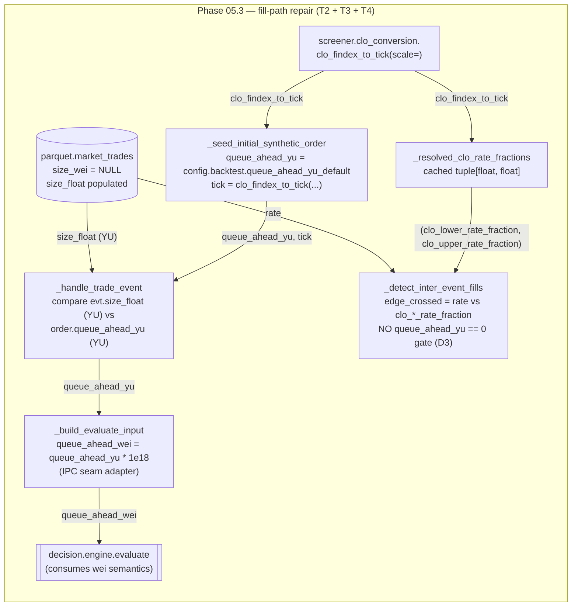

[[fill-path-repair-2026-04-30]]

## Phase 05.4-01 Bug A — Calibration Migration + Operator Row Insert Script

Bug A was discovered during the Phase 05.3 T6 dry-run: Alembic migration 0008
(`0008_market_reward_calibration_effective_at.py`) had been authored but never
applied to `state/state.sqlite`. The `_load_operator_calibration_history` method
in `replay.py` queries `effective_at_utc IS NOT NULL` — a column that did not exist
on the live DB — causing every query to fail silently and the engine to fall through
to default fallback values (`e_liq=100, side_split=0.5`). This produced ~4.5M
`no_operator_calibration` warnings and a reward leg ~3-5x off.

The fix applies migration 0008 via `scripts/apply_alembic_migration.py` and then
inserts two operator calibration rows via the new one-shot script:

- `scripts/insert_operator_calibration_rows_phase054.py` — Phase 05.4-01 Bug A:
  insert prior+current operator calibration rows. Calls
  `state.writers.market_reward_calibration.insert_market_reward_calibration`.

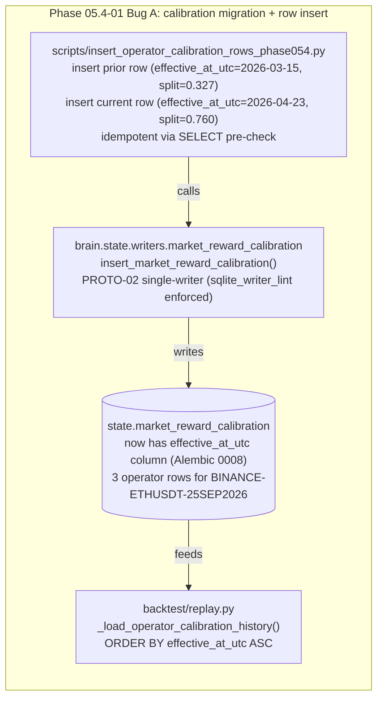

[[phase-05-4-bug-a-calibration-migration]]

## Related protocols

- Engineering Protocol #1 — LLM Wiki. Every research / decision / postmortem
  markdown cites a `[[wiki-link]]` at least once. Enforced by
  `scripts/wiki_cite_lint.py`.
- Engineering Protocol #3 — RUN_MANIFEST. Every run emits a manifest with the
  full knob tree on the first log record + sidecar JSON. Enforced by the
  Pydantic-reflection round-trip test in `python/tests/test_manifest_contains_all_knobs.py`.
